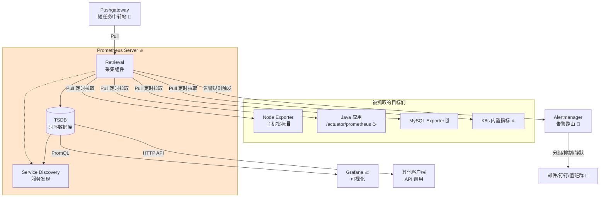
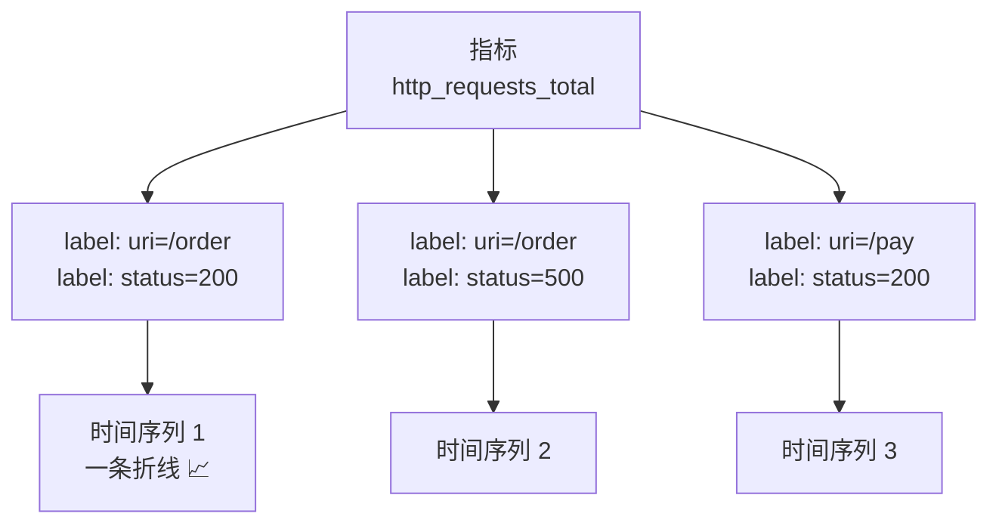
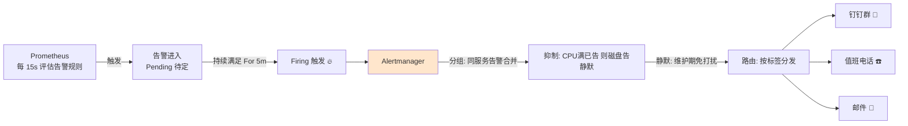
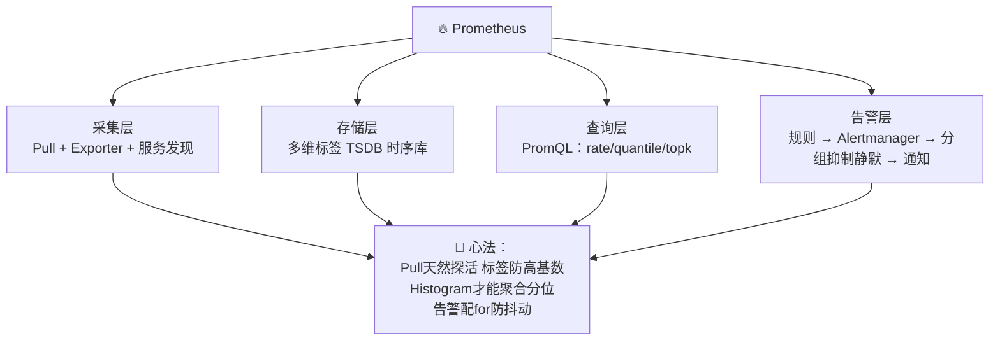

# 🔥 Prometheus 学习笔记

> 今天要吃透的是云原生监控的"心脏"—— **Prometheus** ✨
> 上一节 Grafana 是漂亮的仪表盘，这一节挖它的"数据发动机"！Pull 拉取、四种指标、PromQL 神语法、Alertmanager 告警路由，一次讲透～(≧▽≦)

---

## 📚 目录一览

1. [Prometheus 是什么？](#一prometheus-是什么)
2. [为什么需要 Prometheus？](#二为什么需要-prometheus)
3. [核心架构全景](#三核心架构全景)
4. [数据模型：多维时序](#四数据模型多维时序)
5. [四种指标类型](#五四种指标类型)
6. [Pull 模式与 Exporter 生态](#六pull-模式与-exporter-生态)
7. [采集配置与服务发现](#七采集配置与服务发现)
8. [PromQL 深入](#八promql-深入)
9. [告警：Alertmanager](#九告警alertmanager)
10. [Java 应用接入](#十java-应用接入)
11. [存储与数据保留](#十一存储与数据保留)
12. [常见坑与最佳实践](#十二常见坑与最佳实践)
13. [总结 & 速查表](#十三总结--速查表)

---

## 一、Prometheus 是什么？

### 1.1 一句话解释

> **Prometheus = 开源的时序数据库 + 监控告警系统：定时去各个目标"拉"取指标，存成本地时序数据，用 PromQL 查询，越界了交给 Alertmanager 告警。** 🔥

它是 **CNCF 第二个毕业项目**（第一个是 K8s）——云原生监控事实标准！

### 1.2 打个比方 🩺

- **传统监控（Push 推）**：像病人主动跑医院报告体温——1000 个病人天天排队报数，医院（服务器）累死；
- **Prometheus（Pull 拉）**：像**巡房医生**🩺：定时去每个病房（Target）看床头监护仪（metrics 端点），数据一目了然：
  - 某个病房没人应答 → 这个目标挂了（up == 0）；
  - 体温超 39 度 → 开告警单（Alert）给值班护士（Alertmanager → 钉钉/邮件）；
  - 所有历史记录存档（TSDB），随时翻旧账（Grafana 画图）！

---

## 二、为什么需要 Prometheus？

| 痛点 | Prometheus 的解法 |
| --- | --- |
| 🌐 机器/容器成百上千 | 服务发现自动纳管，K8s 原生集成 |
| 📊 数据格式五花八门 | 统一文本格式（metrics 端点），生态统一 |
| 🧮 想算"每秒增长""P95" | PromQL 内置 rate/quantile 等函数 |
| ⏰ 监控数据也要随时间看 | 专为时序数据优化的 TSDB |
| 🔔 告警风暴 | Alertmanager 分组/抑制/静默三连 |
| 🧩 组件多难维护 | 单二进制文件，开箱即用 |

### 2.1 vs 传统监控（如 Zabbix）

| 对比 | Prometheus | Zabbix |
| --- | --- | --- |
| 模型 | 多维标签（天然适合容器动态性）⭐ | 主机+触发器 |
| 查询 | PromQL 强大灵活 | 较简单 |
| K8s 生态 | 原生标配 ⭐ | 需定制 |
| 存储 | 内置 TSDB（时序优化） | 关系型数据库 |
| 适合 | 云原生/微服务 | 传统机房/网络设备 |

---

## 三、核心架构全景



| 组件 | 一句话 |
| --- | --- |
| **Retrieval** | 采集工人：按配置定时 Pull |
| **TSDB** | 时序数据库：本地存储（默认 15 天） |
| **Service Discovery** | 服务发现：K8s/Consus/DNS 自动找目标 |
| **Pushgateway** | 短命任务（批处理脚本）没空等 Pull，先推这里中转 📮 |
| **Alertmanager** | 告警"调度室"：去重分组、路由、静默 |
| **Exporters** | 把第三方系统指标翻译成 Prometheus 格式 |

> 💡 **为什么选 Pull 而不是 Push？**
> ① 目标健康检查天然自带（拉不动 = 挂了）；
> ② 应用不用关心监控服务器在哪（解耦）；
> ③ 拉取节奏自己掌控，突发洪峰不冲垮监控系统；
> ④ 边界网络也只开一个入方向的口子，更安全 ✅

---

## 四、数据模型：多维时序

### 4.1 样本长什么样？

```text
# 格式：指标名{标签1="值",标签2="值"} 样本值 [时间戳]
http_server_requests_seconds_count{uri="/api/order",method="POST",status="200",application="order-service"} 1024

# 时间序列 = 指标名 + 一组唯一标签
# 同一指标不同标签 = 不同的时间序列（多条线）
```

### 4.2 标签是灵魂 🏷️



| 概念 | 说明 |
| --- | --- |
| **metric name** | 指标名（下划线命名） |
| **labels** | 标签：多维度的关键（可按任意标签聚合过滤） |
| **sample** | 一个时间点上的值：`float64 + 毫秒时间戳` |
| **Job / Instance** | 抓取任务 / 被抓目标（也是标签） |

> ⚠️ **高基数陷阱**：标签取值无限增长（如 userId、orderId）= 时间序列爆炸 = 内存磁盘双爆炸！标签只能用有限集合（服务名/uri/状态码这类）💣

---

## 五、四种指标类型

### 5.1 一表选型

| 类型 | 特征 | 只能？ | 场景 | 例子 |
| --- | --- | --- | --- | --- |
| **Counter** 计数器 | 只增不减（重启归零） | ↑ | 累计量 | 请求数、下单量、错误数 |
| **Gauge** 仪表盘 | 可升可降的瞬时值 | ↑↓ | 当前状态 | 内存使用、在线人数、队列长度 |
| **Histogram** 直方图 | 采样分桶统计**分布** | 服务端算 | 耗时/大小分布 | 接口 RT（可算 P95/P99）⭐ |
| **Summary** 摘要 | 客户端预计算分位数 | ↑ | 耗时分布（少量） | 单机 P99 |

### 5.2 Histogram 为什么能算 P95？🔍

把耗时切进"桶"里统计，比如 0.1s、0.5s、1s、+Inf：

```text
http_request_duration_seconds_bucket{le="0.1"} 2400   # ≤0.1s 的有 2400 个
http_request_duration_seconds_bucket{le="0.5"} 4800   # ≤0.5s 累计 4800 个
http_request_duration_seconds_bucket{le="1.0"} 5400   # ≤1s 累计 5400 个
http_request_duration_seconds_bucket{le="+Inf"} 6000  # 总共 6000 个
```

- P95 ≈ 排在第 5700 位（6000×0.95）的值 → 落在 (1.0, +Inf] 桶 → 服务器可**跨实例聚合**计算；
- Summary 在客户端就算好分位数，但**无法跨实例聚合**（10 台机器的 P99 不能平均）——所以微服务场景首选 **Histogram** ⭐

### 5.3 Java 视角（Micrometer 对应关系）

| Prometheus | Micrometer (Java) | 备注 |
| --- | --- | --- |
| Counter | `Counter` | `counter.increment()` |
| Gauge | `Gauge` | `gauge.update()` / 注册引用 |
| Histogram | `Timer` + `publishHistogram()` | 定时器带桶 |
| Summary | `Timer` + `publishPercentiles()` | 客户端分位 |

---

## 六、Pull 模式与 Exporter 生态

### 6.1 Exporter = 翻译官 🌐

目标系统不会说"Prometheus 话"，Exporter 负责翻译：

| Exporter | 翻译什么 |
| --- | --- |
| **node_exporter** ⭐ | Linux 主机：CPU/内存/磁盘/网络 |
| **mysqld_exporter** | MySQL 慢查询/连接数 |
| **redis_exporter** | Redis 内存/命中率 |
| **blackbox_exporter** | 黑盒探测：URL 存活/DNS/TCP |
| **kafka_exporter** | Kafka lag 积压 |
| **Spring Boot Actuator** | Java 应用自带（micrometer 翻译）☕ |
| **kube-state-metrics** | K8s 对象状态（Pod 副本数等） |

### 6.2 metrics 端点长啥样？

```text
# HELP http_server_requests_seconds HTTP 请求指标
# TYPE http_server_requests_seconds histogram
http_server_requests_seconds_bucket{uri="/api/order",status="200",le="0.1"} 9527
http_server_requests_seconds_count{uri="/api/order",status="200"} 1024
http_server_requests_seconds_sum{uri="/api/order",status="200"} 12.34

# HELP jvm_memory_used_bytes JVM 内存使用
# TYPE jvm_memory_used_bytes gauge
jvm_memory_used_bytes{area="heap",id="G1 Eden Space"} 2.048e+08
```

> HELP = 人类说明，TYPE = 指标类型，Prometheus 解析起来毫无压力～

### 6.3 短命任务怎么办？📮

跑 5 分钟就退出的批处理脚本，等不到 Pull → 推给 **Pushgateway** 暂存，Prometheus 照常来拉：

```java
// Java 批处理任务推送指标示例（pushgateway client）
CollectorRegistry registry = new CollectorRegistry();
Gauge.duration(registry, "batch_job_duration_seconds", () -> {
    // 业务逻辑，自动计时
}).run();

PushGateway pg = new PushGateway("pushgateway:9091");
pg.pushAdd(registry, "nightly_report_job");   // 任务名作为分组标签
```

---

## 七、采集配置与服务发现

### 7.1 静态配置（入门）

```yaml
# prometheus.yml
global:
  scrape_interval: 15s          # 全局抓取周期
  evaluation_interval: 15s      # 告警规则评估周期

scrape_configs:
  # ① 静态目标：写死地址（小环境够用）
  - job_name: 'springboot-app'
    metrics_path: '/actuator/prometheus'
    static_configs:
      - targets: ['10.0.0.1:8080', '10.0.0.2:8080']
        labels:
          env: prod

  # ② 主机监控
  - job_name: 'node'
    static_configs:
      - targets: ['10.0.0.1:9100', '10.0.0.2:9100']
```

### 7.2 服务发现（生产必备）🔄

容器时代 IP 天天变，写死地址 = 自讨苦吃：

```yaml
scrape_configs:
  # K8s 服务发现：自动发现带注解的 Pod ⭐
  - job_name: 'kubernetes-pods'
    kubernetes_sd_configs:
      - role: pod
    relabel_configs:
      # 只抓打了 prometheus.io/scrape=true 注解的 Pod
      - source_labels: [__meta_kubernetes_pod_annotation_prometheus_io_scrape]
        action: keep
        regex: true
      # 采集端口用注解里指定的
      - source_labels: [__meta_kubernetes_pod_annotation_prometheus_io_port]
        action: replace
        target_label: __address__
        regex: (.+)
        replacement: ${1}

  # Consul 服务发现（微服务注册中心联动！）
  - job_name: 'consul-services'
    consul_sd_configs:
      - server: 'consul:8500'
```

| 服务发现 | 适合 |
| --- | --- |
| **kubernetes_sd** | K8s 集群 ⭐ |
| **consul_sd** | Consul 注册中心 |
| **dns_sd** | DNS 发现 |
| **static** | 固定机器小环境 |
| **file_sd** | 外部文件热更新目标列表 |

---

## 八、PromQL 深入

Grafana 笔记讲过基础，这次往深挖一层 ⛏️：

### 8.1 三种查询结果类型

| 类型 | 长相 | 例子 |
| --- | --- | --- |
| **瞬时向量** | 一条时间序列的"当前值" | `up` |
| **区间向量** | 一段时间的一串值 | `up[5m]` |
| **标量** | 一个纯数字 | `count(up)` |

### 8.2 常用函数表

| 函数 | 作用 | 示例 |
| --- | --- | --- |
| `rate()` | Counter 转每秒速率 ⭐ | `rate(req_total[5m])` |
| `irate()` | 瞬时速率（灵敏易抖） | `irate(req_total[1m])` |
| `increase()` | 窗口内增量 | `increase(req_total[1h])` = 一小时总量 |
| `sum/min/max/avg` | 聚合 | `sum by (app)(...)` |
| `histogram_quantile()` | 直方图算分位 ⭐ | P95/P99 |
| `topk/bottomk` | 前 N 名 | `topk(5, rate(qps[5m]))` |
| `offset` | 时间偏移对比 | `对比昨天: qps offset 1d` |
| `predict_linear()` | 线性预测 | 磁盘几天后写满 💾 |
| `absent()` | 数据消失检测 | `absent(up{app="pay"})` |

### 8.3 经典实战查询

```promql
# ① 每个服务的 QPS（按服务聚合）
sum by (application) (rate(http_server_requests_seconds_count[5m]))

# ② 每秒错误数（5xx）
sum by (application) (rate(http_server_requests_seconds_count{status=~"5.."}[5m]))

# ③ P99 接口耗时（分桶 + 分位）
histogram_quantile(0.99,
  sum by (le, uri) (rate(http_server_requests_seconds_bucket[5m])))

# ④ 磁盘几天后写满（提前扩容预警 💾）
predict_linear(node_filesystem_free_bytes{mountpoint="/"}[2h], 4*3600*24) < 0

# ⑤ 今天 vs 昨天同时段 QPS（环比）
sum(rate(http_server_requests_seconds_count[5m]))
  / sum(rate(http_server_requests_seconds_count[5m] offset 1d))

# ⑥ QPS TOP5 接口
topk(5, sum by (uri) (rate(http_server_requests_seconds_count[5m])))
```

---

## 九、告警：Alertmanager

### 9.1 分工：Prometheus 出题，Alertmanager 送信



### 9.2 告警规则（prometheus 侧）

```yaml
# rules/alert-rules.yml —— Prometheus 加载的告警规则
groups:
  - name: service-alerts
    rules:
      # 规则一：服务实例掉线
      - alert: ServiceDown
        expr: up == 0
        for: 1m                       # 持续 1 分钟才触发（防抖！）
        labels:
          severity: critical          # 严重级别标签（路由用）
        annotations:
          summary: "服务 {{ $labels.instance }} 掉线了"
          description: "job={{ $labels.job }} 已 1 分钟无法抓取"

      # 规则二：错误率过高
      - alert: HighErrorRate
        expr: |
          sum by (application) (rate(http_server_requests_seconds_count{status=~"5.."}[5m]))
            / sum by (application) (rate(http_server_requests_seconds_count[5m])) * 100 > 5
        for: 5m
        labels:
          severity: warning
        annotations:
          summary: "{{ $labels.application }} 错误率超 5%"
```

### 9.3 Alertmanager 路由配置

```yaml
# alertmanager.yml
route:
  receiver: dingtalk-default          # 默认走钉钉
  group_by: ['alertname', 'application']   # 同名同服务告警打包发（防轰炸！）
  group_wait: 30s                     # 等 30s 凑一批
  repeat_interval: 4h                 # 4 小时重复提醒一次
  routes:
    - match:                          # 级别 = critical → 电话摇人
        severity: critical
      receiver: oncall-phone
    - match:
        severity: warning
      receiver: dingtalk-default

receivers:
  - name: dingtalk-default
    webhook_configs:
      - url: 'http://dingtalk-webhook:8060/dingtalk/alert/send'
  - name: oncall-phone
    webhook_configs:
      - url: 'http://sms-gateway:8080/call'
```

| 告警三连 | 作用 |
| --- | --- |
| **分组 group_by** | 100 条同类告警合成 1 条通知 📦 |
| **抑制 inhibit** | 机房断电告警出现时，抑制下面所有"机器失联"告警 🤫 |
| **静默 silence** | 发版维护窗口，手动设置 2 小时免打扰 😴 |

---

## 十、Java 应用接入

### 10.1 快速接入（复习 Grafana 章节三步）

```xml
<dependency>
    <groupId>org.springframework.boot</groupId>
    <artifactId>spring-boot-starter-actuator</artifactId>
</dependency>
<dependency>
    <groupId>io.micrometer</groupId>
    <artifactId>micrometer-registry-prometheus</artifactId>
</dependency>
```

```yaml
management:
  endpoints:
    web:
      exposure:
        include: prometheus,health
  metrics:
    tags:
      application: order-service    # ⭐ 全局标签：多服务聚合全靠它
```

### 10.2 Timer 双模式：Histogram vs Summary 实战

```java
@Service
public class OrderMetrics {

    // ⭐ 推荐：Histogram 模式（带桶）→ 服务端可聚合算 P95/P99
    private final Timer orderTimer = Timer.builder("order_create_duration")
            .description("下单耗时")
            .serviceLevelObjectives(Duration.ofMillis(100),   // 桶边界
                                    Duration.ofMillis(500),
                                    Duration.ofMillis(1000))
            .register(meterRegistry);

    // Summary 模式：客户端直接算好分位数（单机看，不能跨实例聚合）
    private final Timer orderTimerSummary = Timer.builder("order_create_duration_client")
            .publishPercentiles(0.5, 0.95, 0.99)   // 客户端预计算
            .register(meterRegistry);

    public Order create(OrderRequest req) {
        return orderTimer.record(() -> doCreate(req));   // 一行码住耗时 ✨
    }
}
```

> 💡 **选型口诀**：微服务多实例要聚合看分位数 → `serviceLevelObjectives`（Histogram）；只看单机分位 → `publishPercentiles`（Summary）。

---

## 十一、存储与数据保留

| 知识点 | 说明 |
| --- | --- |
| 存储路径 | 默认本地 `data/` 目录（TSDB） |
| 默认保留 | **15 天**（`--storage.tsdb.retention.time=15d`） |
| 分块存储 | 每 2 小时一个 block，利于压缩 |
| 长期存储 | 接 **Thanos** / **VictoriaMetrics** / Cortex 远端存储 |
| 内存占用 | 时间序列数量 × 采样点数——高基数直接内存爆炸 💣 |

```bash
# 启动时设置保留 30 天
prometheus --storage.tsdb.retention.time=30d \
           --config.file=prometheus.yml
```

> 💡 历史数据要存一年？别硬撑单机 Prometheus——上 Thanos（对象存储 COS 联动，复习 COS 笔记～）！

---

## 十二、常见坑与最佳实践

### 12.1 排雷表 💣

| 坑 | 症状 | 解法 |
| --- | --- | --- |
| 高基数标签 | 序列爆炸，内存/磁盘狂涨 | 禁用 userId/订单号当标签 |
| rate 窗口太短 | 抓取间隔 15s 却用 [30s]，曲线锯齿 | 窗口 ≥ 4×抓取间隔 |
| 单机存长期数据 | 磁盘满、查询慢 | retention 合理 + Thanos/VictoriaMetrics |
| 告警无 for 持续 | 瞬时抖动疯狂告警 | 全部配 `for: 5m` 防抖 |
| Pull 不到目标 | up == 0 | 检查网络/路径/端口；先 curl metrics 端点 |
| 重启后 Counter 归零 | 曲线"跳水" | rate() 会自动处理（rate detects reset）✅ |
| 忘了 Alertmanager 联动 | 告警触发却没人收到 | 检查 rules 目录挂载 + alertmanager 地址配置 |

### 12.2 最佳实践清单 ✅

1. 📌 抓取间隔 15~30s 起步，够细就别更细；
2. 📌 指标命名规范：`<域>_<指标>_<单位后缀>`（如 `order_create_duration_seconds`）；
3. 📌 多实例聚合统一打 `application` 标签；
4. 📌 告警分层：critical 电话、warning 群消息、info 只上大盘；
5. 📌 常用Exporter 起 Docker 验证一遍，理解指标含义再上生产；
6. 📌 Grafana 大盘 + Prometheus 告警分工：看 vs 摇人（复习 Grafana 笔记～）。

---

## 十三、总结 & 速查表

### 13.1 名词速查 📇

| 名词 | 一句话 |
| --- | --- |
| Prometheus | 拉模式时序监控：TSDB + PromQL + 告警 |
| Pull 模式 | 巡房医生定时拉取，拉不动 = 挂 🩺 |
| Exporter | 指标翻译官（node/mysql/blackbox…）🌐 |
| Pushgateway | 短命任务中转站 📮 |
| Counter/Gauge | 只增计数 / 可升可降瞬时值 |
| Histogram/Summary | 分桶分布（可聚合）/ 客户端分位（不可聚合） |
| PromQL | 时序查询语言 |
| rate/increase | 每秒速率 / 窗口增量 |
| Service Discovery | K8s/Consul 自动发现目标 🔄 |
| Alertmanager | 告警调度室：分组/抑制/静默/路由 📢 |

### 13.2 查询速查 🛠️

| 需求 | PromQL |
| --- | --- |
| QPS | `sum by (app)(rate(req_total[5m]))` |
| 错误率 | `5xx总量 / 总量 * 100` |
| P95/P99 | `histogram_quantile(0.95, ...bucket...)` |
| 环比昨天 | `... offset 1d` |
| TOP N | `topk(5, ...)` |
| 磁盘预测 | `predict_linear(...[2h], 4*86400) < 0` |

### 13.3 一图流总结



### 13.4 记住这三句就走不丢 ✨

1. **Pull 是灵魂**：巡房医生模式天然探活，目标拉不动本身就是告警；
2. **标签是维度、也是陷阱**：有限集合随便用，无限取值（userId）碰都别碰；
3. **Counter 配 rate、Histogram 配分位、告警配 for**：三板斧用对，监控数据才有意义。

> 🎉 恭喜点亮 Prometheus 技能树！监控全家桶集齐：**Prometheus 存数据 + Grafana 画图（上一节）+ Alertmanager 摇人 + ELK 看日志 + Arthas 查单机**！动手作业：起一个 Prometheus，抓取自己的 Spring Boot 应用，写一条"错误率>5% 持续5分钟"的告警规则并用 amtool 验证路由～下次想学 Thanos、VictoriaMetrics 或服务网格，随时喊我哦！(๑•̀ㅂ•́)و✧
