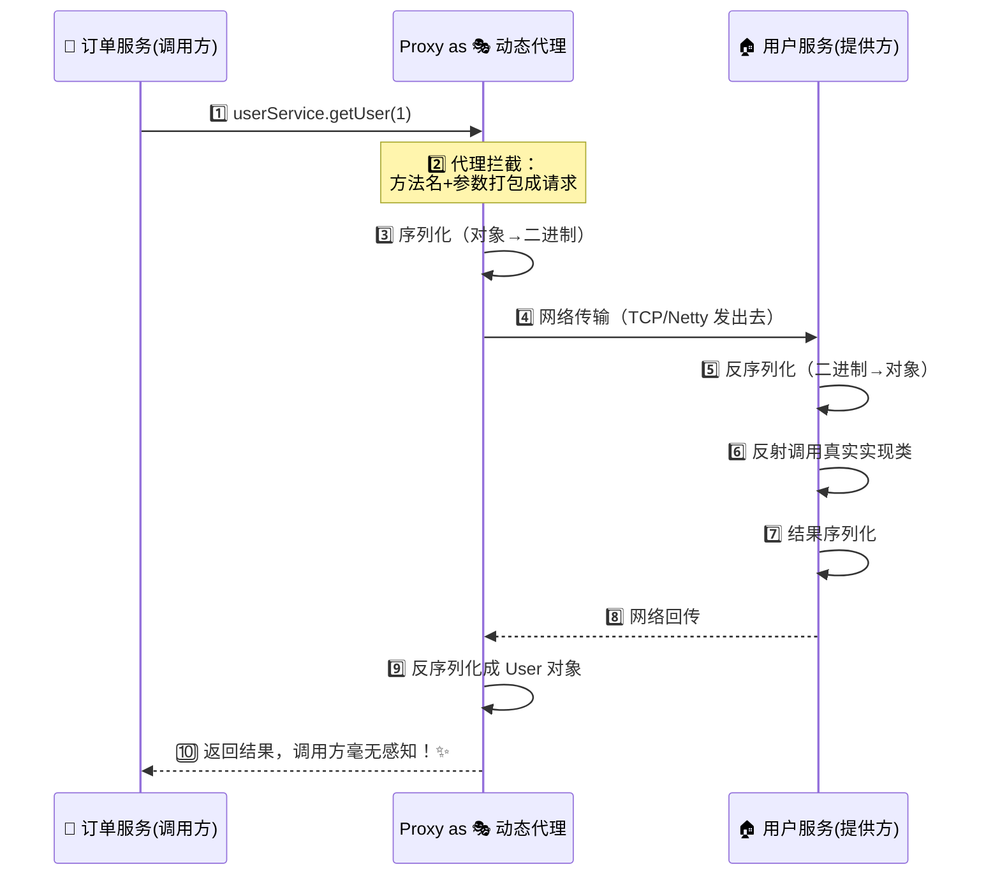
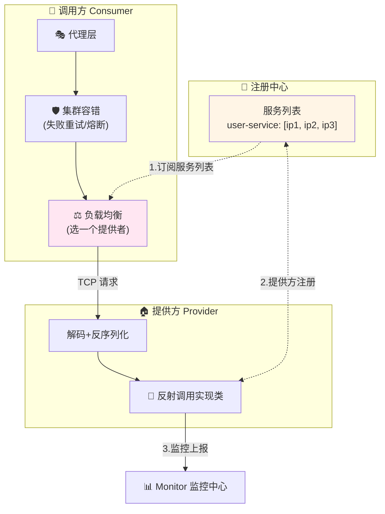
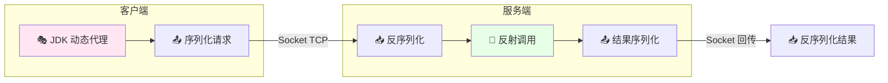
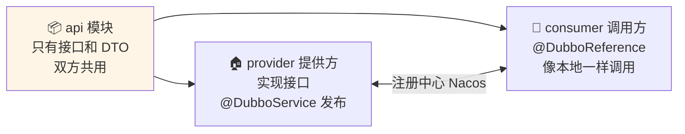
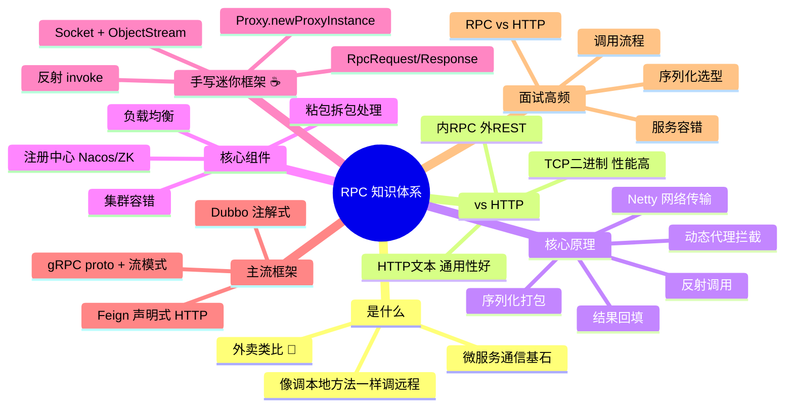

# RPC 远程过程调用 从入门到实战 📞

> 欢迎来到 RPC 小课堂！💖 **RPC（Remote Procedure Call，远程过程调用）**——让你的 Java 代码**像调本地方法一样调远程服务**，微服务世界的"电话线"！学完这篇，Dubbo、gRPC 这些高大上的框架你都能看懂原理啦～
>
> **学习目标**：
> - 🎯 搞懂 RPC 是什么、解决什么问题
> - 🎯 掌握 RPC 核心原理：代理 → 序列化 → 网络传输 → 反射调用
> - 🎯 亲手写一个迷你 RPC 框架（Java）
> - 🎯 认识主流框架 Dubbo / gRPC，能应对面试高频题
>
> **前置知识**：Java 基础（接口、反射、动态代理）、了解网络编程更佳～

---

## 一、初识 RPC：为什么需要它？🌱

### 1.1 从单体到微服务的烦恼


### 1.2 RPC 是什么（一句话版）

> RPC = **远程过程调用**：把"网络请求 + 序列化 + 传输"这些脏活累活全部藏起来，让你写 `userService.getUser(id)` 时**感觉不到对方在另一台服务器上**！

打个比方 🍜：

- 没有 RPC：想吃麻辣烫 → 自己坐车去店里 → 自己跟后厨说 → 自己端回来（裸写 HTTP/Socket）
- 有 RPC：**打开外卖软件点一下就送到** 🛵——中间的沟通、运输全被"代理"掉了！

### 1.3 一个最朴素的问题

> 问：我自己用 `HttpClient` 调 REST 接口不也能跨服务调用吗？为啥还要 RPC？
>
> 答：能用，但 RPC 框架帮你把**序列化、连接管理、服务发现、负载均衡、容错**都做成了"外卖软件"级别的一键体验；而且基于 TCP 长连接 + 二进制协议，**性能通常更高**～ 下面 1.4 详细对比！

### 1.4 RPC vs HTTP/REST（面试高频！⭐）

| 对比项 | RPC（Dubbo/gRPC） | HTTP/REST（Feign/HttpClient） |
|---|---|---|
| 传输协议 | 通常 TCP 长连接 | TCP 短连接/长连接（HTTP/1.1 keep-alive） |
| 报文格式 | 二进制（Protobuf/Hessian）**体积小** | 文本（JSON/XML）**可读性好** |
| 性能 | 序列化快、报文小、连接复用 → **性能高** ⚡ | 相对慢一点（文本解析开销） |
| 使用体验 | **像调本地方法**（接口+代理） | 构造 URL、拼参数、解析响应 |
| 服务发现 | 框架内置（注册中心） | 需搭配注册中心/网关 |
| 跨语言 | gRPC 天然跨语言；Dubbo3 也支持 | HTTP 天然跨语言 ✅ |
| 调试友好 | 抓包要解协议，麻烦 😥 | curl / 浏览器直接调，方便 ✅ |
| 典型场景 | 内部高性能微服务调用 | 对外开放 API、跨语言/跨团队 |

> 💡 **一句话记住**：**内部选 RPC（快、爽），对外选 HTTP（通、稳）**——很多公司就是"对外 RESTful 网关 + 对内 RPC 通信"的组合拳！

---

## 二、RPC 核心原理：一次调用之旅 🧭（重点章节！）

### 2.1 全景时序图

假设订单服务要调用用户服务的方法：



### 2.2 五大核心步骤口诀 🎵

> **一代理、二序列化、三传输、四反射、五回填** ——记住这条主线，RPC 就懂了一大半！

| 步骤 | 干什么 | 用到的技术 |
|---|---|---|
| ① 动态代理 | 拦截接口调用，伪装成"本地方法" | JDK 动态代理 / ByteBuddy |
| ② 序列化 | 对象 → 字节（才能上网传输） | Protobuf / Hessian / Kryo / JSON |
| ③ 网络传输 | 字节流发到对方机器 | Socket / **Netty**（NIO 高性能） |
| ④ 反射调用 | 对方按类名+方法名找到实现并执行 | Java 反射 |
| ⑤ 结果回传 | 结果原路返回、反序列化 | 同上 |

### 2.3 RPC 框架通用架构图

成熟的 RPC 框架（如 Dubbo）在主线之外还加了一堆"增值服务"：



> 💡 **注册中心的作用**：服务提供方启动时"报到"（注册 IP），调用方"查电话本"（订阅列表）；某台挂了自动剔除，新增机器自动发现——这就是**服务治理**的地基～

---

## 三、核心组件深挖 🔍

### 3.1 动态代理：骗过调用者的"替身演员" 🎭

Java 里怎么让"调接口"偷偷变成"发网络请求"？答案是 **JDK 动态代理**：

```java
// ☕ 定义一个业务接口
public interface UserService {
    User getUser(Long id);
}

// ☕ 代理工厂：生成 UserService 的"替身"
public class RpcProxyFactory {

    @SuppressWarnings("unchecked")
    public static <T> T create(Class<T> interfaceClass) {
        return (T) Proxy.newProxyInstance(
                interfaceClass.getClassLoader(),
                new Class[]{interfaceClass},
                (proxy, method, args) -> {
                    // 这里就是"戏法"发生的地方！
                    // 1. 把 接口名、方法名、参数 打包成 RPC 请求
                    RpcRequest request = new RpcRequest();
                    request.setInterfaceName(interfaceClass.getName());
                    request.setMethodName(method.getName());
                    request.setParameterTypes(method.getParameterTypes());
                    request.setArgs(args);

                    // 2. 序列化 + 发送到远程，拿回结果
                    return RpcClient.send(request);
                });
    }
}

// ☕ 调用方的视角：完全像本地方法！
UserService userService = RpcProxyFactory.create(UserService.class);
User user = userService.getUser(1L);   // 看似本地，实则远程 🛵
```

> 🧠 **原理**：`Proxy.newProxyInstance` 在运行时动态生成一个实现了接口的类（$Proxy0），它所有方法都会转到 `InvocationHandler.invoke()` 里——我们就趁这个机会"偷梁换柱"发网络请求！

### 3.2 序列化：对象的"行李打包术" 📦

对象不能直接上网，必须打成字节流；到了对面再拆开。选型对比：

| 序列化方式 | 格式 | 性能 | 体积 | 可读性 | 跨语言 | 典型用户 |
|---|---|---|---|---|---|---|
| **JSON**（Jackson） | 文本 | 一般 | 大 | ✅ 好 | ✅ | REST、调试场景 |
| **Hessian2** | 二进制 | 快 | 小 | ❌ | ✅ | Dubbo 默认 |
| **Kryo** | 二进制 | 超快 ⚡ | 很小 | ❌ | ❌（Java 系） | Twitter、国内很多框架 |
| **Protobuf** | 二进制 | 超快 ⚡ | 极小 | ❌ | ✅ | gRPC |
| Java 原生 | 二进制 | 慢 | 大 | ❌ | ❌ | 不推荐（脆弱+不安全） |

> ⚠️ **小坑提醒**：可序列化的类记得留**无参构造器**；Java 原生序列化有反序列化漏洞风险，生产别用～

### 3.3 网络传输：为什么 RPC 都爱 Netty？

| 方案 | 模型 | 评价 |
|---|---|---|
| BIO（Socket 一连接一线程） | 阻塞 | 简单但并发一高线程爆炸 💥 |
| NIO（原生） | 多路复用 | 性能好但 API 难写 😵 |
| **Netty** | NIO 封装 + 主从 Reactor | **性能高 + API 友好**，Dubbo/gRPC 全在用 ⭐ |

> 📌 Netty 还有个 RPC 必考知识点——**TCP 粘包/拆包**：TCP 是字节流，不知道"消息边界"，两条消息可能粘成一坨。解法：**定长**、**分隔符**、**长度字段**（最常用，报文头写 body 长度）。Dubbo 报文头就是 16 字节定长头～

### 3.4 负载均衡与集群容错

| 组件 | 常见策略 |
|---|---|
| 负载均衡 | 随机、轮询、最少活跃调用、一致性哈希 |
| 集群容错 | **failover**（失败换一台重试，默认）、failfast（快速失败）、failsafe（忽略异常）、forking（并行调多家取最快） |

---

## 四、手写迷你 RPC 框架 ☕⭐（灵魂章节！）

> 咱们用最朴素的 Socket + JDK 代理写一个 100 行内能跑的 RPC，跑通后你会发现 Dubbo 再复杂也是这套骨架！💪

### 4.1 整体结构



### 4.2 通信协议类（请求/响应）

```java
// ☕ RpcRequest.java —— 一次调用需要带的信息
public class RpcRequest implements Serializable {
    private String interfaceName;     // 要调哪个接口
    private String methodName;        // 要调哪个方法
    private Class<?>[] parameterTypes;// 参数类型（重载区分）
    private Object[] args;            // 参数值
    // getter / setter 省略...
}

// ☕ RpcResponse.java —— 结果封装
public class RpcResponse implements Serializable {
    private Object data;              // 正常结果
    private String error;             // 异常信息
    // getter / setter 省略...
}
```

### 4.3 服务端：接收请求 + 反射调用

```java
// ☕ RpcServer.java —— 极简服务端
public class RpcServer {

    /** 启动服务并注册实现类 */
    public void start(int port, Object service) throws IOException {
        try (ServerSocket server = new ServerSocket(port)) {
            System.out.println("RPC 服务已启动，端口：" + port);
            while (true) {
                Socket socket = server.accept();       // 等连接
                new Thread(() -> handle(socket, service)).start();
            }
        }
    }

    private void handle(Socket socket, Object service) {
        try (ObjectInputStream in = new ObjectInputStream(socket.getInputStream());
             ObjectOutputStream out = new ObjectOutputStream(socket.getOutputStream())) {

            // 1️⃣ 读取请求并反序列化
            RpcRequest request = (RpcRequest) in.readObject();

            // 2️⃣ 反射找到方法并调用
            Method method = service.getClass().getMethod(
                    request.getMethodName(), request.getParameterTypes());
            Object result = method.invoke(service, request.getArgs());

            // 3️⃣ 把结果写回去
            out.writeObject(RpcResponse.success(result));
            out.flush();
        } catch (Exception e) {
            e.printStackTrace();
        }
    }
}
```

### 4.4 客户端：动态代理 + 发送

```java
// ☕ RpcClient.java —— 代理 + 网络
public class RpcClient {

    @SuppressWarnings("unchecked")
    public static <T> T refer(Class<T> interfaceClass, String host, int port) {
        return (T) Proxy.newProxyInstance(
                interfaceClass.getClassLoader(),
                new Class[]{interfaceClass},
                (proxy, method, args) -> {
                    try (Socket socket = new Socket(host, port);
                         ObjectOutputStream out = new ObjectOutputStream(socket.getOutputStream());
                         ObjectInputStream in = new ObjectInputStream(socket.getInputStream())) {

                        // 1️⃣ 打包请求
                        RpcRequest request = new RpcRequest();
                        request.setInterfaceName(interfaceClass.getName());
                        request.setMethodName(method.getName());
                        request.setParameterTypes(method.getParameterTypes());
                        request.setArgs(args);

                        // 2️⃣ 发送
                        out.writeObject(request);
                        out.flush();

                        // 3️⃣ 收结果
                        RpcResponse response = (RpcResponse) in.readObject();
                        if (response.getError() != null) {
                            throw new RuntimeException(response.getError());
                        }
                        return response.getData();
                    }
                });
    }
}
```

### 4.5 跑起来！🚀

```java
// ☕ 1. 业务接口和实现
public interface UserService {
    String getUser(Long id);
}

public class UserServiceImpl implements UserService {
    @Override
    public String getUser(Long id) {
        return "用户" + id + "（来自远程服务器）🎉";
    }
}

// ☕ 2. 服务端启动
public class ServerMain {
    public static void main(String[] args) throws Exception {
        new RpcServer().start(8888, new UserServiceImpl());
    }
}

// ☕ 3. 客户端调用
public class ClientMain {
    public static void main(String[] args) {
        UserService userService = RpcClient.refer(UserService.class, "127.0.0.1", 8888);
        // ✨ 像本地方法一样调用远程服务！
        System.out.println(userService.getUser(1L));
        // 输出：用户1（来自远程服务器）🎉
    }
}
```

> 🎓 **和 Dubbo 的差距在哪？** 我们用 BIO + 每请求一线程 + Java 序列化 + 无注册中心。Dubbo 换成了：**Netty（NIO）+ Hessian/Protobuf + 注册中心 + 负载均衡 + 集群容错 + SPI 扩展机制**——骨架一模一样，配件全换成航空级 💪

---

## 五、主流 RPC 框架大比武 🏆

| 框架 | 出品方 | 协议/序列化 | 跨语言 | 特点 | 适用场景 |
|---|---|---|---|---|---|
| **Dubbo** 🇨🇳 | 阿里（Apache 顶级项目） | Dubbo 协议 + Hessian2，也支持 gRPC/REST | Java 为主，Dubbo3 支持多语言 | 生态成熟、中文文档多、与 Spring 无缝 | 国内 Java 微服务标配 |
| **gRPC** 🌍 | Google | HTTP/2 + Protobuf | ✅ 超强（10+语言） | 高性能、强 IDL、四种流模式 | 跨语言、云原生、K8s 生态 |
| **Thrift** | Facebook | 多协议可选 | ✅ | 老牌、Facebook 系 | 遗留系统 |
| **Feign** | Netflix/Spring | HTTP + JSON（本质是 HTTP 客户端） | ✅ | 声明式、写起来最爽 | Spring Cloud 全家桶 |

> 🎀 **国内行情**：Java 微服务 = **Dubbo**（或 Spring Cloud + Feign）；跨语言场景 = **gRPC**。这俩面试最常问！

---

## 六、Dubbo 快速上手 🇨🇳⭐

### 6.1 三部曲：接口包 → 提供方 → 调用方



### 6.2 代码实战（Spring Boot + Dubbo3）

```xml
<!-- ☕ pom.xml 关键依赖 -->
<dependency>
    <groupId>org.apache.dubbo</groupId>
    <artifactId>dubbo-spring-boot-starter</artifactId>
    <version>3.2.0</version>
</dependency>
<dependency>
    <groupId>com.alibaba.nacos</groupId>
    <artifactId>nacos-client</artifactId>
    <version>2.2.1</version>
</dependency>
```

```java
// ☕ provider 侧：暴露服务
@DubboService          // ← 这一个注解，服务就注册到 Nacos 啦！
@Service
public class UserServiceImpl implements UserService {
    @Override
    public User getUser(Long id) {
        return new User(id, "小明", "来自 Dubbo 提供者 🎉");
    }
}
```

```java
// ☕ consumer 侧：远程调用
@RestController
public class OrderController {

    @DubboReference   // ← 注入的是代理对象，调用走网络
    private UserService userService;

    @GetMapping("/order/{userId}")
    public String createOrder(@PathVariable Long userId) {
        User user = userService.getUser(userId);   // 远程调用，无感知！
        return "给 " + user.getName() + " 创建订单成功 ✅";
    }
}
```

```yaml
# ☕ application.yml（provider 和 consumer 都要配注册中心）
dubbo:
  application:
    name: user-service-provider
  registry:
    address: nacos://127.0.0.1:8848
  protocol:
    name: dubbo
    port: 20880
```

> 💡 **开发体验**：定义接口 → 两边引入 → 两个注解，网络通信全透明，这就是 RPC 框架的价值！

---

## 七、gRPC 简介 🌍

### 7.1 核心三件套

1. **Proto 文件**：用 IDL（接口描述语言）定义服务契约，跨语言共享
2. **代码生成器**：`protoc` 编译出各语言的客户端/服务端骨架
3. **HTTP/2 + Protobuf**：二进制多路复用，性能拉满 ⚡

```protobuf
// ☕ user.proto —— 先定义"合同"
syntax = "proto3";

option java_package = "com.demo.grpc";
option java_outer_classname = "UserServiceProto";

service UserService {
  rpc GetUser (UserRequest) returns (UserReply);        // 一元调用
  rpc Chat (stream ChatMsg) returns (stream ChatReply); // 双向流！
}

message UserRequest {
  int64 id = 1;
}

message UserReply {
  int64 id = 1;
  string name = 2;
}
```

```bash
# 编译生成 Java 代码
protoc --java_out=. --grpc-java_out=. user.proto
```

### 7.2 四种通信模式

| 模式 | 说明 | 典型场景 |
|---|---|---|
| 一元调用（Unary） | 一问一答 | 普通查数据 |
| 服务端流 | 一问多答 | 推送、下载 |
| 客户端流 | 多问一答 | 批量上传 |
| **双向流** | 两边随便说 | 聊天、实时同步 🎮 |

> ⚠️ **小提醒**：gRPC 基于 HTTP/2，浏览器直接调不方便，对外暴露 API 时一般还是配 REST 网关（grpc-gateway）或用 Nginx 做 grpc 代理～

---

## 八、进阶话题一览 🎁

| 话题 | 一句话说明 |
|---|---|
| **服务注册与发现** | 提供方注册、调用方订阅；常见：Nacos、ZooKeeper、Consul、Etcd |
| **心跳与健康检查** | 定期探测节点死活，挂了自动摘除（联想 Nginx 的 max_fails～） |
| **超时与重试** | 必设！防止雪崩；重试要**幂等**才安全 |
| **熔断降级** | 下游挂了快速失败 + 兜底数据（Sentinel / Hystrix） |
| **异步调用** | CompletableFuture / Mono 响应式，不阻塞线程 |
| **泛化调用** | 不依赖接口 jar 包，传方法名字符串直接调（网关常用） |
| **优雅上下线** | 下线先摘流量再停机（和 K8s 的 readiness 探针是好朋友～） |

---

## 九、高频面试题速答 🎯

| 问题 | 精简答案 |
|---|---|
| RPC 和 HTTP 的区别？ | RPC 是**调用方式的思想**（像本地一样调远程），HTTP 是**传输协议**；狭义对比：RPC 常用 TCP+二进制（性能高），HTTP/REST 用文本（通用可读） |
| RPC 调用的核心流程？ | 代理拦截 → 序列化 → 网络传输 → 服务端反序列化 → 反射调用 → 结果回传反序列化 |
| JDK 动态代理原理？ | 运行时生成接口的子类（$ProxyN），方法调用统一转发到 InvocationHandler.invoke() |
| 为什么 RPC 常用 TCP 而不是 HTTP？ | 减少文本协议开销、二进制更小、长连接复用、可自定义协议（当然 gRPC 也跑在 HTTP/2 上，本质是高效利用） |
| 序列化怎么选型？ | 跨语言选 Protobuf；Java 内部选 Kryo/Hessian；需要可读调试选 JSON |
| 什么是 TCP 粘包拆包？ | TCP 是字节流无消息边界；用定长/分隔符/长度字段（LengthFieldBasedFrameDecoder）解决 |
| Dubbo 和 Spring Cloud 怎么选？ | Dubbo：RPC 性能强、国内生态；Spring Cloud：HTTP/REST 生态全（网关/配置/总线），治理组件全家桶；如今也可混用（Dubbo3 + Spring Cloud） |
| gRPC 为什么快？ | Protobuf 二进制序列化（小且快）+ HTTP/2 多路复用（一个连接并发多请求，无队头阻塞） |
| RPC 框架怎么处理服务挂掉？ | 心跳检测摘除节点 + 超时快速失败 + failover 重试其他节点 + 熔断降级兜底 |

---

## 十、知识总结地图 🗺️



> 🎀 **毕业寄语**：RPC 的灵魂就一条——**"把远程调用伪装成本地调用"**！先把手写迷你框架跑通（第四章），再回头看 Dubbo/gRPC 你会突然开窍：哦～原来它们只是给这个骨架装上了航空发动机！面试聊原理时直接拿手写经历举例，超级加分哦～ 加油！💪✨
