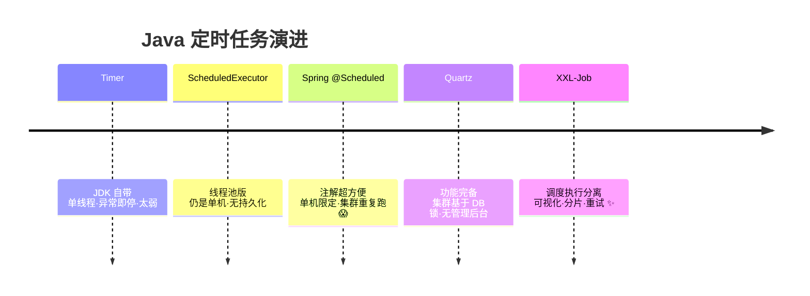
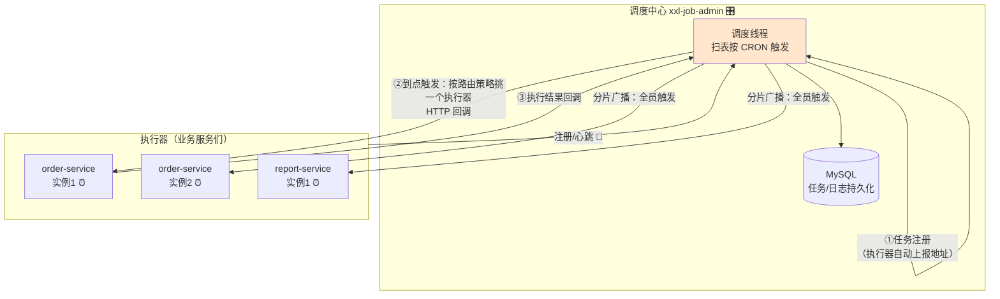
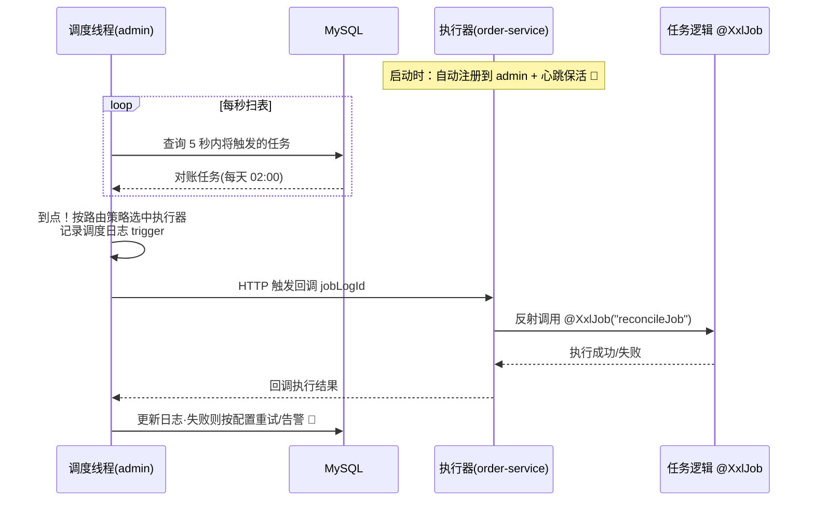
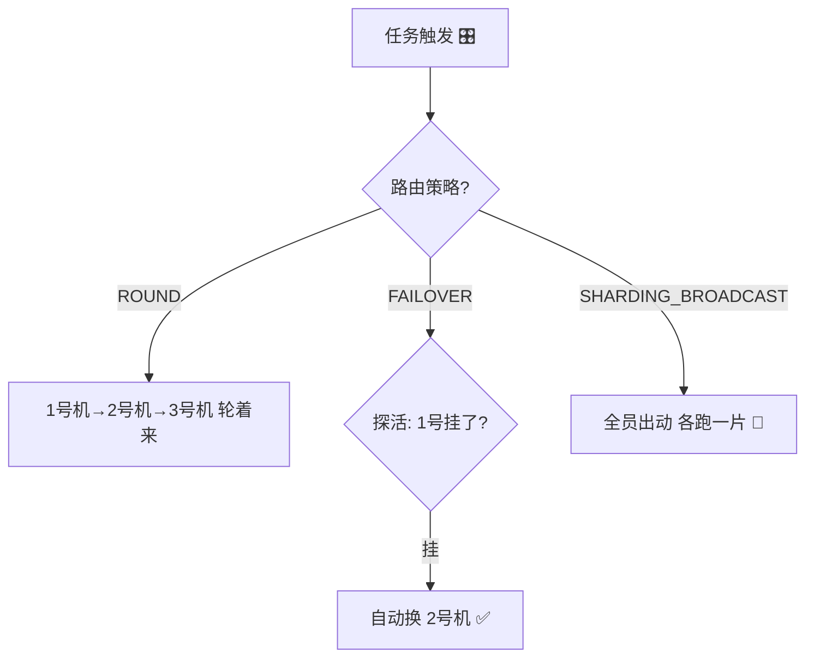
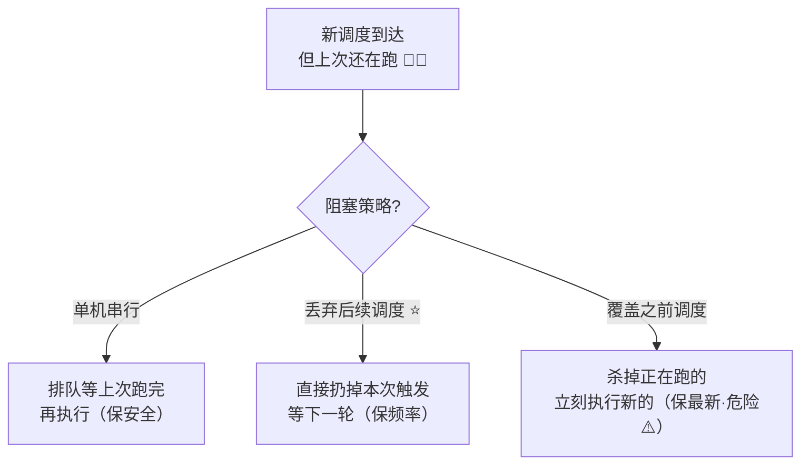
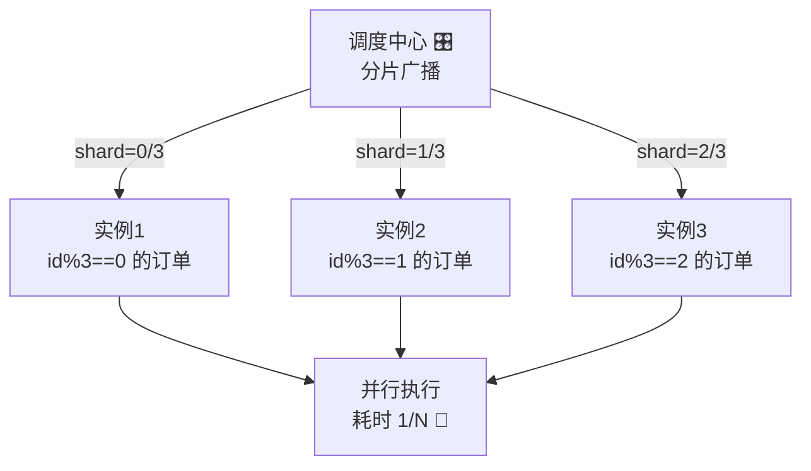
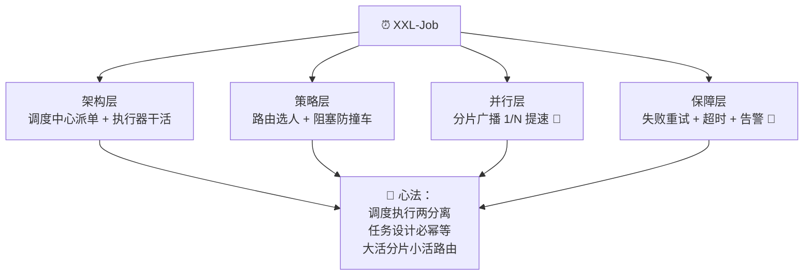

# ⏰ XXL-Job 学习笔记

> 今天要吃透的是分布式任务调度神器—— **XXL-Job** ✨
> `@Scheduled` 定时任务在单体里岁月静好，一到集群就重复执行八百遍！XXL-Job 一个后台管所有定时任务，可视化管理、分片并行、失败重试全都有～(≧▽≦)

---

## 📚 目录一览

1. [XXL-Job 是什么？](#一xxl-job-是什么)
2. [为什么需要 XXL-Job？](#二为什么需要-xxl-job)
3. [核心架构：调度中心 + 执行器](#三核心架构调度中心--执行器)
4. [部署调度中心](#四部署调度中心)
5. [Spring Boot 接入](#五spring-boot-接入)
6. [路由策略：任务分给谁？](#六路由策略任务分给谁)
7. [阻塞策略：任务撞车怎么办？](#七阻塞策略任务撞车怎么办)
8. [分片广播：大任务拆着跑](#八分片广播大任务拆着跑)
9. [高级特性](#九高级特性)
10. [XXL-Job vs Quartz vs Elastic-Job](#十xxl-job-vs-quartz-vs-elastic-job)
11. [常见坑与最佳实践](#十一常见坑与最佳实践)
12. [总结 & 速查表](#十二总结--速查表)

---

## 一、XXL-Job 是什么？

### 1.1 一句话解释

> **XXL-Job = 开源分布式任务调度平台：一个"调度中心"后台统一管理所有定时任务（什么时间、跑在哪台机器、怎么跑），业务服务里的"执行器"只管接活干活。** ⏰

作者许雪里（xxl 就是拼音缩写），国内使用率极高的开源项目，设计轻量、开箱即用！

### 1.2 打个比方 📦

定时任务管理就像**外卖派单**：
- **@Scheduled** = 每个骑手自己定闹钟接单：一个商家 8 个骑手都定了"12:00 去取餐"，结果 8 个人抢了同一份餐（重复执行）😅；
- **XXL-Job** = 请了个**专业派单调度台** 🎛️：
  - 商家（任务）统一登记在平台上；
  - 到点了调度台挑**一个**合适的骑手（执行器）去取；
  - 骑手忙不过来？换一个（故障转移）；订单太大？拆开几人分送（分片广播）；
  - 全程可查：谁几点取的、跑了多久、成功没（日志与报表）！

### 1.3 定时任务演进史 🕰️



---

## 二、为什么需要 XXL-Job？

### 2.1 @Scheduled / Quartz 的痛点 😢

| 痛点 | 场景 |
| --- | --- |
| 🔁 集群重复执行 | 服务部署 3 个实例，凌晨对账任务跑了 3 遍 💸 |
| 🕹️ 改时间要发版 | 每月 1 号改成 2 号？改代码重新发布 |
| 👀 看不见摸不着 | 任务跑没跑？成功没？日志去服务器翻 |
| 🔀 无失败处理 | 任务挂了没人知道，更别提自动重试 |
| 🐘 大任务跑不动 | 500 万数据单机跑 3 小时，没法拆分并行 |
| 🔧 Quartz 管理难 | 集群靠数据库锁，改个 cron 得写 SQL |

### 2.2 XXL-Job 的答案 ✨

| 能力 | 说明 |
| --- | --- |
| 🎛️ 可视化后台 | Web 界面管理任务：CRON、启停、手动触发、查日志 |
| ☝️ 集群不重复 | 调度中心统一派发，多实例只跑一份 |
| ⚖️ 路由策略 | 轮询/第一个/一致性哈希/故障转移……随心选 |
| 🧩 分片广播 | 大任务自动拆片，多机并行提速 🚀 |
| 🔁 失败重试 | 失败自动重试 + 邮件告警 |
| 📜 在线日志 | 每次执行日志直接后台看，支持滚动 |

---

## 三、核心架构：调度中心 + 执行器

### 3.1 架构图



### 3.2 两大角色分工

| 角色 | 是什么 | 干什么 |
| --- | --- | --- |
| **调度中心** xxl-job-admin | 独立部署的 Web 服务 | 管"什么时候、把任务派给谁"：CRON 触发、路由、重试、日志、告警 |
| **执行器** Executor | 内嵌在业务服务里的组件 | 管"怎么干活"：接收调度、执行任务逻辑、上报结果 |

> 💡 **调度与执行分离**是精髓：调度中心挂了不影响在跑的任务；执行器集群扩缩容，调度中心自动感知（执行器自动注册 + 心跳 💓）。

### 3.3 一次调度的完整时序



---

## 四、部署调度中心

### 4.1 方式一：源码启动（学习推荐）

```bash
# ① 拉源码
git clone https://github.com/xuxueli/xxl-job.git

# ② 初始化数据库（自带脚本）
#    执行 doc/db/tables_xxl_job.sql → 生成 xxl_job 库和 8 张表

# ③ 改配置：xxl-job-admin/src/main/resources/application.properties
#    spring.datasource.url=jdbc:mysql://localhost:3306/xxl_job...
#    server.port=8080

# ④ 启动 XxlJobAdminApplication
#    访问 http://localhost:8080/xxl-job-admin  账号 admin / 密码 123456 ✅
```

### 4.2 方式二：Docker 一键起 🐳

```yaml
# docker-compose.yml（复习 Docker 笔记～）
services:
  xxl-job-admin:
    image: xuxueli/xxl-job-admin:2.4.0
    ports:
      - "8080:8080"
    environment:
      PARAMS: >-
        --spring.datasource.url=jdbc:mysql://mysql:3306/xxl_job?useUnicode=true&characterEncoding=UTF-8
        --spring.datasource.username=root
        --spring.datasource.password=root
    depends_on:
      - mysql
  mysql:
    image: mysql:8.0
    environment:
      MYSQL_ROOT_PASSWORD: root
      MYSQL_DATABASE: xxl_job
    volumes:
      - ./tables_xxl_job.sql:/docker-entrypoint-initdb.d/init.sql   # 自动建表
```

| 核心数据表 | 存什么 |
| --- | --- |
| xxl_job_info | 任务定义（CRON/路由/参数） |
| xxl_job_log | 每次调度与执行结果 |
| xxl_job_registry | 执行器注册表（心跳续约） |
| xxl_job_lock | 集群调度锁（防重复触发） |

---

## 五、Spring Boot 接入

### 5.1 依赖与配置 ☕

```xml
<dependency>
    <groupId>com.xuxueli</groupId>
    <artifactId>xxl-job-core</artifactId>
    <version>2.4.0</version>
</dependency>
```

```yaml
# application.yml
xxl:
  job:
    admin:
      addresses: http://localhost:8080/xxl-job-admin   # 调度中心地址
    executor:
      appname: order-service-executor     # 执行器名（后台要对应！）
      port: 9999                          # 执行器内嵌 server 端口（接收调度回调）
      logpath: /data/applogs/xxl-job/jobhandler
      logretentiondays: 30
    accessToken: default_token
```

```java
// 配置类：注入执行器 Bean
@Configuration
public class XxlJobConfig {

    @Bean
    public XxlJobSpringExecutor xxlJobExecutor() {
        XxlJobSpringExecutor executor = new XxlJobSpringExecutor();
        executor.setAdminAddresses("http://localhost:8080/xxl-job-admin");
        executor.setAppname("order-service-executor");
        executor.setPort(9999);
        executor.setAccessToken("default_token");
        return executor;
    }
}
```

### 5.2 第一个任务：@XxlJob 注解 ✨

```java
@Component
public class OrderXxlJobs {

    private static final Logger log = LoggerFactory.getLogger(OrderXxlJobs.class);

    /**
     * 对账任务：JobHandler 名 = "reconcileJob"
     * 后台新建任务时填这个名称来匹配 ✅
     */
    @XxlJob("reconcileJob")
    public void reconcileJob() {
        // ① 拿任务参数（后台配置里随时改，无需发版！）
        String param = XxlJobHelper.getJobParam();       // 例："2026-09-14"
        log.info("开始对账，参数：{}", param);

        // ② 业务逻辑……
        int diffCount = reconcileService.check(param);

        // ③ 上报结果与自定义日志（后台"执行日志"直接看）
        XxlJobHelper.log("对账完成，差异数：{}", diffCount);

        // ④ 成功/失败（决定是否重试）
        if (diffCount > 1000) {
            XxlJobHelper.handleFail("差异过大，需人工介入！");
        } else {
            XxlJobHelper.handleSuccess();
        }
    }
}
```

### 5.3 后台配置任务（三步走）

1. **执行器管理** → 新建：AppName = `order-service-executor`；
2. **任务管理** → 新增：

| 配置项 | 值 | 说明 |
| --- | --- | --- |
| 调度类型 | CRON | `0 0 2 * * ?`（每天 02:00） |
| 运行模式 | BEAN | JobHandler = `reconcileJob` |
| 路由策略 | 第一个 / 轮询 | 见第六章 |
| 阻塞处理 | 丢弃后续调度 | 见第七章 |
| 失败重试次数 | 3 | 失败自动重试 |

3. **启动任务** → 到点自动跑，也可点"执行一次"手动试！🎉

---

## 六、路由策略：任务分给谁？

执行器是多实例集群时，这次任务派给哪台？**路由策略**说了算 ⚖️：

| 策略 | 一句话 | 场景 |
| --- | --- | --- |
| **FIRST** 第一个 | 固定选第一台 | 只想跑在特定机器 |
| **LAST** 最后一个 | 固定选最后注册的 | 同上 |
| **ROUND** 轮询 ⭐ | 一人一次排队来 | 最常用，均摊压力 |
| **RANDOM** 随机 | 碰运气挑一台 | 简单场景 |
| **CONSISTENT_HASH** 一致性哈希 | 按任务参数哈希固定机器 | 同参数总在同一台（有缓存亲和） |
| **FAILOVER** 故障转移 ⭐ | 逐台探活，挑活着的发 | 稳妥之选 |
| **BUSYOVER** 忙碌转移 | 挑不忙的机器发 | 避开正在干活的 |
| **SHARDING_BROADCAST** 分片广播 | 全部实例都触发 | 大任务并行 🚀（第八章） |



---

## 七、阻塞策略：任务撞车怎么办？

上一次还没跑完，下一次触发又来了（比如任务跑 10 分钟，CRON 却每 5 分钟一次）：



| 策略 | 行为 | 适合 |
| --- | --- | --- |
| **单机串行** | 排队执行 | 任务必须完整跑完（对账） |
| **丢弃后续调度** ⭐ | 跳过本次 | 大多数场景（错过就错过） |
| **覆盖之前调度** | 干掉旧的跑新的 | 只关心最新数据 |

> ⚠️ 覆盖策略会 `interrupt` 正在执行的任务，若任务里没处理中断（如事务中），可能产生脏数据——慎用！

---

## 八、分片广播：大任务拆着跑 🧩

**500 万条数据对账，单机跑 3 小时 → 3 台机器并行 1 小时跑完！**

原理：调度中心给**所有**实例都发触发请求，并附上"总分片数"和"当前分片序号"，任务代码按序号拆数据：

```java
/**
 * 分片对账：3 台执行器 → shardIndex = 0/1/2，shardTotal = 3
 * 按 id % 3 == shardIndex 各自认领一片 🧩
 */
@XxlJob("shardingReconcileJob")
public void shardingReconcileJob() {
    int shardIndex = XxlJobHelper.getShardIndex();   // 我是第几片
    int shardTotal = XxlJobHelper.getShardTotal();   // 总共几片

    XxlJobHelper.log("分片参数：当前片={}, 总片={}", shardIndex, shardTotal);

    // 核心：按分片取数——每台机器只处理自己那 1/N ！
    List<Long> orderIds = orderMapper.selectByShard(shardIndex, shardTotal);
    // SQL: SELECT id FROM t_order WHERE id % #{shardTotal} = #{shardIndex}

    orderIds.forEach(this::reconcileOne);
    XxlJobHelper.handleSuccess();
}
```



> 💡 妙处：**不用预先指定哪台机器跑哪片**——扩容到 5 台实例，下次触发自动 shardTotal=5，天然自适应！

---

## 九、高级特性

### 9.1 任务依赖：子任务 🧷

主任务成功后自动触发子任务（对账完成 → 自动生成报表）：任务配置"子任务ID"即可级联。

### 9.2 失败重试与告警 📧

| 项 | 说明 |
| --- | --- |
| 失败重试次数 | 任务级配置，失败后按序重试 |
| 告警邮件 | 调度失败/执行失败发邮件（配置 SMTP） |
| 超时时间 | 超时杀任务，防"僵尸任务"占资源 |

### 9.3 GLUE 模式：在线写代码 💻

任务逻辑直接在后台编辑器里写（Java/Shell/Python），即时生效不用发版——**应急爽器**，但代码不在 Git 里（复习 Git 心法：**代码必须版本化**，GLUE 仅限临时救急 ⚠️）。

### 9.4 其他实用功能

| 功能 | 一句话 |
| --- | --- |
| 手动执行一次 | 调试利器，带参数执行 |
| 查看执行日志 | 每次运行日志滚动查看（XxlJobHelper.log 写入的） |
| 任务复制 | 同类任务快速建 |
| 运行报表 | 成功率/耗时分布一眼看 |
| 告警邮件主题 | 自定义告警内容 |

---

## 十、XXL-Job vs Quartz vs Elastic-Job

| 对比 | XXL-Job ⭐ | Quartz | Elastic-Job |
| --- | --- | --- | --- |
| 架构 | 调度/执行分离，中心化 | 去中心化（DB 锁竞争） | 去中心化（ZK 协调） |
| 管理界面 | 自带 Web ⭐ | 无 | 部分（Lite 无） |
| 部署 | 轻量，一个 admin + 依赖 | 嵌入应用 | 需 ZooKeeper（复习 Etcd 笔记～） |
| 分片 | 内置分片广播 ⭐ | 无 | 强大 |
| 学习成本 | 低 ⭐ | 中 | 中高 |
| 社区（国内） | 极活跃 ⭐ | 成熟稳定 | 一般 |
| 适合 | 绝大多数业务场景 | 单应用简单定时 | 复杂分片需求 |

---

## 十一、常见坑与最佳实践

### 11.1 排雷表 💣

| 坑 | 症状 | 解法 |
| --- | --- | --- |
| 执行器注册不上 | 后台"自动注册"空 | 检查 appname 一致、网络互通、accessToken 相同 |
| 任务从不触发 | CRON 到点没反应 | 检查任务是否启动、时区（CRON 按服务器时区） |
| 执行器端口冲突 | 9999 被占启动报错 | executor.port 换端口（-1 自动分配） |
| 集群仍重复执行 | 多实例各跑各的 | 路由策略别用分片广播；检查是否多套 admin 库 |
| 任务日志看不到 | 后台日志为空 | 用 XxlJobHelper.log 而不是 logback 输出 |
| 覆盖策略脏数据 | 任务被杀事务未回滚 | 谨慎用覆盖；任务幂等设计 |
| admin 单点挂了 | 全部任务停摆 | admin 集群部署（DB 锁保证不重复调度）+ 监控告警（复习 Prometheus～） |
| 任务不幂等 | 重试导致重复处理 | 任务代码按幂等设计（唯一键/状态检查） |

### 11.2 最佳实践清单 ✅

1. 📌 任务命名规范：`业务_动作`（`order_reconcile`），JobHandler 与后台名称对齐；
2. 📌 **任务逻辑必须幂等**：重试机制的前提；
3. 📌 大数据量任务用**分片广播**，分片键选离散度好的字段（id 取模）；
4. 📌 关键任务配**超时 + 失败重试 + 告警**三件套；
5. 📌 admin 生产**集群部署**（前置 Nginx），MySQL 主从；
6. 📌 accessToken 生产必改默认值；
7. 📌 把任务参数放后台配置，改参数不发版 ✨。

---

## 十二、总结 & 速查表

### 12.1 名词速查 📇

| 名词 | 一句话 |
| --- | --- |
| XXL-Job | 中心化分布式任务调度平台 ⏰ |
| 调度中心 admin | 管"何时派单"：CRON/路由/重试/告警 🎛️ |
| 执行器 executor | 内嵌业务服务，管"怎么干活" |
| @XxlJob | 任务处理器注解，名字对应后台 JobHandler |
| XxlJobHelper | 任务上下文工具：取参数/记日志/报结果 |
| 路由策略 | 多实例选谁执行（轮询/故障转移…） |
| 阻塞策略 | 任务撞车怎么办（串行/丢弃/覆盖） |
| 分片广播 | 全员触发，各跑 1/N 片 🧩 |
| 子任务 | 主任务成功后级联触发 |
| GLUE 模式 | 后台在线写代码（应急用） |

### 12.2 API 速查 🛠️

| 动作 | 代码 |
| --- | --- |
| 定义任务 | `@XxlJob("名字")` + `public void xx()` |
| 取任务参数 | `XxlJobHelper.getJobParam()` |
| 记执行日志 | `XxlJobHelper.log("...")` |
| 取分片 | `getShardIndex()` / `getShardTotal()` |
| 上报成功 | `XxlJobHelper.handleSuccess()` |
| 上报失败 | `XxlJobHelper.handleFail("原因")` |

### 12.3 一图流总结



### 12.4 记住这三句就走不丢 ✨

1. **调度与执行分离**：admin 管"何时派单"，executor 管"怎么干活"，扩容缩容自动感知；
2. **任务必须幂等**：重试、覆盖、分片都建立在"跑两次不出错"的基础上；
3. **大任务分片、小任务路由**：数据量大上 SHARDING_BROADCAST，普通任务 FAILOVER/ROUND 足矣。

> 🎉 恭喜点亮 XXL-Job 技能树！动手作业：Docker 起 admin，给自己的 Spring Boot 服务接入执行器，写一个"每分钟跑一次的对账任务"，再升级成分片广播感受多机并行～配合之前学的 ELK（任务日志入 ELK）、Prometheus（监控任务耗时），定时任务体系完整闭环！下次想学 PowerJob、延迟任务方案或其他主题，随时喊我哦！(๑•̀ㅂ•́)و✧
