# ☁️ 云原生（Cloud Native）学习笔记

> 今天要打开的是云时代的"武林秘籍"—— **云原生（Cloud Native）** ✨
> Docker、Kubernetes、微服务、DevOps……这些酷炫名词全都出自这一门派！我会用大白话 + Java 视角带您轻松入门～(≧▽≦)

---

## 📚 目录一览

1. [什么是云原生？](#一什么是云原生)
2. [发展历程：从物理机到 Serverless](#二发展历程从物理机到-serverless)
3. [云原生技术栈全景图](#三云原生技术栈全景图)
4. [容器技术：Docker 🐳](#四容器技术docker-)
5. [容器编排：Kubernetes ⎈](#五容器编排kubernetes-)
6. [微服务与服务网格](#六微服务与服务网格)
7. [DevOps 与 CI/CD](#七devops-与-cicd)
8. [可观测性：日志/指标/追踪](#八可观测性日志指标追踪)
9. [Serverless：无服务器](#九serverless无服务器)
10. [十二要素应用（12-Factor）](#十十二要素应用12-factor)
11. [总结 & 速查表](#十一总结--速查表)

---

## 一、什么是云原生？

### 1.1 一句话解释

> **云原生 = 一套"生在云上、长在云上"的应用构建方法论 + 技术栈：容器打包、动态编排、微服务架构、持续交付、弹性伸缩。** 🌱

> 📖 CNCF（云原生计算基金会）的定义关键词：**容器、服务网格、不可变基础设施、声明式 API**。

### 1.2 打个比方 🏗️

- **传统应用**像"自建房"🏠：一台服务器一套环境，搬家（换机器）要拆了重装，慢且容易出错；
- **云原生应用**像"集装箱里的乐高"📦：应用连同环境打成标准集装箱（容器），哪里需要吊到哪里，坏了换一个一模一样的，扩容就多吊几个箱子！

### 1.3 ⚠️ 云原生 ≠ 上云！

| 说法 | 对不对 |
| --- | --- |
| "把服务器搬到了云上" = 云原生 | ❌ 那只是"托管"，应用架构没变 |
| "应用为云而生：容器化+弹性+自动化" | ✅ 这才是云原生 |

> 💡 类似：把纸质表格拍照存电脑 ≠ 数字化；重新设计成在线协作系统才叫数字化～

### 1.4 云原生四大法宝

| 法宝 | 一句话 |
| --- | --- |
| 📦 容器化 | 应用+环境打包成标准镜像，到哪都能跑 |
| 🤖 动态编排 | K8s 自动调度、自愈、扩缩容 |
| 🔩 微服务 | 大应用拆小服务，独立开发部署 |
| 🔄 持续交付 | CI/CD 流水线自动构建测试发布 |

---

## 二、发展历程：从物理机到 Serverless

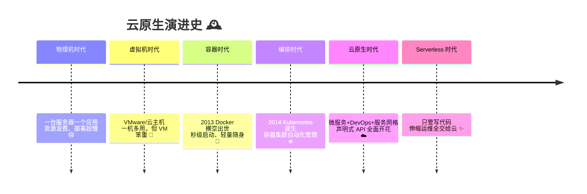

| 时代 | 部署单位 | 启动速度 | 资源占用 |
| --- | --- | --- | --- |
| 物理机 | 整台机器 | 分钟~小时级 | 1 应用独占 😱 |
| 虚拟机 VM | 虚拟机镜像 | 分钟级 | GB 级 🐘 |
| 容器 Container | 容器镜像 | **秒级** ⚡ | MB 级 🐣 |

---

## 三、云原生技术栈全景图

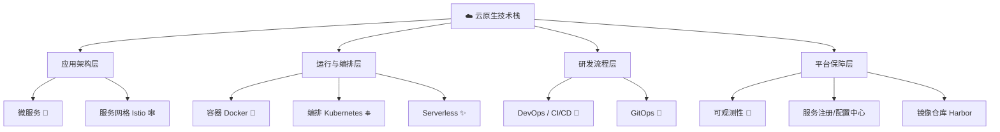

各层职责一句话：

| 层次 | 干什么 | 代表选手 |
| --- | --- | --- |
| 应用架构 | 代码怎么拆 | Spring Cloud、Dubbo、Istio |
| 运行编排 | 在哪跑、怎么扩 | Docker、K8s |
| 研发流程 | 怎么又快又稳地发布 | Jenkins、GitLab CI、ArgoCD |
| 平台保障 | 出事怎么发现 | Prometheus、Grafana、ELK、SkyWalking |

---

## 四、容器技术：Docker 🐳

### 4.1 三大核心概念

| 概念 | 一句话 | 类比 |
| --- | --- | --- |
| 镜像 Image | 只读的"应用+环境"模板 | 菜谱/蛋糕模具 🍰 |
| 容器 Container | 镜像跑起来的实例 | 按模具做出来的蛋糕 |
| 仓库 Registry | 存放镜像的地方 | 蛋糕店货架（Docker Hub / Harbor） |

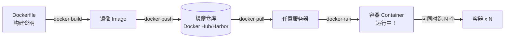

### 4.2 容器 vs 虚拟机

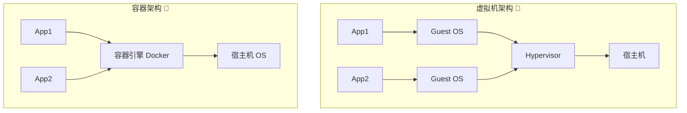

| 对比项 | 虚拟机 🐘 | 容器 🐣 |
| --- | --- | --- |
| 隔离级别 | 整个操作系统（内核级） | 进程级（共享宿主内核） |
| 启动速度 | 分钟级 | 秒级 ⚡ |
| 体积 | GB 级 | MB 级 |
| 性能损耗 | 较大 | 几乎无 |

### 4.3 Java 应用的 Dockerfile 实战 ☕

```dockerfile
# ========== 多阶段构建：编译归编译，运行归运行 ==========
# 阶段一：用 Maven 编译 Java 项目 🏗️
FROM maven:3.9-eclipse-temurin-17 AS builder
WORKDIR /app
# 先拷 pom 拉依赖（利用缓存，改代码也不用重新下依赖哦～）
COPY pom.xml .
RUN mvn dependency:go-offline
COPY src ./src
RUN mvn package -DskipTests

# 阶段二：轻量运行环境 🏃
FROM eclipse-temurin:17-jre-alpine
WORKDIR /app
# 只把编译好的 jar 拷进来，镜像小小的～
COPY --from=builder /app/target/*.jar app.jar

# 容器最佳实践：别用 root 跑！
RUN addgroup -S app && adduser -S app -G app
USER app

EXPOSE 8080
ENTRYPOINT ["java", "-jar", "app.jar"]
```

### 4.4 常用命令速查 🛠️

| 命令 | 作用 |
| --- | --- |
| `docker build -t myapp:1.0 .` | 按当前目录 Dockerfile 构建镜像 |
| `docker run -d -p 8080:8080 myapp:1.0` | 后台运行并映射端口 |
| `docker ps` | 看运行中的容器 |
| `docker logs -f 容器ID` | 追日志 |
| `docker exec -it 容器ID sh` | 钻进容器里看看 |
| `docker push/pull` | 推/拉镜像 |

---

## 五、容器编排：Kubernetes ⎈

### 5.1 为什么需要 K8s？

容器一多问题就来了：几百个容器，谁挂了重启？流量怎么分发？怎么扩容？节假日流量洪峰怎么办？→ **K8s 就是"容器幼儿园园长"**，把这一切管得明明白白 👩‍🏫

### 5.2 K8s 架构一图看懂

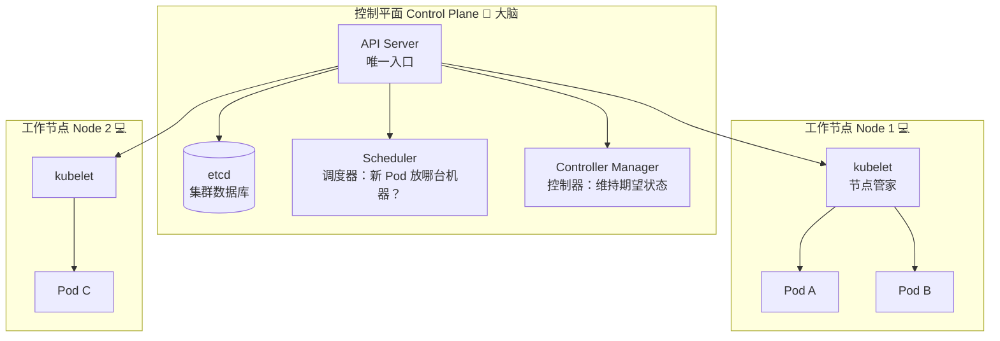

> 💡 **声明式 API**：您只说"我要 3 个副本"（期望状态），K8s 持续对比现状并自动纠偏——挂了拉起、多了删掉。不用您一步步教它怎么做！✨

### 5.3 核心概念速览 🧱

| 概念 | 一句话 | 类比 |
| --- | --- | --- |
| Pod | 最小调度单位，1~N 个容器的组合 | 一间宿舍（住 1 个或几个容器）🏠 |
| Deployment | 管理 Pod 副本数 + 滚动更新 | 宿舍管理员阿姨 |
| Service | 一组 Pod 的稳定访问入口 + 负载均衡 | 宿舍楼前台总机 ☎️ |
| Ingress | 集群对外的七层入口（域名/路由/TLS） | 大门+门牌指路牌 🚪 |
| ConfigMap | 配置文件（非敏感） | 公告栏 📋 |
| Secret | 敏感信息（密码/密钥） | 保险柜 🔐 |
| Namespace | 资源的逻辑分组 | 不同的楼栋 |
| HPA | 按指标自动扩缩容 | 客流高峰自动加班 📈 |

Deployment → Service → Ingress 关系：

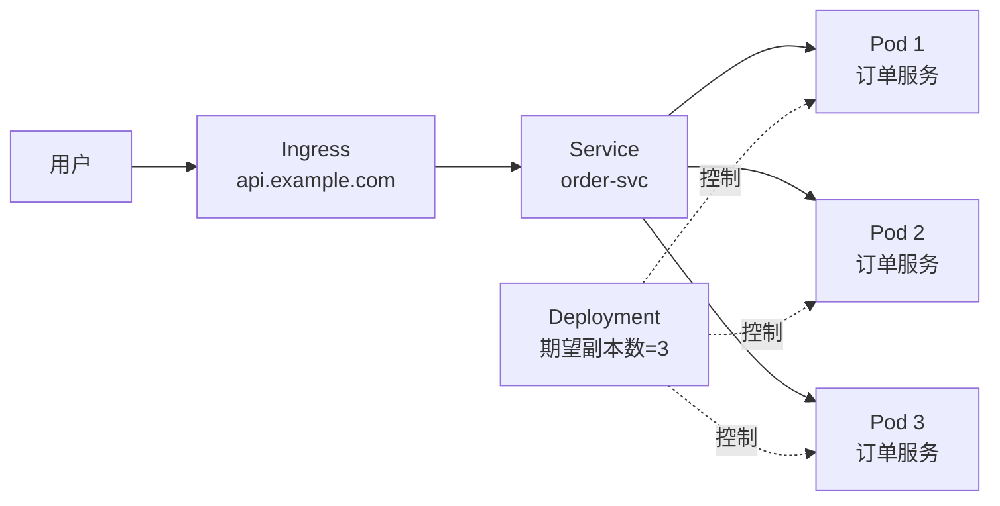

### 5.4 部署 Java 应用实战（YAML）⎈

```yaml
# deployment.yaml —— 部署 Spring Boot 订单服务
apiVersion: apps/v1
kind: Deployment
metadata:
  name: order-service          # 部署名
  namespace: prod              # 所在命名空间
spec:
  replicas: 3                  # 期望 3 个副本，挂了自动补 🔄
  selector:
    matchLabels:
      app: order-service
  template:                    # Pod 模板
    metadata:
      labels:
        app: order-service
    spec:
      containers:
        - name: order-service
          image: registry.example.com/order-service:1.2.0   # 🐳 镜像
          ports:
            - containerPort: 8080
          env:                 # 环境变量注入
            - name: SPRING_PROFILES_ACTIVE
              value: "prod"
          resources:           # 资源限额，防止"吃垮"节点！
            requests:          # 最低保障
              cpu: "250m"      # 0.25 核
              memory: "512Mi"
            limits:            # 上限
              cpu: "500m"
              memory: "1Gi"
          livenessProbe:       # 🩺 存活检查：挂了就重启
            httpGet:
              path: /actuator/health/liveness
              port: 8080
            initialDelaySeconds: 30
          readinessProbe:      # 🚦 就绪检查：没准备好不接流量
            httpGet:
              path: /actuator/health/readiness
              port: 8080
            initialDelaySeconds: 20
```

```yaml
# service.yaml —— 稳定访问入口
apiVersion: v1
kind: Service
metadata:
  name: order-service
  namespace: prod
spec:
  selector:
    app: order-service         # 圈住带这个标签的所有 Pod
  ports:
    - port: 80                 # Service 对外端口
      targetPort: 8080         # 容器实际端口
---
# hpa.yaml —— 自动扩缩容：忙时加 Pod，闲时省钱 📈
apiVersion: autoscaling/v2
kind: HorizontalPodAutoscaler
metadata:
  name: order-service-hpa
  namespace: prod
spec:
  scaleTargetRef:
    apiVersion: apps/v1
    kind: Deployment
    name: order-service
  minReplicas: 3               # 最少 3 个
  maxReplicas: 10              # 最多 10 个
  metrics:
    - type: Resource
      resource:
        name: cpu
        target:
          type: Utilization
          averageUtilization: 70   # CPU 超 70% 就扩容
```

### 5.5 kubectl 常用命令 🛠️

| 命令 | 作用 |
| --- | --- |
| `kubectl apply -f deployment.yaml` | 应用配置（声明式） |
| `kubectl get pods -n prod` | 看 Pod 列表 |
| `kubectl describe pod xxx` | 看某 Pod 详情（排错神器） |
| `kubectl logs -f pod名` | 看容器日志 |
| `kubectl rollout restart deploy/xxx` | 滚动重启 |
| `kubectl scale deploy xxx --replicas=5` | 手动扩到 5 副本 |
| `kubectl exec -it pod名 -- sh` | 钻进容器 |

---

## 六、微服务与服务网格

### 6.1 单体 vs 微服务

| 对比项 | 单体应用 🏢 | 微服务 🧩 |
| --- | --- | --- |
| 结构 | 所有功能一个工程一个包 | 按业务拆成一堆小服务 |
| 部署 | 改一处，整个重发 | 谁改谁发，互不影响 ✅ |
| 技术栈 | 一统天下 | 每个服务可自选（Java/Go…） |
| 扩容 | 整体复制，浪费 | 只扩压力大的服务 ✅ |
| 复杂度 | 本地简单，后期"大泥球" | 引入分布式问题（网络/事务/排障）⚠️ |

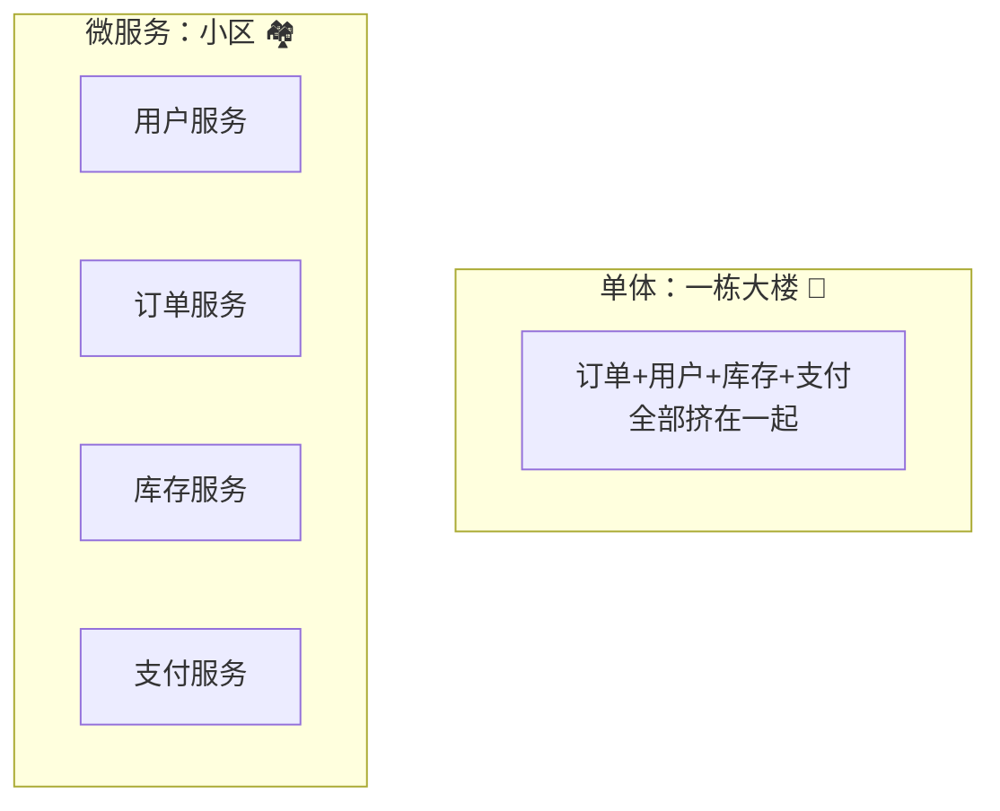

### 6.2 服务网格（Service Mesh）🕸️

微服务一多，重试、熔断、限流、加密、灰度……每个服务都要写一遍？太累啦！→ **把这些"家务活"下沉到 Sidecar 代理，统一治理**：

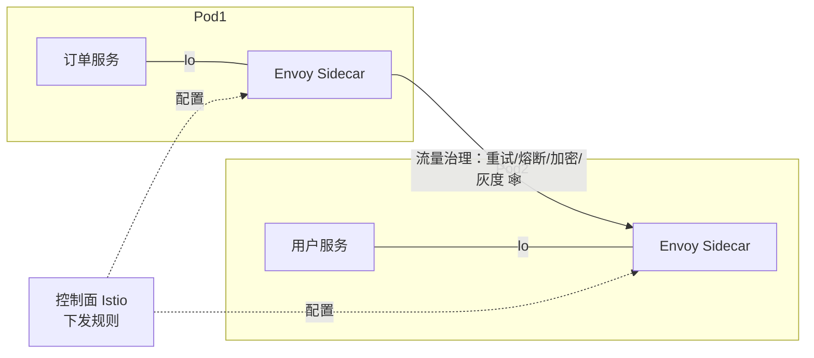

> 💡 一句话：**应用专心写业务，通信的脏活累活全交给网格**～Java 里对应的是把 Spring Cloud 里 Hystrix/Ribbon 那套"SDK 模式"换成"基础设施模式"。

---

## 七、DevOps 与 CI/CD

### 7.1 是什么？

- **DevOps** = 开发（Dev）+ 运维（Ops）手拉手 🤝：自动化 + 协作文化，让发布又快又稳。
- **CI 持续集成**：代码一提交就自动编译、测试。
- **CD 持续交付/部署**：测试通过自动打包镜像、发布上线。

### 7.2 典型 CI/CD 流水线

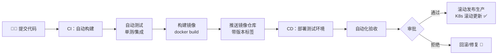

### 7.3 GitOps：一切以 Git 为准 📝

> 声明式思想再进一步：**Git 仓库里的 YAML 就是生产的"唯一真相"**，改配置 = 提 PR，ArgoCD 监听到变化自动同步到集群。

| 传统部署 | GitOps 部署 |
| --- | --- |
| 手敲 kubectl 命令 | 修改 Git 里的 YAML |
| 改了啥靠记忆 | 每次变更都是一次提交，有据可查 |
| 回滚靠人肉 | `git revert` 即回滚 ✨ |

---

## 八、可观测性：日志/指标/追踪

系统上了云、拆了微服务，出问题怎么查？靠**可观测性三支柱**🔭：

| 支柱 | 看什么 | 类比 | 常用工具 |
| --- | --- | --- | --- |
| 📊 指标 Metrics | 数字化健康状态（QPS、CPU、延迟） | 体检报告 | Prometheus + Grafana |
| 📜 日志 Logging | 具体发生了什么 | 日记本 | ELK / Loki |
| 🔗 链路追踪 Tracing | 一个请求穿过了哪些服务、卡在哪 | 快递物流轨迹 | SkyWalking / Jaeger |

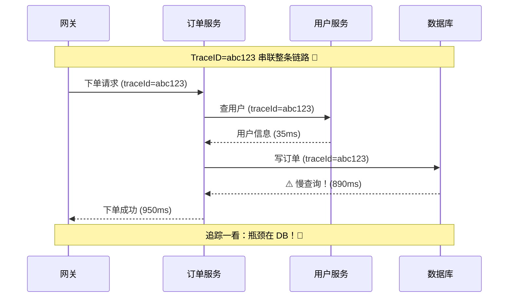

Java 小贴士 ☕：Spring Boot + Micrometer 接 Prometheus，加 `spring-cloud-starter-sleuth`（或 Micrometer Tracing）就能自动给日志打上 traceId～

---

## 九、Serverless：无服务器

> **不是没有服务器，是您不用管服务器！** 只交代码（函数），扩容、高可用、运维全由云平台包办 ✨

| 形态 | 大白话 | 例子 |
| --- | --- | --- |
| FaaS 函数即服务 | 传一个函数上去，事件来了就执行 | 腾讯云 SCF、AWS Lambda |
| BaaS 后端即服务 | 登录、存储、数据库直接调现成服务 | COS、云数据库 |

| 对比 | 传统 K8s 部署 | Serverless |
| --- | --- | --- |
| 计费 | 按容器常驻 | 按调用次数+运行时长 💰 |
| 冷启动 | 无 | 首次调用有延迟 ⚠️ |
| 适用 | 常驻服务、长连接 | 突发流量、事件处理（如图片上传触发压缩） |

---

## 十、十二要素应用（12-Factor）

云原生应用的"行为规范十二条"，挑最关键的记 ✨：

| 要素 | 一句话 |
| --- | --- |
| ① 基准代码 | 一份代码库，多环境多部署 |
| ② 依赖显式声明 | Java 用 pom.xml 锁依赖 ✅ |
| ③ 配置存环境 | 配置用**环境变量**注入，不打进代码 ⚠️ 最常踩坑！ |
| ④ 后端服务当资源 | DB/MQ 是"挂件"，可替换 |
| ⑤ 严格分离构建/发布/运行 | 先构建镜像，再发布 |
| ⑥ 进程无状态 | 状态放 Redis/DB，进程随时可杀可换 💀 |
| ⑦ 端口绑定 | 服务自己监听端口对外提供服务 |
| ⑧ 并发靠水平扩展 | 多开实例，而不是单个实例加大 |
| ⑨ 快速启动优雅退出 | 启动快、关得体面（处理完在途请求） |
| ⑩ 开发=生产尽量一致 | 镜像一样、环境相似，减少"我电脑上没事" |
| ⑪ 日志当事件流 | 日志打到 stdout，收集交给平台 📜 |
| ⑫ 管理任务当一次性进程 | 定时任务也容器化 |

---

## 十一、总结 & 速查表

### 11.1 名词速查 📇

| 名词 | 一句话记忆 |
| --- | --- |
| 云原生 | 为云而生的应用构建方式：容器+编排+微服务+DevOps |
| Docker | 把应用+环境打包成"集装箱" 📦 |
| Kubernetes | 容器集群的"幼儿园园长"，自愈+扩缩+调度 ⎈ |
| Pod | K8s 最小调度单位（一栋小宿舍） |
| Deployment | 副本数管家 + 滚动更新 |
| Service / Ingress | 集群内稳定入口 / 集群外大门 |
| 声明式 API | 说"要什么"，不用教"怎么做" |
| 服务网格 | 流量治理下沉到 Sidecar，业务代码零侵入 🕸️ |
| CI/CD | 提交即构建测试、通过即发布 🔄 |
| 可观测性 | 指标+日志+追踪三支柱 🔭 |
| Serverless | 只管写代码，运维全交给云 ✨ |

### 11.2 一图流总结

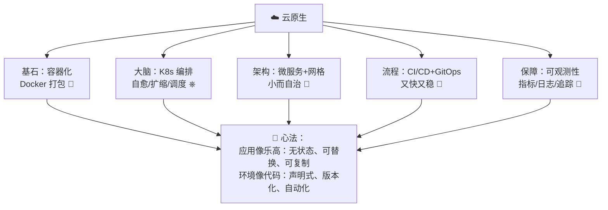

### 11.3 记住这三句就走不丢 ✨

1. **容器是砖，K8s 是工地**：镜像标准化交付，编排自动化运维。
2. **声明一切**：写清"期望状态"，剩下的交给系统自愈。
3. **无状态 + 可观测**：进程随时可换（状态外置），出事能秒定位（三支柱）。

> 🎉 恭喜把云原生全景地图点亮！建议下一步亲手体验：把自己的 Spring Boot 小项目写成 Dockerfile → 用 docker run 跑起来 → 再试试 minikube 部署，成就感爆棚哦～(๑•̀ㅂ•́)و✧
