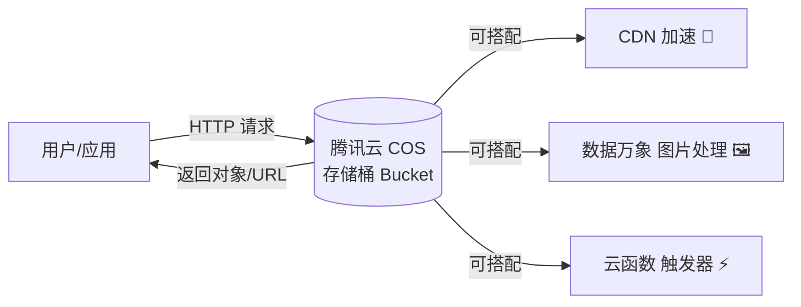
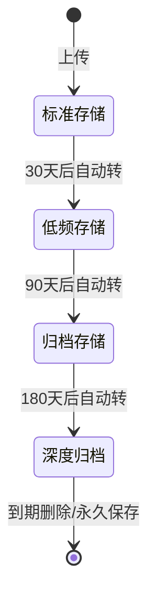
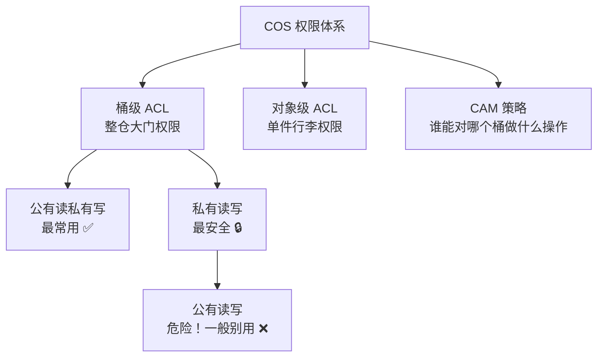
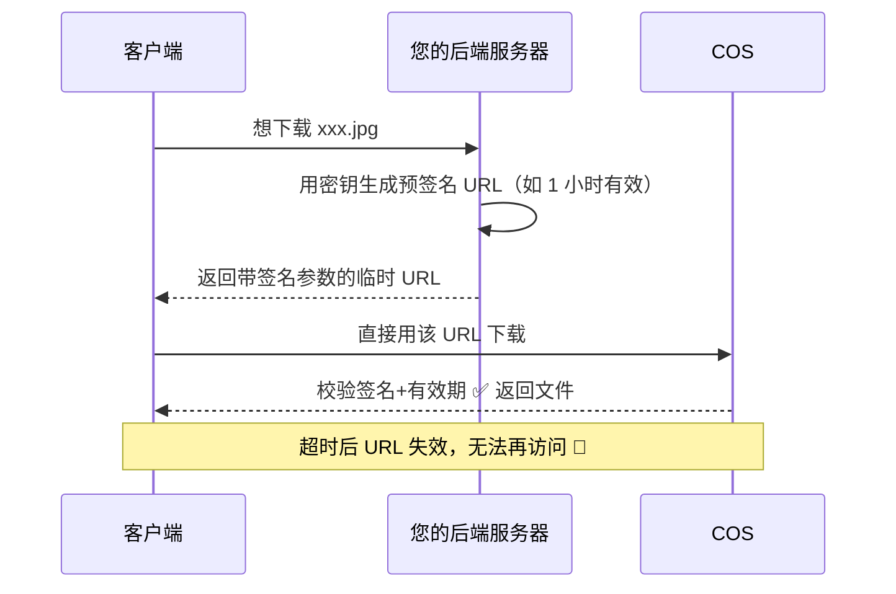
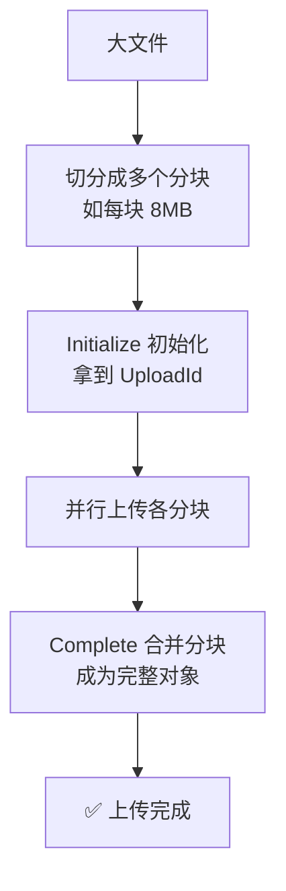
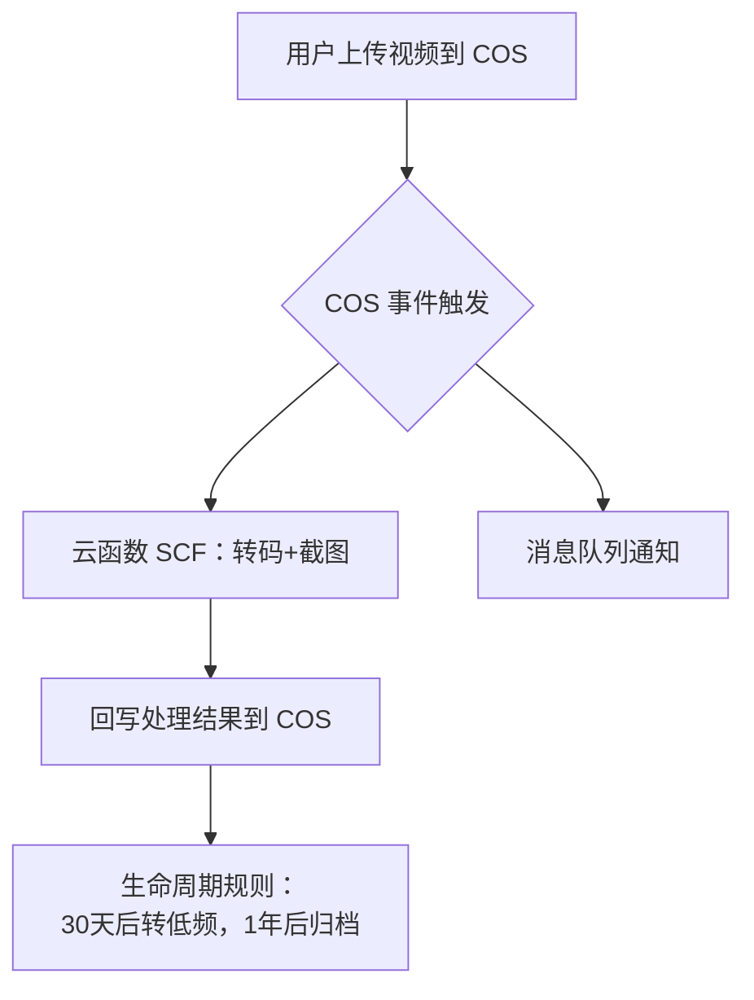
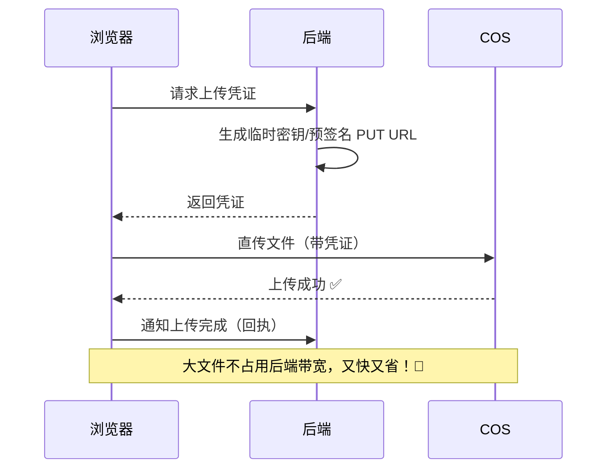
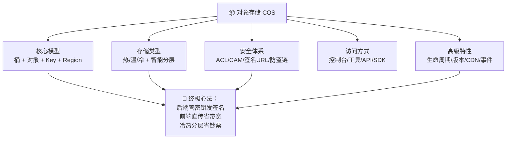

# 📦 对象存储 COS 学习笔记

> 今天要认识的是云上的"超级收纳仓库"—— **对象存储（Object Storage）**，重点讲腾讯云的 **COS（Cloud Object Storage）** ✨
> 放图片、存视频、做备份……它都能一网打尽！我会用大白话 + Java 代码带您轻松吃透它～(≧▽≦)

---

## 📚 目录一览

1. [什么是对象存储？](#一什么是对象存储)
2. [COS 核心概念](#二cos-核心概念)
3. [存储类型：按需选仓放货](#三存储类型按需选仓放货)
4. [权限与安全](#四权限与安全别让仓库裸奔)
5. [访问 COS 的四种方式](#五访问-cos-的四种方式)
6. [Java SDK 实战](#六java-sdk-实战)
7. [高级特性](#七高级特性让仓库更聪明)
8. [典型应用场景](#八典型应用场景)
9. [最佳实践与费用优化](#九最佳实践与费用优化)
10. [总结 & 速查表](#十总结--速查表)

---

## 一、什么是对象存储？

### 1.1 一句话解释

> **对象存储 = 把文件当作一个个"对象"，扁平地存进云端无限大的仓库里，靠 HTTP 接口随存随取。** 🗄️

### 1.2 打个比方 🏠

- 对象存储就像**自助仓储仓库**：
  - 您把行李（文件）交过去，拿到一张**取件凭证**（Key + URL）；
  - 不用关心货放几号柜几号架（没有目录层级、不管磁盘）；
  - 想拿行李？拿着凭证说一声（HTTP GET）就行！
  - 仓库几乎**无限大**，东西再多也堆得下～

### 1.3 三种存储架构对比

| 对比项 | 块存储 💾 | 文件存储 📁 | 对象存储 📦 |
| --- | --- | --- | --- |
| 像什么 | 一块裸硬盘 | 一个共享文件夹 | 一个云上仓库 |
| 访问方式 | 按扇区/块 | 目录树 + 文件系统（NFS/SMB） | HTTP RESTful API |
| 性能 | 超高（数据库最爱） | 高 | 吞吐大、延迟中等 |
| 容量 | 有限 | 有限 | **近无限** ✨ |
| 典型用途 | 数据库、虚拟机磁盘 | 共享文档、局域网 | 图片/视频/备份/静态资源 |

> 💡 **一句话记住**：结构化热数据用块存储，办公室共享用文件存储，**海量文件放网上**用对象存储！

---

## 二、COS 核心概念

### 2.1 概念速览 🧱

| 概念 | 一句话解释 | 类比 |
| --- | --- | --- |
| 存储桶 Bucket | 存对象的"容器"，名字全局唯一 | 仓库里的一个独立货区 🗃️ |
| 对象 Object | 存的"文件" = 数据 + 元数据 + Key | 一件带标签的行李 🧳 |
| 对象键 Key | 对象在桶内的唯一标识（类似路径） | 取件凭证 / 货位号 🏷️ |
| 地域 Region | 桶所在的数据中心位置（如 ap-guangzhou） | 仓库在哪个城市 🌏 |
| APPID | 腾讯云账号的数字 ID，桶名必带 | 仓库的营业执照号 🪪 |
| 访问域名 | 桶的默认 URL | 仓库的门牌地址 🚪 |

### 2.2 对象的三件套 🧳

一个对象 = **Key（键）+ Data（数据）+ Metadata（元数据）**：

```text
Key       : images/cat.jpg          ← 唯一标识（长得像路径，但其实是"扁平字符串"）
Data      : 二进制文件内容            ← 图片/视频/任意字节流（单个最大 48.8TB！）
Metadata  : Content-Type=image/jpeg ← 元数据（大小、类型、自定义信息等）
```

### 2.3 URL 结构拆解 🔍

每个对象都有一个默认访问地址：

```text
https://mybucket-1250000000.cos.ap-guangzhou.myqcloud.com/images/cat.jpg
       └────────┬────────┘ └──────┬──────┘                └─────┬─────┘
        桶名-APPID        地域 Region                对象键 Key（用 / 分隔）
```

### 2.4 整体工作图



---

## 三、存储类型：按需选仓放货

COS 提供多种存储类型，核心就看两个问题：**取的频率高不高？能等多久？**

| 存储类型 | 大白话 | 适用场景 | 单价 | 读取速度 |
| --- | --- | --- | --- | --- |
| 🟢 标准存储 STANDARD | 常用货放门口 | 网站图片、App 资源、热点视频 | 存储贵 | 即时 ⚡ |
| 🟡 低频存储 STANDARD_IA | 偶尔取一次 | 月度报表、灾备数据 | 存储便宜、读取贵 | 即时 ⚡ |
| 🧠 智能分层 INTELLIGENT_TIERING | 系统自动帮您搬家 | 访问模式摸不透的数据 | 自动优化 | 即时 ⚡ |
| 🟠 归档存储 ARCHIVE | 压箱底，取要等 | 合同存档、日志归档 | 超便宜 | 需解冻（分钟~小时级）🧊 |
| 🔵 深度归档 DEEP_ARCHIVE | 埋在地窖里 | 年度合规备份 | 最便宜 | 解冻最慢（最长 12~48 小时）🧊🧊 |

生命周期自动流转示意：



> 💡 **省钱口诀**：热数据用标准，温数据用低频，冷数据进归档，拿不准就智能分层～

---

## 四、权限与安全：别让仓库裸奔 🛡️

### 4.1 三层权限体系



| 权限模式 | 大白话 | 适合 |
| --- | --- | --- |
| 私有读写 | 谁都进不来，只认签名请求 | 机密文件、内部数据 🔒 |
| 公有读私有写 | 谁都能"看"，但只有自己能"放" | 网站图片、公开资源 ✅ |
| 公有读写 | 谁都能放能拿（会被坏人塞垃圾！） | 几乎不用 ❌ |

### 4.2 预签名 URL：临时通行证 🎫

私有桶的文件想给某人临时下载怎么办？→ **生成带签名的临时 URL（有效期自定义）**，过期自动失效！



### 4.3 安全清单 ✅

| 措施 | 说明 |
| --- | --- |
| 🔑 密钥不进前端 | SecretKey 永远只放后端，前端用临时密钥/签名 URL |
| 👥 最小权限 | 用 CAM 子账号按桶/操作授权，别用主账号密钥 |
| 🔗 防盗链 | 配 Referer 白/黑名单，防别的网站盗用您的流量 |
| 🔒 服务端加密 | SSE-COS 一键加密存储 |
| 📜 版本控制 | 开启后误删可恢复 |
| 🚨 告警 | 公网访问异常、流量突增及时知道 |

---

## 五、访问 COS 的四种方式

| 方式 | 大白话 | 适合 |
| --- | --- | --- |
| 🖥️ 控制台 | 网页点点点 | 日常管理、新手 |
| 🛠️ COSCMD / COSCLI | 命令行工具 | 运维批量操作 |
| 📡 API | 直接 HTTP 请求 | 任何语言手搓 |
| ☕ SDK | 官方封装好的库（Java/Go/Python...） | **业务开发首选 ✅** |

---

## 六、Java SDK 实战

### 6.1 引入依赖（Maven）

```xml
<dependency>
    <groupId>com.qcloud</groupId>
    <artifactId>cos_api</artifactId>
    <version>5.6.227</version>
</dependency>
```

### 6.2 初始化客户端 ☕

```java
import com.qcloud.cos.COSClient;
import com.qcloud.cos.ClientConfig;
import com.qcloud.cos.auth.BasicCOSCredentials;
import com.qcloud.cos.auth.COSCredentials;
import com.qcloud.cos.region.Region;

public class CosDemo {

    private static final String SECRET_ID  = "您的SecretId";   // 🔑 从访问管理 CAM 获取
    private static final String SECRET_KEY = "您的SecretKey";  // 🔐 千万别提交到代码仓库！
    private static final String BUCKET_NAME = "mybucket-1250000000"; // 桶名-APPID
    private static final Region REGION = new Region("ap-guangzhou");

    public static COSClient createClient() {
        // 1️⃣ 凭证：密钥信息
        COSCredentials cred = new BasicCOSCredentials(SECRET_ID, SECRET_KEY);
        // 2️⃣ 配置：地域（桶在哪就填哪～）
        ClientConfig clientConfig = new ClientConfig(REGION);
        // 3️⃣ 创建客户端实例
        return new COSClient(cred, clientConfig);
    }
}
```

> ⚠️ **生产环境提醒**：客户端是重量级对象，**全局建一个复用即可**，用完记得 `shutdown()`；密钥建议放环境变量或配置中心哦！

### 6.3 上传文件 ⬆️

```java
import com.qcloud.cos.model.PutObjectRequest;
import com.qcloud.cos.model.PutObjectResult;
import java.io.File;

public void uploadFile(COSClient cosClient, File localFile) {
    // 对象键：建议按 日期/业务/文件名 组织，好找又整洁～
    String key = "images/2026/09/cat.jpg";

    PutObjectRequest request = new PutObjectRequest(
            BUCKET_NAME, key, localFile);

    // 💡 可选：设置存储类型与元数据
    request.setStorageClass("STANDARD_IA"); // 低频存储
    request.putCustomRequestHeader("x-cos-meta-uploader", "xiaomei"); // 自定义元数据

    PutObjectResult result = cosClient.putObject(request);
    System.out.println("上传成功！ETag=" + result.getETag());
}
```

**小文件用 putObject，大文件用 uploadFile（自动分块+断点续传）：**

```java
import com.qcloud.cos.transfer.TransferManager;
import com.qcloud.cos.transfer.Upload;

public void uploadBigFile(TransferManager tm, File bigVideo) throws InterruptedException {
    String key = "videos/lecture-01.mp4";
    // 🧩 大文件自动分块上传，失败自动重试，稳！
    Upload upload = tm.upload(BUCKET_NAME, key, bigVideo);
    upload.waitForCompletion();  // 也可注册监听器展示进度条～
    System.out.println("大文件上传完成！");
}
```

分块上传原理一览：



### 6.4 下载文件 ⬇️

```java
import com.qcloud.cos.model.GetObjectRequest;
import java.io.File;

public void downloadFile(COSClient cosClient) {
    GetObjectRequest request = new GetObjectRequest(
            BUCKET_NAME, "images/2026/09/cat.jpg");

    // 下载到本地文件
    File target = new File("downloaded_cat.jpg");
    cosClient.getObject(request, target);

    // 💡 还能只下载文件的一部分（Range 下载，视频拖进度条就靠它！）
    request.setRange(1024, 4096); // 下载第 1024~4096 字节
}
```

### 6.5 列举对象 📋

```java
import com.qcloud.cos.model.ListObjectsRequest;
import com.qcloud.cos.model.ObjectListing;
import com.qcloud.cos.model.COSObjectSummary;

public void listObjects(COSClient cosClient) {
    ListObjectsRequest request = new ListObjectsRequest();
    request.setBucketName(BUCKET_NAME);
    request.setPrefix("images/2026/");   // 按前缀过滤（模拟"文件夹"）
    request.setMaxKeys(100);             // 每页最多 100 条
    request.setDelimiter("/");           // 按 / 分组，实现"浏览文件夹"效果

    ObjectListing listing = cosClient.listObjects(request);
    for (COSObjectSummary obj : listing.getObjectSummaries()) {
        System.out.println(obj.getKey() + " → " + obj.getSize() + " 字节");
    }
    // 列表很长时用 listing.isTruncated() +getNextMarker() 翻页哦～
}
```

### 6.6 删除对象 🗑️

```java
public void deleteObject(COSClient cosClient) {
    // 删单个
    cosClient.deleteObject(BUCKET_NAME, "images/2026/09/cat.jpg");

    // 批量删（一次最多 1000 个）
    import com.qcloud.cos.model.DeleteObjectsRequest;
    DeleteObjectsRequest batch = new DeleteObjectsRequest(BUCKET_NAME);
    batch.addKey(new DeleteObjectsRequest
            .KeyVersion("images/old/1.jpg", null));
    batch.addKey(new DeleteObjectsRequest
            .KeyVersion("images/old/2.jpg", null));
    cosClient.deleteObjects(batch);
}
```

### 6.7 生成预签名 URL 🎫

```java
import com.qcloud.cos.http.HttpMethodName;
import java.net.URL;
import java.util.Date;

public String genPresignedUrl(COSClient cosClient) {
    GeneratePresignedUrlRequest request = new GeneratePresignedUrlRequest(
            BUCKET_NAME, "reports/secret.pdf", HttpMethodName.GET);

    // 🎫 1 小时内有效的临时下载链接
    request.setExpiration(new Date(System.currentTimeMillis() + 3600 * 1000));

    URL url = cosClient.generatePresignedUrl(request);
    return url.toString();
    // 长这样：https://xxx.cos.ap-guangzhou.myqcloud.com/reports/secret.pdf?q-sign-algorithm=...
}
```

### 6.8 Spring Boot 整合示例：头像上传接口 🌸

```java
@RestController
@RequestMapping("/api/files")
@RequiredArgsConstructor
public class FileController {

    private final COSClient cosClient;
    private static final String BUCKET = "mybucket-1250000000";

    @PostMapping("/avatar")
    public String uploadAvatar(@RequestParam("file") MultipartFile file)
            throws IOException {
        // 1️⃣ 生成唯一对象键，避免重名覆盖
        String suffix = getSuffix(file.getOriginalFilename());
        String key = "avatars/" + UUID.randomUUID() + suffix;

        // 2️⃣ 构造元数据
        ObjectMetadata metadata = new ObjectMetadata();
        metadata.setContentLength(file.getSize());
        metadata.setContentType(file.getContentType());

        // 3️⃣ 上传（字节流方式）
        cosClient.putObject(new PutObjectRequest(
                BUCKET, key, file.getInputStream(), metadata));

        // 4️⃣ 拼出访问 URL（若桶为公有读）
        return "https://" + BUCKET + ".cos.ap-guangzhou.myqcloud.com/" + key;
    }

    private String getSuffix(String name) {
        int i = name == null ? -1 : name.lastIndexOf('.');
        return i < 0 ? "" : name.substring(i);
    }
}
```

---

## 七、高级特性：让仓库更聪明 🧠

| 特性 | 一句话 | 典型用法 |
| --- | --- | --- |
| 🔄 生命周期规则 | 到时间自动转类型/删除 | 30 天后标准→低频，一年后删除 |
| 🌏 跨地域复制 | 把对象同步到另一个城市的桶 | 容灾备份 |
| 🕰️ 版本控制 | 同一个 Key 保留所有历史版本 | 误删/误覆盖救星 |
| 🌐 静态网站托管 | 桶直接当网站用 | 个人博客、活动页 |
| 🚀 CDN 加速 | 全国节点缓存，访问飞快 | 图片视频分发 |
| 🖼️ 数据万象 CI | 云端图片处理 | 缩略图、加水印、鉴黄 |
| ⚡ 事件通知 | 有对象变动就触发动作 | 上传完自动触发云函数转码 |
| 🔐 服务端加密 | 存储时自动加密 | 合规要求数据 |

生命周期 + 事件通知流程示意：



---

## 八、典型应用场景

| 场景 | 方案组合 |
| --- | --- |
| 🖼️ 网站/App 图片 | COS（公有读）+ CDN 加速 + 数据万象缩略图 |
| 📹 音视频点播 | COS 存源文件 + 云函数/转码服务 + CDN |
| 💾 数据备份 | 服务器数据定时打包 → COS 归档存储 + 跨地域复制 |
| 📄 文件中转/分享 | 私有桶 + 预签名 URL 临时分享 |
| 🌐 静态网站 | 桶开静态托管 + 自定义 CDN 域名 + HTTPS 证书 |
| 🧊 大数据分析 | 数据湖底座：COS + 大数据/EMR 直接读写 |

典型"前端直传"架构（后端只发签名，文件流量不过自己服务器！省带宽 💰）：



---

## 九、最佳实践与费用优化

### 9.1 Key 命名规范 🏷️

| 建议 | 示例 |
| --- | --- |
| 按业务/日期分层 | `avatars/2026/09/uuid.jpg` |
| 用 UUID 防重名 | 避免同名互相覆盖 |
| 避免特殊字符 | 少用空格、中文、`?&=` 等需转义字符 |
| 高频列举场景前缀别太集中 | 前缀离散一点，列举更快 |

### 9.2 费用构成 💰

| 计费项 | 说明 | 省钱姿势 |
| --- | --- | --- |
| 存储容量 | 放多久收多少 | 冷数据转归档/深度归档 |
| 下行流量 | 从 COS 下载到公网 | **套 CDN**（CDN 流量更便宜且更快） |
| 请求次数 | GET/PUT 次数 | 减少不必要的列举、合并小请求 |
| 数据取回 | 归档数据解冻 | 冷数据别频繁取回 |

### 9.3 最佳实践清单 ✅

1. 🔑 密钥放后端/环境变量，前端走临时凭证直传；
2. 🪪 生产用 CAM 子账号最小授权；
3. 🗑️ 删除桶内对象不直接删桶；空桶才能删桶；
4. ⏰ 大文件上传用 TransferManager（分块+重试）；
5. 🌊 静态资源上 CDN，别裸扛公网流量；
6. 📜 重要数据开版本控制 + 跨地域复制；
7. 🧊 冷数据配生命周期规则自动归档。

---

## 十、总结 & 速查表

### 10.1 核心概念速查 📇

| 概念 | 一句话记忆 |
| --- | --- |
| Bucket | 全局唯一的"仓库"，名字 = 自定义名-APPID |
| Key | 对象唯一标识，长得像路径但本质是字符串 |
| Region | 桶所在地域，URL 里必须有 |
| 存储类型 | 标准热 / 低频温 / 归档冷 / 智能分层自动搬 |
| 预签名 URL | 私有桶的"限时通行证" |
| 生命周期 | 自动转类型、自动删除的管家 |
| ACL/CAM | 谁能进门、谁能动哪件货 |

### 10.2 Java SDK 常用操作速查 ☕

| 操作 | 核心代码 |
| --- | --- |
| 初始化 | `new COSClient(cred, new ClientConfig(region))` |
| 上传 | `cosClient.putObject(new PutObjectRequest(bucket, key, file))` |
| 大文件 | `transferManager.upload(bucket, key, file)` |
| 下载 | `cosClient.getObject(new GetObjectRequest(bucket, key), localFile)` |
| 列举 | `cosClient.listObjects(listObjectsRequest)` |
| 删除 | `cosClient.deleteObject(bucket, key)` |
| 临时链接 | `cosClient.generatePresignedUrl(request)` |

### 10.3 一图流总结



### 10.4 记住这三句就走不丢 ✨

1. **万物皆对象**：桶装对象，Key 是凭证，URL 是地址。
2. **密钥不出后端**：签名 URL + 前端直传，又安全又省钱。
3. **冷热要分层**：生命周期管到底，费用账单笑嘻嘻～💰

> 🎉 恭喜点亮对象存储 COS 的技能树！建议把 Java SDK 的上传+预签名例子亲手跑一遍，感受一下"云端仓库"的丝滑～下次想学 CDN、数据万象或者文件系统对比，随时喊我哦！(๑•̀ㅂ•́)و✧
