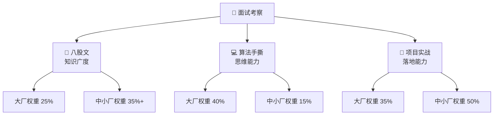
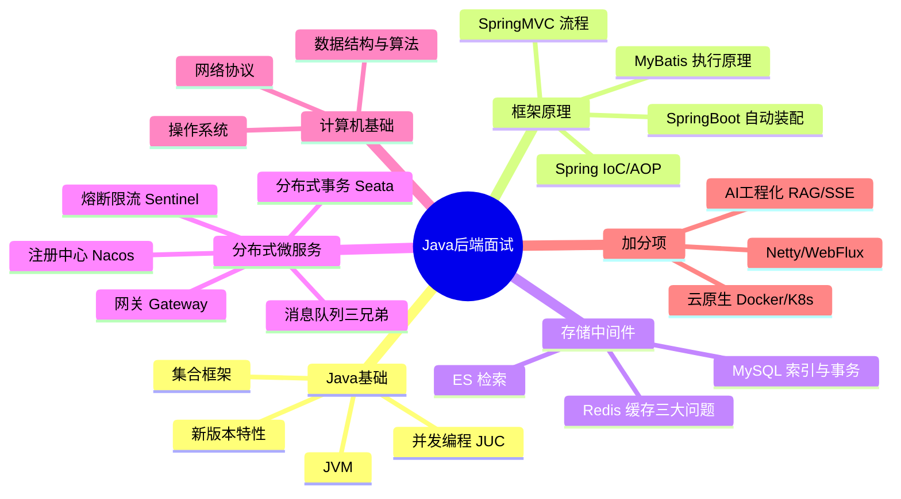
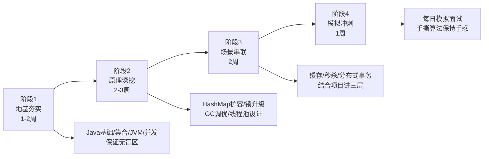
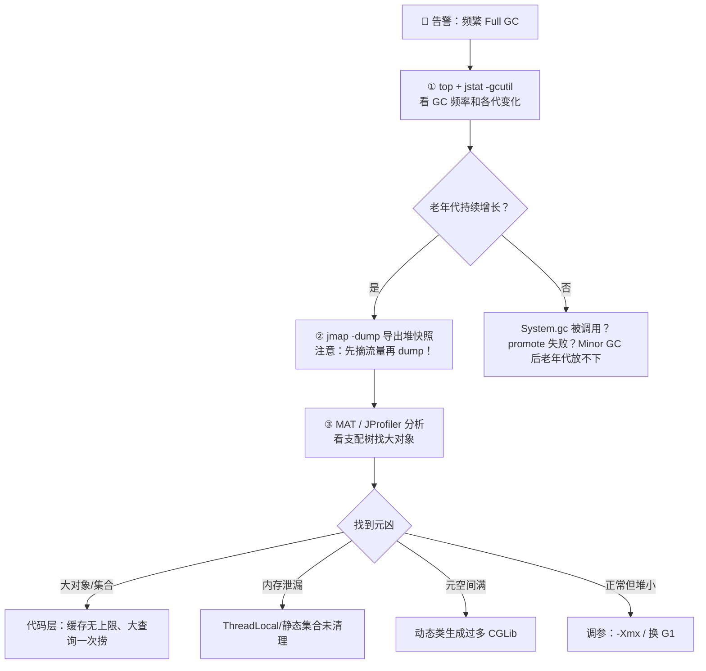
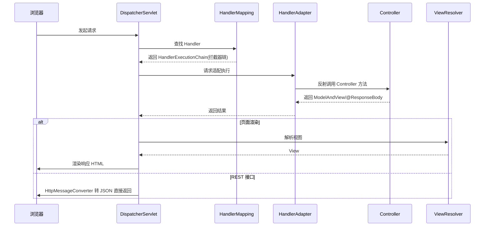
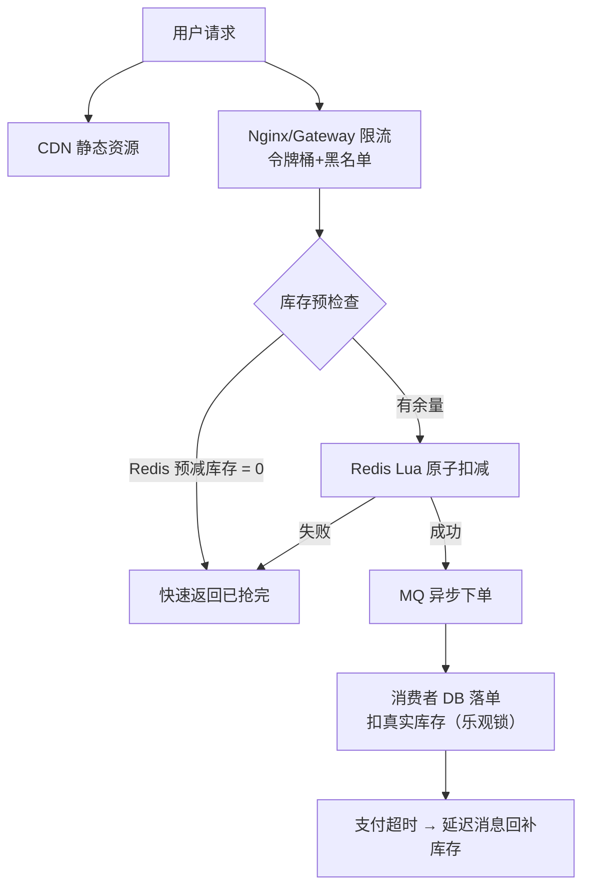
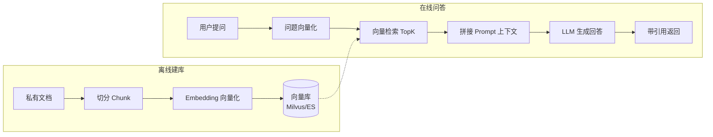

# 🎯 2026 Java 后端面试全攻略 + 高频面试题大全

> 📅 整理时间：2026-10 | 🎀 为「技术栈超全的全栈选手」量身定制
> 💡 使用姿势：先看趋势和路线 → 再按模块刷题 → 每题对照「答题要点」自测，讲不出来就回去翻笔记～

***

## 一、先看大局：2026 面试趋势速览 🌊

### 1.1 市场在变，咱得跟上节奏！

| 趋势                 | 一句话解读                  | 对策                |
| ------------------ | ---------------------- | ----------------- |
| 📉 初级岗内卷严重         | 单岗投递 3000+，只会 CRUD 没出路 | 往「深度 + 复合能力」卷     |
| 📈 架构/高并发岗缺口大      | 分布式、JVM 调优人才被抢着要       | 主攻分布式 + 性能调优      |
| ☁️ 云原生成必选项         | 90% 中大厂要求 Docker/K8s   | 咱有储备，面试大胆写！       |
| 🤖 Java + AI 工程化爆火 | 62% 企业用 Java 做 AI 功能   | **咱的王炸！重点包装！**    |
| 🧵 新版 JDK 成主流      | 虚拟线程、Records、模式匹配高频考   | Java 多版本特性笔记翻出来复习 |

### 1.2 面试官的「能力验证三角」



### 1.3 答题的「三层境界」——背题只能到第一层！

| 层次     | 表现                      | 结果       |
| ------ | ----------------------- | -------- |
| 🥉 第一层 | 背出标准答案                  | 及格线，勉强过关 |
| 🥈 第二层 | 讲清「为什么这样设计 + trade-off」 | 良好，面试官点头 |
| 🥇 第三层 | 结合项目场景，说清怎么用、踩过啥坑       | 优秀，直接加分！ |

> ⚠️ 血泪教训：背 200 道题不如把 20 道讲到能接三轮追问！

***

## 二、个人优势分析：你的技术牌面 🃏

讲师翻了你的文件夹，这手牌相当能打！

### 2.1 核心王牌（简历主打）

| 技术域           | 你已掌握                                             | 面试定位        |
| ------------- | ------------------------------------------------ | ----------- |
| ☕ Java 核心     | Java / JUC / JVM / 多版本特性                         | 必考项，基础分保底   |
| 🌱 Spring 全家桶 | Spring / Boot / MVC / WebFlux / 源码               | 高频考点，源码是加分项 |
| 🗄️ 数据库       | MySQL / Redis / ES / MongoDB / PG                | 必考项，场景题重灾区  |
| 🏗️ 微服务       | SpringCloud / Nacos / Sentinel / Seata / Gateway | 中高级岗位核心考察   |
| 📨 消息队列       | RocketMQ / Kafka / RabbitMQ 三修                   | 对比题随便问，咱不怕！ |

### 2.2 差异化杀器（拉开差距就靠它）

| 杀器                | 杀伤力           | 使用建议                                           |
| ----------------- | ------------- | ---------------------------------------------- |
| 🤖 AI + Java      | ⭐⭐⭐⭐⭐ 2026 最火 | SpringAI / LangChain4j / RAG / SSE 流式，直接写进项目亮点 |
| ⚡ Netty / WebFlux | ⭐⭐⭐⭐          | 响应式 + 高性能通信，架构面加分                              |
| 🐳 云原生            | ⭐⭐⭐⭐          | Docker / K8s / Prometheus，运维意识拉满               |
| 🔍 可观测性           | ⭐⭐⭐           | SkyWalking / ELK / Arthas，线上问题排查能力             |

### 2.3 面试知识版图（你的文件夹 → 考点映射）



***

## 三、备战路线图：分四步走 🗺️



### 每日打卡清单 ✅

| 时间段   | 任务                    | 时长   |
| ----- | --------------------- | ---- |
| 🌅 上午 | 1 个模块的面试题 + 回顾对应笔记    | 2h   |
| 🌞 下午 | 算法题 2 道（链表/DP/双指针轮着来） | 1.5h |
| 🌆 晚上 | 项目复盘：把今天学的知识点「嫁接」到项目里 | 1h   |
| 🌙 睡前 | 过一遍当天错的题（大脑记忆黄金期！）    | 0.5h |

***

## 四、高频面试题大全 📝

> 🌟🌟🌟 必考压轴 | 🌟🌟 高频 | 🌟 加分项
> 每题附「💡 答题要点」，先自己答一遍再对照哦～

***

### 模块 1：Java 基础（一面开门题）☕

**1.1** **`==`** **和** **`equals`** **的区别？🌟🌟🌟**

- 💡 `==` 比较基本类型值 / 引用类型地址；`equals` 默认同 `==`，重写后比内容
- 🔥 追问：重写 equals 为什么必须重写 hashCode？→ 哈希集合先比 hash 再比 equals，不重写会导致存取异常
- 🎯 项目层：Integer 缓存池 -128\~127 导致 `==` 翻车的坑

**1.2 String 为什么设计成不可变？🌟🌟🌟**

- 💡 线程安全、字符串常量池复用、hashCode 缓存、安全性（防路径/URL 篡改）
- 🔥 追问：String / StringBuilder / StringBuffer 怎么选？→ 不可变 / 单线程拼接 / 多线程拼接

**1.3 接口和抽象类的区别？什么场景用哪个？🌟🌟**

- 💡 接口是「能做什么」（行为契约，可多实现），抽象类是「是什么」（模板复用，单继承）
- 🎯 场景层：模板方法模式用抽象类（如 JUC 的 AQS），能力扩展用接口（如 Comparable）

**1.4 JDK 8 / 17 / 21 各有什么核心特性？🌟🌟🌟（2026 高频）**

- 💡 JDK8：Lambda / Stream / Optional / 新时间 API；JDK17：Records / 密封类 / 模式匹配（ LTS ）；JDK21：**虚拟线程** / 结构化并发
- 🔥 追问：虚拟线程和平台线程区别？→ 见模块 3

**1.5 深拷贝和浅拷贝？怎么实现深拷贝？🌟**

- 💡 浅拷贝复制引用，深拷贝递归复制全部；实现：重写 clone() 逐层克隆、序列化反序列化、JSON 往返

**1.6 异常体系：Error / Exception / 受检异常？🌟**

- 💡 Throwable → Error（不该抓）+ Exception；受检异常强制处理，非受检（RuntimeException）不强制
- 🎯 场景层：全局异常处理器 `@RestControllerAdvice` 怎么设计的

**1.7 反射的原理和应用？性能问题怎么优化？🌟**

- 💡 运行时获取类信息、调用方法；应用：Spring IoC、MyBatis、动态代理
- 🔥 优化：缓存 Method/Field 对象、MethodHandle、LambdaMetafactory

***

### 模块 2：集合框架（HashMap 是永远的神）📦

**2.1 HashMap 的底层结构？put 的完整流程？🌟🌟🌟**

- 💡 JDK8：数组 + 链表 + 红黑树；put 流程：hash → 定位桶 → 冲突则链表尾插/树化 → 超容量的 0.75 倍扩容 2 倍
- 🔥 树化条件：链表长度 ≥ 8 且数组长度 ≥ 64；退化阈值 6
- 🔥 扰动函数：`(h = key.hashCode()) ^ (h >>> 16)` 让高位参与运算，减少冲突

**2.2 JDK 1.7 和 1.8 的 HashMap 区别？为什么 1.7 头插会死循环？🌟🌟🌟**

- 💡 1.7 头插法在并发扩容时形成环形链表 → get 死循环；1.8 改尾插解决
- 🔥 追问：那 1.8 线程安全了吗？→ 没有！并发 put 仍会丢数据，要用 ConcurrentHashMap

**2.3 ConcurrentHashMap 怎么保证线程安全？1.7 vs 1.8？🌟🌟🌟**

- 💡 1.7：Segment 分段锁；1.8：CAS + synchronized 锁单个桶头节点，粒度更细
- 🔥 追问：get 为什么不加锁？→ Node 的 val 和 next 用 volatile 修饰保证可见性
- 🔥 size 怎么算？→ baseCount + CounterCell 分散计数（类似 LongAdder 思想）

**2.4 ArrayList vs LinkedList？线程安全的 List 用哪个？🌟🌟**

- 💡 ArrayList 数组随机访问 O(1)，LinkedList 双向链表增删快（但要先找到位置！）
- 💡 线程安全：CopyOnWriteArrayList（读多写少，写时复制）/ Collections.synchronizedList

**2.5 HashMap、LinkedHashMap、TreeMap 怎么选？🌟🌟**

- 💡 无序查找快选 HashMap；要保持插入序/实现 LRU 选 LinkedHashMap（accessOrder=true）；要排序选 TreeMap（红黑树）

**2.6 fail-fast 和 fail-safe？🌟**

- 💡 fail-fast：遍历时被修改抛 ConcurrentModificationException（modCount 检测）；fail-safe：COW 家族遍历副本，不抛异常但读到的可能是旧数据

***

### 模块 3：并发编程 JUC（区分初中高级的分水岭）⚡

**3.1 线程池七大参数？为什么禁止用 Executors？🌟🌟🌟**

- 💡 corePoolSize / maximumPoolSize / keepAliveTime / unit / workQueue / threadFactory / handler
- 💡 Executors 的坑：newFixedThreadPool 用无界队列易 OOM，newCachedThreadPool 最大线程 Integer.MAX\_VALUE 易打爆
- 🔥 手写要会：

```java
new ThreadPoolExecutor(10, 20, 60L, TimeUnit.SECONDS,
        new ArrayBlockingQueue<>(1000),
        new ThreadFactoryBuilder().setNamePrefix("biz-pool-").build(),
        new ThreadPoolExecutor.CallerRunsPolicy());
```

- 🔥 追问：任务提交后的执行顺序？→ 核心线程 → 队列 → 非核心线程 → 拒绝策略
- 🎯 场景层：IO 密集型线程数怎么定？→ 线程数 ≈ 核数 × (1 + 平均等待时间/计算时间)

**3.2 synchronized 锁升级过程？🌟🌟🌟**

- 💡 无锁 → 偏向锁（单线程重入，只记线程 ID）→ 轻量级锁（CAS 自旋）→ 重量级锁（Monitor，涉及内核态）
- 🔥 追问：JDK15 为什么废弃偏向锁？→ 维护成本高、现代应用竞争场景多，收益变小
- 🔥 追问：synchronized 和 ReentrantLock 区别？→ 一个 JVM 层自动释放/一个 API 层手动释放+可中断+可超时+公平锁+多条件变量

**3.3 volatile 的作用？能保证原子性吗？🌟🌟🌟**

- 💡 保证可见性（MESI 缓存一致性）+ 禁止指令重排（内存屏障）；**不保证原子性**！
- 🔥 经典案例：双重检查锁单例为什么要 volatile？→ 防止 new 对象时「分配内存→初始化→赋值引用」重排导致别的线程拿到半成品对象

**3.4 CAS 是什么？ABA 问题怎么解决？🌟🌟**

- 💡 CompareAndSwap，CPU 原子指令；ABA：值 A→B→A 中间变化无感知
- 🔥 解决：AtomicStampedReference 带版本号 / AtomicMarkableReference 带布尔标记
- 🔥 追问：CAS 的其他缺点？→ 自旋开销（长时间失败 CPU 空转）+ 只能保证单变量

**3.5 AQS 原理？ReentrantLock 怎么基于它实现？🌟🌟🌟**

- 💡 核心：volatile int state + CLH 双向队列 + 独占/共享模式
- 🔥 加锁流程：CAS 改 state → 失败入队 park → 前驱释放 unpark 唤醒
- 🔥 追问：公平锁和非公平锁？→ 非公平先 CAS 抢一把再排队，吞吐高但可能饥饿
- 🔥 追问：还有谁基于 AQS？→ Semaphore（共享 state）、CountDownLatch、ReentrantReadWriteLock（state 高 16 位读低 16 位写）

**3.6 ThreadLocal 原理？为什么会内存泄漏？🌟🌟🌟**

- 💡 每个 Thread 持有 ThreadLocalMap，key 是 ThreadLocal 弱引用，value 是强引用
- 🔥 泄漏机制：ThreadLocal 被回收后 key 变 null，但 value 还被链着 → 用完必须 remove()
- 🎯 场景层：线程池复用线程 + ThreadLocal 不清理 = 用户 A 看到用户 B 的数据！（经典事故题）
- 🔥 追问：为什么 key 设计成弱引用？→ 至少让 ThreadLocal 对象本身能被回收，减少泄漏面

**3.7 虚拟线程是什么？和平台线程的区别？🌟🌟🌟（2026 爆款考题）**

- 💡 JDK21 轻量级线程，JVM 调度，阻塞时自动 unmount，由几百字节载体线程承载
- 💡 对比表：

| 维度   | 平台线程     | 虚拟线程              |
| ---- | -------- | ----------------- |
| 内存开销 | \~1MB 栈  | 几百字节              |
| 数量级  | 数百       | 数百万               |
| 阻塞代价 | 阻塞 OS 线程 | 自动让出载体线程          |
| 适用场景 | CPU 密集   | **IO 密集（调接口/查库）** |

```java
// 用法超简单，代码还是同步写法！
try (var executor = Executors.newVirtualThreadPerTaskExecutor()) {
    IntStream.range(0, 100_000).forEach(i ->
        executor.submit(() -> { /* 调用远程接口 */ return i; }));
}
```

- 🔥 追问：虚拟线程的坑？→ 不要池化（用完即弃）、synchronized 长阻塞会 pin 住载体线程（JDK24 已优化）、ThreadLocal 大对象慎用

**3.8 CountDownLatch、CyclicBarrier、Semaphore 区别？🌟🌟**

- 💡 倒计时门闩（一次性，等 N 个任务完成）/ 循环栅栏（可重置，互相等）/ 信号量（限流，控制并发数）

**3.9 CompletableFuture 怎么用？为什么异步首选它？🌟🌟**

- 💡 thenApply / thenCompose / allOf / exceptionally / orTimeout
- 🔥 优势：任务编排（串并行组合）、回调避免阻塞、异常传播链式处理
- 🎯 场景层：并行调 3 个下游接口聚合结果，超时降级 —— 完美案例

***

### 模块 4：JVM（面试深度的照妖镜）🔍

**4.1 JVM 运行时数据区？哪些线程共享？🌟🌟🌟**

- 💡 共享：堆、方法区（元空间）；私有：虚拟机栈、本地方法栈、程序计数器
- 🔥 追问：JDK8 为什么用元空间替换永久代？→ 永久代大小固定易 OOM，元空间用本地内存，字符串常量池也早挪到堆了

**4.2 对象创建的完整过程？🌟🌟**

- 💡 类加载检查 → 分配内存（指针碰撞/空闲列表）→ 零值初始化 → 设置对象头 → `<init>` 构造
- 🔥 对象内存布局：对象头（Mark Word + 类型指针）+ 实例数据 + 对齐填充

**4.3 GC 算法和常见垃圾收集器？G1 和 ZGC 的区别？🌟🌟🌟**

- 💡 算法：标记-清除（碎片）、标记-复制（新生代）、标记-整理（老年代）、分代收集
- 💡 演进：Serial → Parallel → CMS → **G1** → **ZGC**

| 维度        | G1                          | ZGC                   |
| --------- | --------------------------- | --------------------- |
| 目标        | 可预测停顿（-XX:MaxGCPauseMillis） | 亚毫秒级停顿                |
| 堆\_region | Region 分 region             | Region + 着色指针 + 读屏障   |
| 停顿时间      | \~200ms                     | <1ms（JDK21 分代 ZGC 更强） |
| 适用堆       | 几十 GB                       | TB 级超大堆低延迟            |

**4.4 怎么判断对象可以回收？🌟🌟🌟**

- 💡 引用计数（循环引用缺陷）→ 可达性分析（GC Roots：栈帧局部变量、静态变量、常量、JNI 引用等）
- 🔥 四种引用：强 > 软（内存不足回收）> 弱（下次 GC 必收）> 虚（跟踪回收，配合队列）

**4.5 类加载过程和双亲委派模型？为什么要设计双亲委派？🌟🌟🌟**

- 💡 加载 → 验证 → 准备 → 解析 → 初始化
- 💡 双亲委派：子加载器先委托父加载器，父无法加载才自己来 → 防止核心类被篡改（安全）+ 避免重复加载
- 🔥 追问：怎么打破？→ 重写 loadClass()（SPI、JDBC 驱动、Tomcat 隔离都有打破场景）

**4.6 线上频繁 Full GC 怎么排查？🌟🌟🌟（必考场景题）**

- 💡 排查路线图：



- 🔥 神器安利：Arthas 在线诊断（dashboard / heapdump / profiler 火焰图）—— 咱运维文件夹里学过，大胆说！

**4.7 JVM 调优做过吗？说说思路 🌟🌟**

- 💡 原则：先监控后调优，大多数场景默认参数 + G1 就够
- 💡 常见手段：合理堆大小比例、选择合适收集器、MaxGCPauseMillis 控停顿、大对象阈值 -XX:PretenureSizeThreshold
- 🎯 加分话术：「我处理过一次缓存大对象导致的 Full GC，用 MAT 定位到本地缓存无淘汰策略，改用 Caffeine 的 W-TinyLFU 后 GC 频率降了 90%」

***

### 模块 5：Spring 全家桶（框架必考区）🌱

**5.1 IoC 是什么？好处是什么？🌟🌟🌟**

- 💡 控制反转：对象创建和依赖管理交给容器，DI 是实现方式
- 💡 好处：解耦、易测试（注入 mock）、生命周期统一管理
- 🔥 Bean 生命周期（简版）：实例化 → 属性填充 → Aware 回调 → BeanPostProcessor 前置 → 初始化（@PostConstruct）→ 后置处理 → 使用 → 销毁（@PreDestroy）

**5.2 Spring 怎么解决循环依赖？三级缓存原理？🌟🌟🌟**

- 💡 三级缓存：singletonObjects（成品）/ earlySingletonObjects（半成品）/ singletonFactories（工厂，可生成早期引用或代理）
- 💡 流程：A 创建中暴露工厂 → 注入 B 时 B 拿到 A 的早期引用 → B 完成 → A 继续
- 🔥 追问一：为什么要第三级？不是二级就够？→ 为了 AOP：代理对象延迟到真正被循环依赖时才生成，保证正常流程代理只创建一次
- 🔥 追问二：什么情况解决不了？→ 构造器循环依赖、prototype 作用域、@Async 代理过早暴露

**5.3 AOP 原理？JDK 动态代理和 CGLIB 区别？🌟🌟🌟**

- 💡 面向切面：把日志/事务等横切逻辑抽出来统一织入
- 💡 JDK 代理：基于接口，反射调用；CGLIB：继承目标类，FastClass 机制避免反射（JDK17+ 需要开放模块反射权限）
- 🔥 追问：Spring 默认用哪个？→ 有接口 JDK，没接口 CGLIB；SpringBoot 2.x 起默认全 CGLIB（proxyTargetClass=true）

**5.4 Spring 事务什么时候会失效？🌟🌟🌟（高频陷阱题）**

- 💡 八大失效场景，重点记这 5 个：

| 场景                | 原因                                         |
| ----------------- | ------------------------------------------ |
| 方法非 public        | 事务基于动态代理，非 public 无法被代理增强                  |
| 同类内部调用 this.xxx() | 绕过了代理对象                                    |
| 异常被 catch 吞了      | 切面感知不到异常                                   |
| 抛出受检异常默认不回滚       | 默认只回滚 RuntimeException/Error，需 rollbackFor |
| 多线程调用             | 事务基于 ThreadLocal，跨线程失效                     |

- 🔥 解法：内部调用改为 AopContext.currentProxy() 或自注入

**5.5 SpringBoot 自动装配原理？🌟🌟🌟**
- 💡 **一句话版**：SpringBoot 启动时，把第三方 jar 包里预先写好的配置类（约定目录下的清单文件列着的）自动加载进容器，再用条件注解筛选一遍——满足条件的生效，不满足的跳过。
- 💡 打个比方：启动就像「点外卖」——各商家（Starter）提前把菜单（清单文件）放在固定位置，SpringBoot 启动时挨个翻菜单，厨房还在营业的（@ConditionalOnClass 等条件满足）就下单（注册 Bean）
- 🔥 追问细节时再展开链路：@SpringBootApplication → @EnableAutoConfiguration → @Import(AutoConfigurationImportSelector) → 读 `META-INF/spring/...AutoConfiguration.imports`（2.7 前是 spring.factories）→ @ConditionalOnXxx 过滤生效
- 🎯 加分：自己写过 Starter 吗？→ 讲自动配置类 + 条件注解 + 配置绑定，AI Starter 就是这么封装的

**5.6 SpringBoot 启动流程大致做了什么？🌟🌟**

- 💡 SpringApplication.run：环境准备 → 创建 ApplicationContext → prepareContext（注册启动类）→ refreshContext（refresh：BeanFactory 准备、执行 BeanFactoryPostProcessor、注册 BeanPostProcessor、onRefresh 创建内嵌 Web 容器、实例化单例）→ 发布就绪事件

**5.7 SpringMVC 一次请求的完整流程？🌟🌟🌟**



- 🔥 追问：@RestController 和 @Controller 区别？→ 前者 = @Controller + @ResponseBody，走消息转换器不走视图解析

**5.8 MyBatis 的执行流程？#{} 和 \${} 区别？🌟🌟🌟**

- 💡 流程：解析配置 → SqlSession → Executor → StatementHandler → ParameterHandler 设参 → 执行 → ResultSetHandler 映射
- 💡 #{} 预编译占位符（防 SQL 注入）；\${} 字符串拼接（只能用于动态表名/排序字段等白名单场景）
- 🔥 追问：Mapper 接口没有实现类为什么能执行？→ JDK 动态代理 + MapperProxy
- 🔥 追问：一级二级缓存？→ 一级 SqlSession 级默认开；二级 namespace 级（分布式下脏读风险，一般用 Redis 替代）

**5.9 MyBatis-Plus 相比 MyBatis 的增强？🌟🌟**

- 💡 内置 CRUD（BaseMapper）、条件构造器、分页插件、代码生成器、逻辑删除/乐观锁/自动填充
- 🔥 追问：分页插件原理？→ 拦截 StatementHandler，自动改写 SQL 加 LIMIT + 发 count 语句

**5.10 WebFlux 和 MVC 的区别？什么时候选 WebFlux？🌟🌟（咱有储备，加分题！）**

- 💡 MVC：Servlet 阻塞式，一请求一线程（或池）；WebFlux：Reactor 响应式，少量 EventLoop 线程 + 非阻塞 IO
- 💡 选型：IO 密集 + 高并发长连接（SSE 推流/网关聚合）选 WebFlux；CPU 密集或团队不熟响应式选 MVC + 虚拟线程更简单
- 🎯 连接 AI 场景：大模型流式输出天然适合 WebFlux/SSE —— 无缝衔接模块 12！

***

### 模块 6：MySQL（场景题重灾区）🗄️

**6.1 InnoDB 为什么用 B+ 树？不用 B 树/红黑树/哈希？🌟🌟🌟**

- 💡 vs 红黑树：B+ 树矮胖（3 层撑千万级数据），磁盘 IO 次数少
- 💡 vs B 树：非叶子节点不存数据 → 单页放更多键 → 更矮；叶子链表串联 → 范围查询丝滑
- 💡 vs 哈希：哈希不支持范围查询和排序

**6.2 聚簇索引和非聚簇索引？回表是什么？🌟🌟🌟**

- 💡 聚簇索引：叶子存整行数据（主键）；二级索引：叶子存主键值 → 查完还要回聚簇索引拿数据 = 回表
- 🔥 覆盖索引：查询列全在索引里，免回表 → `select id, name from t where name = 'x'` 建联合索引(name) 就覆盖了
- 🔥 索引下推 ICP：5.6+ 在存储引擎层先过滤联合索引后面的列，减少回表次数

**6.3 最左前缀原则？索引失效的场景？🌟🌟🌟**

- 💡 联合索引 (a,b,c)：查询条件必须从 a 开始连续才有效；(a,c) 只用到 a
- 💡 失效场景：对索引列函数/运算、隐式类型转换（字符串列传数字）、like '%xx' 前导模糊、or 连接非索引列、不满足最左前缀
- 🔥 追问：`like '%xx%'` 一定走不了索引吗？→ 不绝对，覆盖索引时可以走（免回表优势）

**6.4 事务的 ACID 怎么实现的？🌟🌟🌟**

| 特性    | 实现手段               |
| ----- | ------------------ |
| A 原子性 | undo log 回滚        |
| D 持久性 | redo log（WAL 先写日志） |
| I 隔离性 | MVCC + 锁           |
| C 一致性 | 前三者共同保障（目的）        |

**6.5 MVCC 原理？ReadView 的规则？🌟🌟🌟**

- 💡 三件套：隐藏列（trx\_id 回滚指针）+ undo log 版本链 + ReadView
- 💡 可见性判断：trx\_id < min\_id 可见；trx\_id > max\_id 不可见；在活跃列表里不可见；不在且 < max\_id 可见
- 🔥 RC 和 RR 的区别就在 ReadView 生成时机：RC 每次查询重新生成，RR 第一次查询生成后复用

**6.6 四大隔离级别和各自问题？🌟🌟🌟**

- 💡 读未提交（脏读）→ 读已提交 RC（不可重复读）→ 可重复读 RR（幻读，InnoDB 间隙锁基本解决）→ 串行化
- 🔥 MySQL 默认 RR；为什么很多大厂改 RC？→ 间隙锁少、死锁概率低、并发性能好

**6.7 锁体系：行锁、间隙锁、临键锁、意向锁？🌟🌟**

- 💡 行锁（记录锁）锁一行；间隙锁 Gap Lock 锁区间防插入；临键锁 Next-Key = 记录 + 间隙（RR 默认，解决幻读）；意向锁表级，快速判断表里有没有行锁

**6.8 一条慢 SQL 怎么优化？🌟🌟🌟（必考场景题）**

- 💡 标准流程：
  1. `慢查询日志` 定位 SQL
  2. `EXPLAIN` 看执行计划：重点看 type（至少 range）、key、rows、Extra（Using filesort / temporary 要警惕）
  3. 优化手段：加/改联合索引、覆盖索引、改写 SQL（子查询改 join、大分页改游标）、避免 select \*
  4. 仍慢 → 拆库拆表、读写分离、上缓存
- 🔥 大分页优化：`limit 1000000, 10` → 延迟关联 `id >= (select id ... limit 1000000, 1)`

**6.9 redo log、undo log、binlog 区别？两阶段提交？🌟🌟**

- 💡 redo：InnoDB 层，崩溃恢复物理日志；undo：回滚 + MVCC 逻辑日志；binlog：Server 层，主从复制/恢复的逻辑日志
- 🔥 两阶段提交：redo prepare → 写 binlog → redo commit，保证两个日志一致
- 🔥 追问：先写 redo 后写 binlog 会怎样？→ 崩溃恢复后主库有数据从库没有 → 主从不一致

***

### 模块 7：Redis（缓存三问 + 分布式锁必考）🟥

**7.1 Redis 为什么快？🌟🌟🌟**

- 💡 纯内存 + 单线程无锁竞争（6.0 前）+ IO 多路复用 epoll + 高效数据结构（SDS 动态扩容/跳表/压缩列表）
- 🔥 追问：6.0 为什么引入多线程？→ 只是网络 IO 多线程（读写 socket/协议解析），命令执行仍单线程

**7.2 缓存穿透 / 击穿 / 雪崩 区别和解法？🌟🌟🌟（必背！）**

| 问题     | 是什么                   | 解法                             |
| ------ | --------------------- | ------------------------------ |
| 🕳️ 穿透 | 查不存在的数据，缓存永不命中打穿到 DB  | 缓存空值（短 TTL）/ 布隆过滤器 / 参数校验      |
| 🎯 击穿  | 热点 key 过期瞬间大量请求打 DB   | 互斥锁重建 / 逻辑过期不删真 key / 热点永不过期   |
| ❄️ 雪崩  | 大量 key 同时过期或 Redis 宕机 | TTL 加随机值 / 高可用集群 / 限流降级 / 多级缓存 |

**7.3 Redis 和 MySQL 数据一致性怎么保证？🌟🌟🌟（高频！）**

- 💡 首选方案：**Cache Aside**：读→先缓存后 DB 回填；写→**先更新 DB 再删缓存**
- 🔥 为什么是删缓存不是更新缓存？→ 避免并发写覆盖 + 懒加载按需计算
- 🔥 为什么先 DB 后删缓存？→ 反过来的话删缓存后、写 DB 前被读请求回填旧值
- 🔥 延迟双删 + binlog 订阅（Canal）异步删除保证最终一致
- 🔥 强一致就要分布式锁串行化，但性能代价大 → 一般接受最终一致

**7.4 分布式锁怎么实现？Redisson 的看门狗？🌟🌟🌟**

```java
RLock lock = redissonClient.getLock("order:lock:" + orderId);
try {
    // 看门狗默认 30s，每 10s 自动续期
    if (lock.tryLock(3, TimeUnit.SECONDS)) {
        // 业务
    }
} finally {
    lock.unlock(); // 一定要放 finally！
}
```

- 💡 手写 SETNX 的问题：忘过期/过期误删他人锁（Lua 脚本比对 value）/ 业务没执行完锁过期 → Redisson watchdog 续期 + 可重入（Hash 结构）全解决
- 🔥 追问：主从切换锁丢失？→ RedLock 争议方案（多数派加锁）；更稳 → etcd/ZooKeeper，或业务幂等兜底

**7.5 Redis 持久化 RDB vs AOF？🌟🌟**

- 💡 RDB：定时快照，文件小恢复快，可能丢最后一次快照后的数据；AOF：追加写命令，appendfsync everysec 折中，4.0 后混合持久化（RDB 头 + AOF 增量）两全其美

**7.6 Redis 过期删除和内存淘汰策略？🌟🌟**

- 💡 删除：惰性删除 + 定期抽样删除；淘汰：8 种策略，重点 noeviction（默认，写报错）、allkeys-lru、volatile-lru、allkeys-lfu（4.0+）
- 🔥 追问：Redis 的 LRU 和标准 LRU 区别？→ 近似 LRU（随机采样淘汰池），省内存；LFU 用 Morris 计数器衰减

**7.7 缓存热点 key 怎么发现和处理？🌟🌟**

- 💡 发现：客户端统计 / monitor 命令 / 代理层统计；处理：本地缓存兜底（Caffeine 多级缓存）、key 打散多副本、读写分离

**7.8 大 key / 热 key 的危害和处理？🌟**

- 💡 大 key（value 超大或元素过多）：删除阻塞（UNLINK 异步删）、拆分（hash 分桶）、压缩
- 💡 热 key：见 7.7

**7.9 Redis 集群方案对比？🌟🌟**

- 💡 主从（读写分离，故障需人工）/ 哨兵（自动故障转移）/ Cluster（16384 槽分片 + 多主多从，去中心化）
- 🔥 追问：为什么是 16384 个槽？→ CRC16 & 16383；心跳包带槽信息，槽多了心跳太重

***

### 模块 8：消息队列（三修玩家的优势局）📨

**8.1 为什么要用 MQ？带来什么问题？🌟🌟🌟**

- 💡 三大作用：**异步**（注册后发短信异步化提速）、**削峰**（秒杀请求先进队列）、**解耦**（订单系统不依赖下游细节）
- 💡 代价：系统复杂度↑、可用性依赖↑、**一致性问题**（消息丢失/重复）

**8.2 怎么保证消息不丢失？🌟🌟🌟（必考！）**


- 🔥 追问：Kafka 怎么配？→ acks=all + min.insync.replicas≥2 + retries + 关闭自动提交 offset

**8.3 怎么保证消息不重复消费（幂等性）？🌟🌟🌟**

- 💡 重复不可避免（重试机制必然带来），只能消费端幂等：
  - 唯一业务 ID + 数据库唯一索引
  - Redis setnx 记录已处理消息 ID
  - 状态机（订单状态只能单向流转）

**8.4 怎么保证消息顺序？🌟🌟**

- 💡 局部顺序即可：同一业务 key（同一订单）发到同一分区/队列（MessageQueueSelector / 相同 routing key）
- 🔥 追问：RocketMQ 乱序场景？→ 队列内正常是顺序的；消费端多线程/重平衡会乱 → MessageListenerOrderly 单线程消费

**8.5 大量消息积压怎么处理？🌟🌟🌟（线上事故题）**

- 💡 排查：消费能力不足 or 消费卡死（死循环/下游慢）
- 💡 应急：扩容消费者（分区/队列数 ≥ 消费者数，不够先扩队列）、临时转储新 topic 分片并行消费、跳过可丢弃的过期消息、修复 bug 后灰度放量
- 💡 长期：监控告警（积压量阈值）、消费者压测、水平扩容预案

**8.6 RocketMQ / Kafka / RabbitMQ 怎么选？🌟🌟（三修优势题！）**

| 维度      | RocketMQ         | Kafka            | RabbitMQ       |
| ------- | ---------------- | ---------------- | -------------- |
| 吞吐      | 十万级              | **百万级**          | 万级             |
| 延迟      | ms 级             | ms 级（批量化）        | **μs\~ms 级最低** |
| 功能      | 事务消息/延迟消息/重试死信齐全 | 较朴素（流处理生态强）      | 路由灵活           |
| 场景      | **电商业务首选**       | 日志/大数据管道         | 传统企业/复杂路由      |
| 2026 趋势 | 业务消息中间件主流        | KRaft 去 ZK 化、流处理 | 逐渐被前两者替代       |

- 🔥 追问：RocketMQ 事务消息原理？→ 半消息 + 本地事务 + 回查机制，保证「本地事务和发消息」的原子性

**8.7 延迟消息怎么实现？🌟🌟**

- 💡 RocketMQ 4.x 定时等级（18 级）/ 5.x 任意时间；Kafka 原生不支持 → 变通：时间轮（Netty HashedWheelTimer）/ 延迟 topic 轮询
- 🎯 场景：订单 30 分钟未支付自动取消

***

### 模块 9：微服务与分布式（中高级必考）🏗️

**9.1 微服务拆分的原则？拆太细的坏处？🌟🌟**

- 💡 按 DDD 限界上下文/业务能力拆；坏处：分布式复杂度、链路长、运维成本爆炸 → 「足够小但不过度」
- 🔥 单体 → 微服务的演进理由：独立部署、团队自治、故障隔离、技术异构

**9.2 Nacos 注册中心原理？AP 还是 CP？🌟🌟**

- 💡 服务注册：客户端启动注册实例，心跳续约（临时实例 5s 一次，15s 未收到标记不健康，30s 剔除）
- 💡 服务发现：客户端定时拉取 + UDP 推送变更
- 🔥 AP/CP：临时实例走 Distro 协议（AP，最终一致）；持久实例走 Raft（CP）→ 智能双模

**9.3 Nacos 配置热更新原理？🌟**

- 💡 客户端长轮询（30s 超时的 hold 请求）→ 配置变更立即响应 → 客户端拉新配置回调 @RefreshScope

**9.4 Sentinel 怎么实现限流熔断？和 Hystrix 区别？🌟🌟**

- 💡 限流：QPS/并发线程数 + 流控效果（快速失败/Warm Up 预热/排队等待匀速）；熔断：慢调用比例/异常比例/异常数，半开探测恢复
- 💡 原理：滑动窗口统计 + 责任链 Slot（NodeSelector → ClusterBuilder → 统计 → 流控 → 系统保护）
- 🔥 vs Hystrix：Hystrix 线程池隔离（重、已停更），Sentinel 信号量+并发线程数（轻）、规则动态数据源、控制台实时推送

**9.5 常见限流算法对比？🌟🌟**

| 算法   | 特点          | 问题                            |
| ---- | ----------- | ----------------------------- |
| 计数器  | 简单          | 临界突刺（窗口边界 2 倍流量）              |
| 滑动窗口 | 平滑统计        | 实现稍复杂（Sentinel 用的）            |
| 漏桶   | 恒定速率流出，绝对平滑 | 无法应对突发                        |
| 令牌桶  | 匀速发牌允许突发    | Guava RateLimiter / Redis+Lua |

- 🎯 分布式限流：Redis + Lua 令牌桶，网关层 Sentinel-Gateway

**9.6 分布式事务方案对比？Seata 的 AT 模式原理？🌟🌟🌟**

- 💡 2PC/XA：强一致但同步阻塞、性能差；TCC：Try-Confirm-Cancel 业务侵入大但性能好；SAGA：长事务编排，补偿逆向操作；本地消息表/事务消息：最终一致，最常用！

| 方案       | 一致性 | 侵入性 | 性能 | 场景      |
| -------- | --- | --- | -- | ------- |
| XA/2PC   | 强   | 低   | 差  | 传统金融强一致 |
| TCC      | 强   | 高   | 好  | 资金类核心链路 |
| Seata AT | 最终  | 极低  | 中  | 通用快速接入  |
| 事务消息     | 最终  | 中   | 好  | 异步解耦场景  |

- 🔥 Seata AT 原理：一阶段业务 SQL + 记录 undo\_log（前后镜像）+ 行锁，二阶段成功删日志、失败反向补偿；TC 协调全局锁防脏写

**9.7 CAP 和 BASE 理论？🌟🌟**

- 💡 CAP 三选二（网络分区 P 必选，实际是 CP vs AP 的取舍）；BASE = 基本可用 + 软状态 + 最终一致，是 AP 的工程实践
- 🎯 举例：ZooKeeper CP（选举期间不可用）、Eureka AP（自我保护宁返回旧的）、Nacos 双模可切

**9.8 分布式 ID 方案对比？🌟🌟**

- 💡 UUID（无序，页分裂）、数据库号段（简单但有瓶颈）、**雪花算法 Snowflake**（时间戳+机器ID+序列号，趋势递增）、Leaf/UidGenerator（号段+雪花优化）
- 🔥 追问：时钟回拨问题？→ 等待/扩展位记录回拨次数/美团 Leaf-segment

**9.9 Gateway 网关的作用和核心概念？🌟**

- 💡 统一入口：路由断言 Route + Predicate + Filter（全局过滤器做鉴权/限流/日志）
- 🔥 追问：网关怎么做的统一鉴权？→ GlobalFilter + JWT 校验，白名单放行，透传用户信息到下游（header 清洗防伪造）

**9.10 服务雪崩是什么？怎么防？🌟🌟**

- 💡 下游慢 → 上游线程堆积 → 级联崩溃；三板斧：**限流**（Sentinel）+ **熔断降级**（快速失败返回兜底）+ **隔离**（线程池/信号量）+ 超时与重试（幂等前提）

***

### 模块 10：计算机网络 + 操作系统（基础广度题）🌐

**10.1 TCP 三次握手 / 四次挥手，为什么是三次/四次？🌟🌟🌟**

- 💡 三次：双方确认收发能力 + 同步初始序列号防历史重复连接；两次会让失效连接请求误建连
- 💡 四次：半关闭，被动方可能还有数据要发，ACK 和 FIN 分开发

**10.2 TCP 和 UDP 区别？各自场景？🌟🌟**

- 💡 TCP 面向连接/可靠/字节流/拥塞控制；UDP 无连接/不可靠/数据报/轻量
- 🎯 UDP 场景：实时音视频、DNS、游戏；QUIC（HTTP/3）基于 UDP 在用户态重建可靠性 → 2026 新宠考点！

**10.3 HTTP 1.1 / 2.0 / 3.0 演进？🌟🌟（2026 高频新增）**

| 版本  | 核心改进                     | 遗留问题            |
| --- | ------------------------ | --------------- |
| 1.1 | 长连接、管道化                  | 队头阻塞（应用层）       |
| 2.0 | 二进制分帧、多路复用、头部压缩          | TCP 队头阻塞（传输层）仍在 |
| 3.0 | **QUIC（UDP）**、0-RTT、连接迁移 | 部署普及中           |

**10.4 HTTPS 握手流程？TLS1.3 优化了什么？🌟🌟**

- 💡 TCP → TLS 握手：证书验证（CA 链）→ 非对称协商对称密钥 → 对称加密通信
- 🔥 TLS1.3：握手 2-RTT → 1-RTT，恢复连接 0-RTT，删掉不安全套件

**10.5 从浏览器输入 URL 到页面展示，发生了什么？🌟🌟🌟**

- 💡 DNS 解析 → TCP/TLS 建连 → HTTP 请求 → 服务端处理（负载均衡→网关→微服务）→ 响应渲染
- 🔥 每一步都能被追问：DNS 递归迭代查询、CDN 命中、Nginx 反代、浏览器解析渲染管线

**10.6 进程 / 线程 / 协程区别？🌟🌟**

- 💡 进程资源分配单位（独立地址空间，IPC 通信）；线程调度单位（共享进程资源）；协程用户态调度（Go goroutine / Java 虚拟线程）
- 🔥 通信方式：管道/消息队列/共享内存/信号量/socket；死锁四条件：互斥、持有等待、不可剥夺、循环等待

**10.7 IO 多路复用：select / poll / epoll？🌟🌟**

- 💡 select：fd 数量限制 1024，每次全量拷贝遍历；poll：链表无上限但仍遍历；**epoll**：红黑树管理 + 就绪链表回调，O(1) 取就绪事件
- 🎯 关联：Redis 单线程高效、Netty 的 NioEventLoop、Nginx 都靠 epoll —— 串起来讲超加分！

**10.8 零拷贝是什么？🌟🌟**

- 💡 传统读文件发送：4 次拷贝 4 次上下文切换；零拷贝：mmap（减少一次）或 sendfile（DMA 直接到网卡，Kafka 高吞吐的核心之一）；Netty 的 CompositeByteBuf / FileRegion

***

### 模块 11：系统设计与场景题（二面三面杀手锏）🚀

**11.1 设计一个秒杀系统？🌟🌟🌟（万年必考）**



- 💡 要点口诀：**限流 → 缓存预热 → Redis 原子扣减 → MQ 削峰 → 异步落库 → 库存回补**；防超卖靠 Lua/乐观锁，防黄牛靠答题/风控

**11.2 Redis + DB 的多级缓存架构怎么设计？🌟🌟**

- 💡 请求链：本地缓存 Caffeine（毫秒级，进程内）→ Redis（网络级）→ DB；一致性用 MQ/binlog 异步失效 + 短 TTL 兜底
- 🔥 咱有 Caffeine 笔记，能讲 W-TinyLFU 淘汰算法 → 直接上第二层！

**11.3 接口幂等性怎么设计？🌟🌟🌟**

- 💡 天然幂等：查询/删除；写操作方案：唯一索引、token 机制（先取 token 提交带 token）、悲观/乐观锁、状态机、分布式锁
- 🎯 场景：支付回调可能重复通知 → 状态机 + 唯一流水号

**11.4 如何设计一个短链系统？🌟🌟**

- 💡 发号器（雪花/号段）→ 62 进制编码 → Redis 缓存映射 → 301/302 跳转（302 便于统计）→ 高并发读：缓存 + CDN

**11.5 订单超时未支付自动取消，方案对比？🌟🌟（咱学过 Xxl-job，优势题）**

| 方案                  | 优缺点             |
| ------------------- | --------------- |
| 定时任务扫表（Xxl-job）     | 简单可靠；但有延迟、扫全表压力 |
| JDK 延迟队列 DelayQueue | 简单；单机内存态，重启丢失   |
| Redis 过期监听          | 不保证准时、可能丢消息     |
| **RocketMQ 延迟消息**   | 精准、可靠、天然解耦（推荐）  |
| Redis ZSet 时间轮轮询    | 高性能；需自研调度逻辑     |

**11.6 海量数据场景：10 亿数据怎么快速查找/去重/统计？🌟🌟**

- 💡 布隆过滤器（判存在，有误判率）；HyperLogLog（UV 基数统计，12KB 搞定亿级）；位图（签到/在线状态）；分库分表（range/hash，分片键选择避免数据倾斜）；ES 倒排索引（多维检索）

**11.7 读写分离和分库分表怎么做？🌟🌟**

- 💡 主写从读 + 主从延迟处理（强制走主/半同步）；垂直分库（按业务）+ 水平分表（按分片键）
- 🔥 分表后的问题：分布式 ID、跨分片 join/事务（业务避免）、扩容迁移（双写迁移/一致性哈希）

**11.8 接口性能优化思路？🌟🌟**

- 💡 全链路排查：日志/SkyWalking 链路追踪定位瓶颈 → 常见手段：加缓存、SQL 优化、并行调用（CompletableFuture）、异步化（MQ/线程池）、批量处理、池化复用（连接池调优）

**11.9 线上 OOM / CPU 飙高怎么排查？🌟🌟（工程感体现题）**

- 💡 CPU 高：`top` 找进程 → `top -Hp` 找线程 → `printf '%x'` 转十六进制 → `jstack` 抓栈（Arthas `thread -n 3` 一步到位）
- 💡 OOM：`jmap -dump` → MAT 分析支配树 → 定位大对象来源 → 代码修复或参数调整
- 🎯 话术：「我用 Arthas 的 dashboard/thread/profiler 火焰图在线定位过…」——运维文件夹的储备直接变现！

***

### 模块 12：Java + AI 工程化（2026 王炸加分项）🤖💥

> 💖 咱有 LLM / RAG / SpringAI / LangChain4j 的完整储备，这部分就是和其他候选人拉开差距的主场！大胆往项目里写！

**12.1 Java 后端怎么对接大模型？🌟🌟🌟（2026 一面必问）**

- 💡 HTTP 调用模型 API（DeepSeek/通义/OpenAI 兼容协议）→ 封装请求 JSON（messages/model/temperature）→ **SSE 流式接收**增量返回
- 💡 技术选型：Spring AI（企业级、模型抽象）、LangChain4j（链式编排、AI Service 声明式）、WebFlux/OkHttp 手撸

```java
// Spring AI 一行切换模型供应商，美滋滋～
@GetMapping(value = "/chat", produces = "text/event-stream")
public Flux<String> chat(@RequestParam String msg) {
    return chatModel.stream(msg); // SSE 流式打字机效果
}
```

**12.2 SSE 是什么？为什么 AI 回复都用它？🌟🌟🌟**

- 💡 Server-Sent Events：HTTP 长连接单向推送，`Content-Type: text/event-stream`，服务端逐块 write
- 🔥 vs WebSocket：SSE 单向、简单、HTTP 友好（自动重连）；WebSocket 双向复杂场景（协作编辑/游戏）才需要 —— **AI 打字机只需单向推 → SSE 完胜**
- 🔥 vs 轮询/长轮询：实时性 + 省资源

**12.3 RAG 检索增强生成的原理和流程？🌟🌟🌟（二面大厂必问）**



- 💡 解决三大痛点：**幻觉**（有据可依）、**私有数据**（不用上传公网）、**时效性**（知识库随时更新）
- 🔥 追问：检索效果差怎么优化？→ 切分策略（语义/重叠窗口）、混合检索（向量+BM25）、重排序 Rerank、查询改写

**12.4 什么是 AI 幻觉？工程上怎么缓解？🌟🌟**

- 💡 模型一本正经胡说八道；缓解：RAG 提供事实依据、Prompt 约束（要求引用来源/允许回答不知道）、温度调低、输出后校验

**12.5 多轮对话的上下文记忆怎么实现？🌟🌟**

- 💡 短期：Redis 存 session 历史消息（List/Hash + TTL + 滑动窗口截断）；长期：对话摘要压缩 + 向量化存记忆库按需召回（MemGPT 思路）

**12.6 AI 接口的稳定性保障？🌟🌟（后端工程感的体现）**

- 💡 三板斧齐上：**限流**（Sentinel 按 key/user 维度）、**超时与重试**（指数退避，幂等前提）、**降级**（模型不可用返回兜底话术/切备用模型）
- 💡 密钥安全：配置中心加密存储、网关层代转发、前端永远摸不到 API Key

**12.7 Function Calling / Agent 是什么？🌟🌟（进阶加分）**

- 💡 Function Calling：模型输出结构化「函数调用意图」→ 后端执行真实 API → 结果回传模型总结
- 💡 Agent：LLM 当大脑 + 工具 + 记忆 + 规划循环（ReAct：思考→行动→观察）→ 咱的 ReAct/Multi-Agent 笔记直接上！
- 🎯 项目话术：「我用 LangChain4j 的 AiServices 声明式定义了 AI 工具接口，模型自动路由到订单查询/库存检查等 @Tool 方法」

**12.8 微服务架构下 AI 服务怎么部署？🌟**

- 💡 独立 AI 微服务（无状态、可水平扩展）→ Nacos 注册 → Gateway 统一路由鉴权限流 → 对话上下文走 Redis → 长任务（文档解析/批量向量化）丢 MQ 异步处理
- 🔥 私有化 vs 云端 API：数据安全选私有化（要 GPU），快速验证选云端（Java 直接 HTTP 调）

***

## 五、面试当天实战技巧 🎪

### 5.1 答题万能框架：是什么 → 为什么 → 怎么用 → 踩过坑


### 5.2 高频场景应对表

| 情况       | 应对话术                                           |
| -------- | ---------------------------------------------- |
| 😵 不会的题  | 「这块我了解不深，但我猜测思路是…可以从 XX 角度分析」（展示思维 > 硬编）       |
| 🤔 被追问到底 | 别慌！追问说明前面答得好，按原理层一层层往下讲                        |
| 💼 项目没亮点 | 把 AI 功能 / 性能优化 / 排查事故嫁接进项目（提前编好 2-3 个 STAR 故事） |
| 💰 谈薪    | 报区间不报死数，强调「技术匹配度 + 即战力 + AI 复合能力」              |

### 5.3 简历项目包装模板（AI 增强版）

> 🌟 **智能客服系统**（示例）
>
> - 基于 SpringBoot + SpringCloud Alibaba 微服务架构，Nacos 注册配置中心，Gateway 统一鉴权限流
> - 集成 DeepSeek 大模型，基于 **Spring AI + RAG**（ES 向量检索）实现企业知识库问答，回答准确率提升 40%
> - **SSE 流式输出**打字机效果，CompletableFuture 并行调用，接口 P99 从 8s 降至 2s
> - Redis 缓存对话上下文实现多轮记忆，Sentinel 对 AI 接口限流降级，保障服务可用性

***

## 六、冲刺打卡表 🏁

- [ ] 模块 1-4 Java 基础 + 集合 + JUC + JVM（保命分）
- [ ] 模块 5 Spring 全家桶（必考区）
- [ ] 模块 6-7 MySQL + Redis（场景题重点）
- [ ] 模块 8 MQ（三修对比题练熟）
- [ ] 模块 9 微服务分布式（中高级分水岭）
- [ ] 模块 10 网络操作系统（广度扫盲）
- [ ] 模块 11 系统设计场景题（二面三板斧）
- [ ] 模块 12 AI 工程化（王炸！项目话术背熟）
- [ ] 算法：hot100 刷完 + 每日 2 道保持手感
- [ ] 模拟面试 3 次（对着镜子 / 找朋友 / AI 陪练）

***

> 🎀 写在最后：你的技术栈广度已经是前 5% 的水平了，现在要做的是**把广度收拢成 2-3 个能讲三层的深度点**（推荐：Redis 缓存体系 / 分布式事务 / AI 工程化），再加上**每个知识点都能连到项目**。
> 💪 面试不是考试，是聊天炫技！讲师相信你一定能拿到心仪的 offer，冲鸭～🎉

