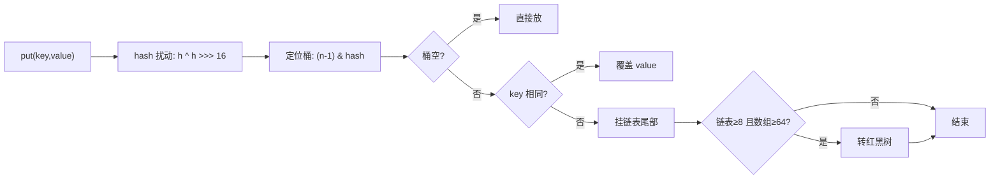
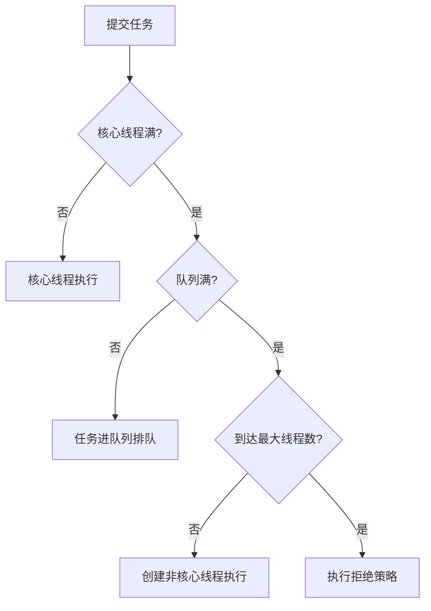
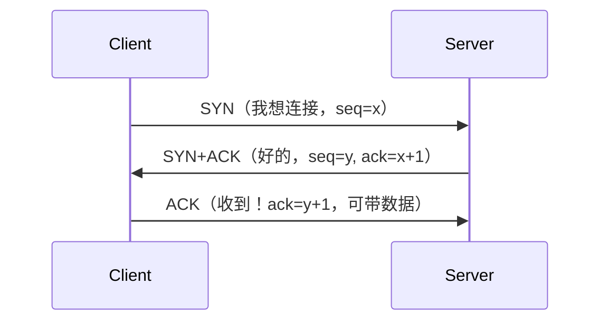
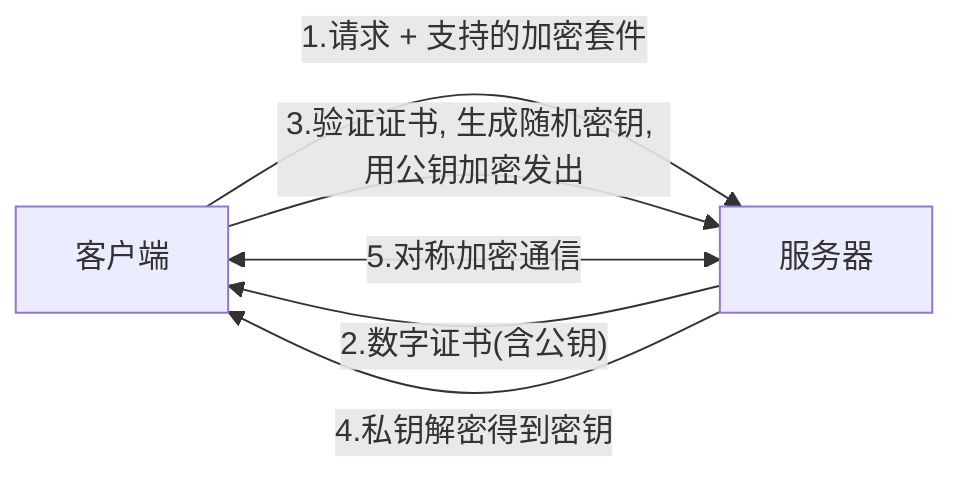
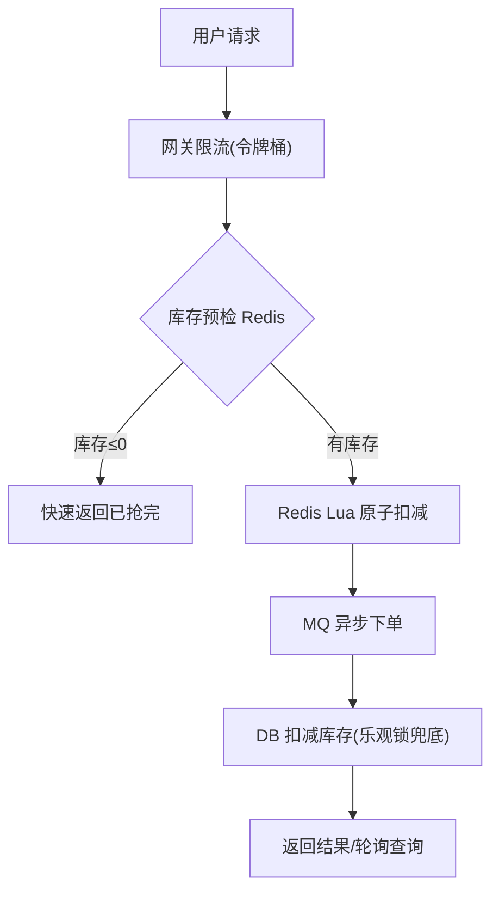

# 🎯 2026 Java 后端面试通关手册 · 第二期（记忆强化版）

> 🎀 第一期学完了？超棒！第二期换打法——**不再追求大而全，专治「记不住、说不出」**！
> 每道题 = 🗣️ 一句话人话 + 🎵 魔性口诀 + 🍜 生活类比 + 🕳️ 追问预警
> 考前一晚翻到文末「口诀速查总表」刷一遍，第二天面试稳如老狗～ 💪

---

## 📖 两期手册怎么配合用？

| 对比项 | 第一期（学习版） | 第二期（记忆版）⭐ |
|--------|----------------|------------------|
| 定位 | 系统学习、建立框架 | 考前速记、开口能说 |
| 答案风格 | 要点罗列 | 一句话 + 口诀 + 类比 |
| 新增内容 | — | 手撕代码、口诀总表、HR 面、7天冲刺表 |
| 使用时机 | 提前 2-4 周精读 | 面试前 3-7 天狂刷 |

> 💡 **答题节奏万能公式**（比第一期更好记）：
> **「先人话 → 再口诀 → 秀细节」**
> 例：HashMap 扩容？→「就是把数组变大重新装（人话），口诀是二倍扩容八转树（口诀），具体是 capacity<<1，链表长度≥8 且数组≥64 才树化（秀细节）」

---

# 模块 1：Java 基础 🎵

## 1.1 == 和 equals 的区别？
- 🗣️ **一句话**：== 比的是「是不是同一个」（地址），equals 比的是「长得像不像」（内容）。
- 🍜 **类比**：== 是问「这俩是双胞胎本人吗？」，equals 是问「这俩长得像吗？」
- 🎵 **口诀**：**「==比地址，equals比内容」**
- 🕳️ **追问**：equals 重写为什么必须重写 hashCode？→ **口诀「相等对象，哈希必等」**，否则 HashMap 里俩「相等」的对象会存两份。

## 1.2 String 为什么设计成不可变？
- 🗣️ **一句话**：字符串太常用了，做成不可变更安全、能缓存、还能共享。
- 🎵 **口诀**：**「安全、缓存、常量池」**
  - 🔒 安全：路径/URL 拼接不怕被中途改
  - ⚡ 缓存：hashCode 算一次存起来
  - 🏊 常量池：相同字符串共享一份，省内存
- 🕳️ **追问**：怎么改 String？→ 不能改！`replace` 是返回**新对象**。

## 1.3 重载 vs 重写？
- 🎵 **口诀**：**「重载同名不同参（编译期，一个类），重写同参同签名（运行期，子父类）」**

## 1.4 接口 vs 抽象类？
- 🗣️ **一句话**：抽象类是「亲爹」（is-a，只能继承一个），接口是「技能」（can-do，可以实现多个）。
- 🎵 **口诀**：**「抽象类是爹，接口是技能」**

## 1.5 异常体系？
- 🗣️ **一句话**：Throwable 分两支——Error 是「绝症」（程序救不了），Exception 是「感冒」（能治）；其中 RuntimeException 是「自己作的」（空指针、越界），编译不检查。
- 🎵 **口诀**：**「Error绝症，Exception感冒；运行时异常自己作的」**

## 1.6 JDK 8/11/17/21 核心新特性速记
- 🎵 **口诀**：**「8是分水岭（Lambda+Stream），17 Records密封类，21 虚拟线程飞起来」**

| 版本 | 必记特性 | 一句话说明 |
|------|---------|-----------|
| 8 | Lambda / Stream / 新时间API | 从「写怎么做」变「写要什么」 |
| 11 | HttpClient / var 增强 | HTTP客户端转正 |
| 17 | Records / 密封类 / 模式匹配 | Records 一行搞定实体类（写法：`record Point(int x, int y) {}`） |
| 21 | **虚拟线程** ⭐ | 创建百万线程不是梦，吞吐量起飞 |

## 1.7 虚拟线程（2026 高频新贵）⭐
- 🗣️ **一句话**：虚拟线程是由 JVM 而不是操作系统管理的「轻量线程」，阻塞时自动让出底层真线程，特别适合 IO 密集场景。
- 🍜 **类比**：平台线程是「专车」（贵、数量少），虚拟线程是「共享单车」（便宜、随取随停）。
- 🎵 **口诀**：**「IO密集用虚拟，CPU密集用平台」**
- 🕳️ **追问**：缺点？→ 不适合 CPU 密集任务；`synchronized` 长期阻塞会 pin 住载体线程（JDK24 已优化）。

---

# 模块 2：集合框架 🎵

## 2.1 HashMap 底层（万年必考）⭐⭐⭐
- 🗣️ **一句话**：数组 + 链表 + 红黑树，key 的 hash 定位桶，冲突了挂链表，链表太长转红黑树。
- 🎵 **魔性口诀**：**「八转树、六退化、六四才树化、二倍来扩容」**
  - 链表长度 ≥ **8** 且数组长度 ≥ **64** → 树化
  - 树节点 ≤ **6** → 退回链表
  - 扩容：容量和阈值都 **×2**
- 🍜 **类比**：一排储物柜（数组），柜子不够用就在柜前排队（链表），队太长就改成按序管理的部门（红黑树）。



- 🕳️ **追问 1**：为什么容量必须是 2 的 n 次方？→ **「位运算代替取模，快速又均匀」**（`(n-1) & hash` 等价于取模但更快）。
- 🕳️ **追问 2**：1.7 头插 vs 1.8 尾插？→ 头插并发扩容会成**环**（死循环），1.8 改尾插。
- 🕳️ **追问 3**：为什么阈值是 8？→ 泊松分布下链表长到 8 的概率约千万分之六，树化是**保底措施**不是常态。

## 2.2 HashMap vs Hashtable vs ConcurrentHashMap
- 🎵 **口诀**：**「HashMap快但线程不安全，Hashtable全锁慢，CHM锁桶细」**

| 对比 | HashMap | Hashtable | ConcurrentHashMap |
|------|---------|-----------|-------------------|
| 线程安全 | ❌ | ✅ 全表锁 | ✅ CAS + synchronized 锁桶头 |
| null key | ✅ 允许1个 | ❌ | ❌ |
| 性能 | 最快 | 最慢 | 并发下最优 |

## 2.3 ConcurrentHashMap 1.8 怎么保证线程安全？
- 🗣️ **一句话**：桶为空用 CAS 放入，桶不空用 synchronized 锁住**桶头节点**再操作——锁粒度细到单个桶。
- 🎵 **口诀**：**「空桶CAS，有桶锁头」**
- 🕳️ **追问**：为什么不用 ReentrantLock 了？→ synchronized 经过锁升级优化后性能够用，还省内存。

## 2.4 ArrayList vs LinkedList
- 🎵 **口诀**：**「数组查快改慢，链表改快查慢」**

| 操作 | ArrayList | LinkedList |
|------|-----------|------------|
| 随机访问 get(i) | O(1) ✅ | O(n) |
| 头部插入 | O(n) | O(1) ✅ |
| 内存 | 连续紧凑 | 每个节点多俩指针 |

> 💡 实战：99% 场景用 ArrayList，LinkedList 几乎只在做**队列/栈**时有意义。

## 2.5 fail-fast vs fail-safe
- 🗣️ **一句话**：迭代时改集合，fail-fast 立刻抛 ConcurrentModificationException（ArrayList），fail-safe 不抛但可能读旧数据（CopyOnWriteArrayList）。
- 🎵 **口诀**：**「快照抛异常，复制不报错」**

---

# 模块 3：并发编程 JUC 🎵

## 3.1 线程生命周期
- 🎵 **口诀**：**「新建、就绪跑、阻塞等、等待睡、终老」**（NEW → RUNNABLE → BLOCKED → WAITING → TERMINATED）

## 3.2 synchronized 锁升级 ⭐
- 🗣️ **一句话**：锁会从轻变重，竞争越激烈锁越「胖」。
- 🎵 **魔性口诀**：**「无锁→偏向锁→轻量级→重量级：一人不用锁，两人转一转，人多找帮主」**
  - 🧍 偏向锁：只有一个线程访问（刻个名字完事）
  - 🔄 轻量级锁：两个线程交替（CAS 自旋）
  - 💪 重量级锁：真打架（操作系统互斥量，涉及内核态）
- 🕳️ **追问**：JDK 15 后偏向锁默认禁用了（维护成本高），知道即可加分。

## 3.3 volatile 作用 ⭐
- 🗣️ **一句话**：让所有线程立刻看到最新值，并禁止指令重排——但**不保证原子性**。
- 🎵 **口诀**：**「可见、有序，不原子」**
- 🍜 **类比**：像微信群公告，改了所有人马上看到；但俩人同时编辑就会乱（不原子）。
- 🕳️ **追问**：i++ 为什么 volatile 救不了？→ 读-改-写三步不是原子的，用 AtomicInteger（CAS）。

## 3.4 CAS 是什么？
- 🗣️ **一句话**：比较并交换——「我以为是 V，是就换成 N，不是就重来」。
- 🍜 **类比**：乐观的抢座位：「座位还空着吧？空着我就坐」。
- 🎵 **口诀**：**「期望值对上才换，换不上就自旋」**
- 🕳️ **追问**：三大问题？→ **ABA**（版本号解决）、**自旋开销**（长时间失败耗CPU）、**只能锁一个变量**（AtomicReference 打包）。

## 3.5 AQS 原理 ⭐
- 🗣️ **一句话**：一个「 getState 状态 + CLH 双向队列 + CAS 」组成的抢锁排队框架，ReentrantLock/Semaphore/CountDownLatch 都是它儿子。
- 🎵 **口诀**：**「一个状态位，一条等待队，抢不到去队尾排」**
- 🍜 **类比**：银行叫号机——state 是窗口数，队列是排号的人，CAS 是抢号。

## 3.6 线程池七大参数 + 执行流程 ⭐⭐⭐
- 🎵 **参数口诀**：**「核心、最大、存活、单位、队列、工厂、拒绝」**
- 🎵 **执行口诀**：**「核心忙 → 进队列 → 队列满 → 开临时工 → 到顶了 → 拒绝你」**



- 🕳️ **追问 1**：拒绝策略四种？→ **「调用者自己跑（CallerRuns）、抛异常（Abort）、丢任务不吭声（Discard）、丢最老的（DiscardOldest）」**
- 🕳️ **追问 2**：线程数怎么定？→ **「CPU密集=N+1，IO密集=2N」**（N=CPU核数）
- 🕳️ **追问 3**：为什么不用 Executors 创建？→ FixedThreadPool 队列无界可能 OOM，手动 ThreadPoolExecutor 更可控（阿里规约）。

## 3.7 ThreadLocal 原理 + 内存泄漏 ⭐
- 🗣️ **一句话**：每个线程自带一个 Map（ThreadLocalMap），key 是 ThreadLocal 弱引用，value 是数据——各玩各的互不干扰。
- 🍜 **类比**：每个线程一个**私人储物柜**。
- 🎵 **口诀**：**「key是弱引用会被回收，value还赖着 → 用完必须 remove()」**
- 🕳️ **追问**：为什么会泄漏？→ 线程池线程复用不死，key 被回收后 value 变成访问不到的孤儿，越积越多。

---

# 模块 4：JVM 🎵

## 4.1 运行时内存区
- 🗣️ **一句话**：线程私有三件套 + 共享区两大件。
- 🎵 **口诀**：**「私：计、栈、本地；共：堆、元」**

| 区域 | 线程 | 存什么 | 口诀补充 |
|------|------|--------|---------|
| 程序计数器 | 私有 | 当前执行到哪行 | 唯一不 OOM 的 |
| 虚拟机栈 | 私有 | 方法栈帧 | 溢出=StackOverflow |
| 本地方法栈 | 私有 | native 方法 | |
| 堆 | 共享 | 对象实例 | GC 主战场 |
| 元空间(1.8+) | 共享 | 类元信息 | 使用本地内存，替代永久代 |

## 4.2 怎么判断对象该回收？
- 🎵 **口诀**：**「引用计数会循环，可达分析才是王」**
- 🗣️ GC Roots 有哪些？→ **「虚拟机栈里的变量、静态变量、常量、JNI 引用」**（口诀：**栈静常JNI**）

## 4.3 垃圾回收算法
- 🎵 **口诀**：**「标清快但碎，复制整但费，标记整理最优雅」**

| 算法 | 思路 | 缺点 | 用在哪 |
|------|------|------|--------|
| 标记-清除 | 标记后直接清 | 内存碎片 | CMS |
| 复制 | 活对象搬到另一半 | 浪费空间 | 新生代（因为朝生夕死对象多） |
| 标记-整理 | 活对象往一头挪 | 慢 | 老年代 |

> 💡 **分代口诀**：**「新生代复制（Eden:S0:S1 = 8:1:1），老年代标整/标清」**

## 4.4 垃圾收集器选型 ⭐
- 🎵 **口诀**：**「CMS 想停顿短，G1 可控可分区，ZGC 毫秒级」**

| 收集器 | 特点 | 适用 |
|--------|------|------|
| CMS | 并发标记清除，低停顿（已废弃） | 老一代项目 |
| G1 | 分 Region，可预测停顿，大内存首选 | JDK9+ 默认 |
| ZGC | 停顿 <1ms，TB 级堆 | JDK17+ 大内存低延迟 |

## 4.5 类加载过程 + 双亲委派 ⭐
- 🎵 **加载过程口诀**：**「加验准初解」（加载→验证→准备→解析→初始化）**
- 🗣️ **双亲委派一句话**：收到加载请求先**往上扔给爹**，爹加载不了才自己来——防止核心类被篡改、避免重复加载。
- 🍜 **类比**：儿子收到难题先问爸，爸搞不定再自己来。
- 🕳️ **追问**：怎么打破？→ 自定义 ClassLoader 重写 loadClass；SPI（JDBC）用线程上下文类加载器；OSGi/热部署。

## 4.6 线上 OOM / CPU 飙高怎么排查？（场景题必考）⭐
- 🎵 **排查口诀**：**「先定位，再快照，后分析」**
  1. `top` 找到嫌疑进程 pid
  2. `top -Hp pid` 找到最忙的线程 tid
  3. `printf '%x' tid` 转十六进制
  4. `jstack pid | grep 十六进制` → 看线程在干嘛
  5. OOM 的话：`jmap -dump` 导出堆 → MAT / JProfiler 分析大对象
- 🎯 **加分**：提 Arthas——`thread -n 3` 三行命令搞定，面试官眼睛会亮 ✨

---

# 模块 5：Spring / SpringBoot 🎵

## 5.1 IOC 是什么？
- 🗣️ **一句话**：对象的创建和组装交给 Spring 容器，你要用直接「要」，不用自己 new。
- 🍜 **类比**：以前做饭（自己 new + set 依赖），现在点外卖（容器做好送来）。
- 🎵 **口诀**：**「工厂 + 反射 + 大 Map」**

## 5.2 AOP 是什么 + 失效场景 ⭐⭐
- 🗣️ **一句话**：在不改原代码的情况下，给方法加「外挂逻辑」（日志/事务/权限）。
- 🎵 **失效口诀**：**「私有、静态、final、构造、内部自调用、非代理对象」六亲不认**
- 🗣️ **自调用为什么失效**：this 调用的是**原始对象**不是代理对象 → 解法：`AopContext.currentProxy()` 或注入自己。
- 🕳️ **追问**：AOP 事务失效场景？→ 同上 + 方法不是 public + 异常被 catch 吞了 + 抛的是受检异常没配 rollbackFor + 数据库引擎不支持事务（MyISAM）。

## 5.3 Bean 生命周期
- 🎵 **口诀**：**「实例化 → 属性填充 → 初始化前(BeanPostProcessor) → 初始化(InitializingBean/init) → 初始化后(AOP代理在这里!) → 用 → 销毁」**
- 💡 记住一句话：**AOP 代理对象是在「初始化后」由 BeanPostProcessor 创建的**——这是三级缓存的关键伏笔！

## 5.4 三级缓存解决循环依赖 ⭐⭐
- 🗣️ **一句话**：A 创建时提前把自己（的工厂）放进三级缓存，B 就能先拿到 A 的引用，等 A 真正完成后用的是同一个代理。
- 🎵 **口诀**：**「一二三，三级放工厂，代理早亮相」**

| 缓存 | 存什么 |
|------|--------|
| 一级 singletonObjects | 成品 Bean |
| 二级 earlySingletonObjects | 半成品 Bean（提前曝光） |
| 三级 singletonFactories | 能生产 Bean/代理 的工厂 |

- 🕳️ **追问**：为什么需要第三级？→ 为了**延迟决定**要不要提前生成 AOP 代理（没有循环依赖就正常时机生成）。

## 5.5 SpringBoot 自动装配（外卖版复习）⭐
- 🗣️ **一句话**：启动时把第三方 jar 里清单文件列的配置类自动加载进容器，条件注解筛选，满足的生效。
- 🍜 **类比**：商家（Starter）把菜单放固定位置，SpringBoot 翻菜单，厨房营业中（条件满足）就下单。
- 🎵 **口诀**：**「清单列配置，条件来放行」**

## 5.6 BeanFactory vs FactoryBean
- 🎵 **口诀**：**「前者是容器，后者是造Bean的工厂（ getObject 返回啥就注册啥）」**
- 🍜 类比：BeanFactory 是「菜市场」，FactoryBean 是「摊主」——摊主决定卖什么。

---

# 模块 6：MySQL 🎵

## 6.1 索引为什么用 B+ 树？⭐⭐⭐
- 🗣️ **一句话**：矮胖树一盘问就到底（IO 少），叶子串成链表范围查询飞快。
- 🎵 **口诀**：**「矮胖少IO，叶子成链好范围」**

| 方案 | 为什么输给 B+ 树 |
|------|-----------------|
| Hash | 不能范围查询、不能排序 |
| B 树 | 数据在所有节点，单节点存的键少 → 树更高 → IO 多 |
| 红黑树/二叉树 | 二叉的太瘦高，百万数据 20+ 层，IO 爆炸 |
| 跳表 | 是 Redis ZSet 的选择（内存结构），磁盘场景 B+ 更优 |

## 6.2 聚簇索引 vs 二级索引 + 回表 ⭐
- 🗣️ **一句话**：聚簇索引叶子存**整行数据**（主键自带），二级索引叶子存**主键值**——用二级索引查完还得拿主键再查一次聚簇索引，这就是**回表**。
- 🎵 **口诀**：**「主键带全行，辅助存主键，查完要回表」**
- 💡 **覆盖索引**：查询的列二级索引里全有 → 不用回表 → **口诀「查的列都在索引里，白嫖不回表」**（EXPLAIN 里 Extra = Using index）

## 6.3 最左前缀原则 ⭐
- 🗣️ **一句话**：联合索引 (a,b,c) 像字典按 a→b→c 排序，查询条件必须从最左列开始连续使用。
- 🎵 **魔性口诀**：**「带头大哥不能死，中间兄弟不能断，范围之后全失效」**
  - ✅ `a` / `a,b` / `a,b,c` 能用
  - ❌ `b,c`（大哥没了）/ `a,c`（c 用不上索引排序）

## 6.4 索引下推（ICP）
- 🗣️ **一句话**：MySQL 5.6+ 在存储引擎层先用索引里的列过滤，再回 Server 层——减少回表次数。
- 🍜 类比：快递员在仓库先挑好再出门，而不是每件都送回家再退。

## 6.5 EXPLAIN 重点看哪几列？
- 🎵 **口诀**：**「type 要 range 以上，key 是否命中，rows 扫多少行，extra 有没有 Using filesort/temporary」**

| type 等级 | 含义 |
|-----------|------|
| system > const > eq_ref > ref > range > index > ALL | ALL 全表扫描要优化！ |

## 6.6 事务 ACID + 隔离级别 ⭐⭐
- 🎵 **ACID 口诀**：**「原一隔持」（原子性-undo、隔离性-锁+MVCC、持久性-redo、一致性-结果）**
- 🎵 **隔离级别口诀**：**「读未提交会脏读，读提交不可重复读，可重复读是默认+幻读靠间隙锁，串行化最安全最慢」**

| 隔离级别 | 脏读 | 不可重复读 | 幻读 |
|---------|------|-----------|------|
| 读未提交 RU | ❌会出现 | ❌ | ❌ |
| 读已提交 RC | ✅避免 | ❌ | ❌ |
| 可重复读 RR（默认） | ✅ | ✅ | 基本避免（间隙锁） |
| 串行化 | ✅ | ✅ | ✅ |

## 6.7 MVCC 原理 ⭐
- 🗣️ **一句话**：每行数据藏着**undo log 版本链**，事务通过 **ReadView** 判断哪个版本自己「可见」——读不加锁，读写不冲突。
- 🎵 **口诀**：**「版本链 + ReadView，读旧写新两不误」**
- 🕳️ **追问**：RC 和 RR 的 ReadView 区别？→ **RC 每次查询生成新的（所以能读到别人提交的），RR 只在第一次查询生成（所以可重复读）**。

## 6.8 行锁、间隙锁、临键锁
- 🗣️ **一句话**：RR 级别下，唯一索引等值**命中**才用纯行锁，否则会锁**间隙**（防止插入解决幻读），行锁+间隙锁=临键锁 Next-Key。
- 🎵 **口诀**：**「等值命中锁行，没命中锁区间」**

## 6.9 慢 SQL 优化步骤（场景题模板）⭐
- 🎵 **口诀**：**「一开二看三分析，四改五测六复盘」**
  1. 开慢查询日志定位 SQL
  2. EXPLAIN 看执行计划
  3. 分析：缺索引？索引失效？返回数据过大？
  4. 改：加索引 / 改写 SQL / 避免函数作用在索引列
  5. 深分页优化：**「延迟关联 / 游标翻页」**（`WHERE id > last_id LIMIT n`）
- 🕳️ **索引失效七宗罪**：**「函数计算、隐式转换、左模糊、or 连非索引、不等号、is null 视情况、违背最左前缀」**

## 6.10 主从复制 + 分库分表
- 🗣️ **主从一句话**：主库写 binlog → IO 线程拉到从库 → 写 relay log → SQL 线程重放。🎵 **口诀「主写binlog，从重放，读写分离扛流量」**
- 🎵 **分库分表口诀**：**「单表过五百万，垂直拆按业务，水平拆按分片键（hash/range/基因法）」**
- 🕳️ **追问**：分完后跨库查询/事务怎么办？→ ES 宽表聚合 / ShardingSphere / Seata。

---

# 模块 7：Redis 🎵

## 7.1 Redis 为什么快？
- 🎵 **口诀**：**「纯内存、单线程免锁、IO多路复用、数据结构个个是特种兵」**

## 7.2 数据类型 + 使用场景（必须如数家珍）⭐
| 类型 | 场景 | 记忆点 |
|------|------|--------|
| String | 缓存、计数器、分布式锁 | `INCR` 点赞数 |
| Hash | 购物车、对象存储 | field 级操作省序列化 |
| List | 消息队列、最新列表 | `LPUSH`+`BRPOP` |
| Set | 去重、共同关注（交集） | `SINTER` |
| ZSet | 排行榜、延迟队列 | score 排序 |
| Bitmap | 签到、活跃统计 | 一亿用户才 12MB 🚀 |
| HyperLogLog | UV 统计 | 0.81% 误差换 12KB |
| GEO | 附近的人 | 底层 ZSet |

## 7.3 缓存三大问题 ⭐⭐⭐（必考！）
- 🎵 **魔性口诀**：**「穿透查没有，击穿热点塌，雪崩全完蛋」**

| 问题 | 是什么 | 解决方案 |
|------|--------|---------|
| 穿透 | 查**不存在**的数据，缓存永远不命中 | 缓存空值（短TTL）/ **布隆过滤器** |
| 击穿 | **热点 key 过期**瞬间大量请求砸向 DB | 互斥锁重建 / 逻辑过期不删 |
| 雪崩 | **大面积 key 同时过期**或 Redis 挂了 | TTL 加随机值 / 多级缓存 / 集群高可用 |

## 7.4 缓存与数据库双写一致性 ⭐
- 🗣️ **一句话**：主流方案是 **Cache Aside——读：先读缓存 miss 再读库回填；写：先更新库，再删除缓存**。
- 🎵 **口诀**：**「写库删缓存，读miss再回填，强一致加延迟双删」**

## 7.5 分布式锁 ⭐
- 🗣️ **一句话**：`SET key value NX EX 10` 一条命令保证「加锁+过期」原子性，释放用 Lua 校验是自己的锁再删，续期靠看门狗。
- 🎵 **口诀**：**「加锁NX EX，解锁用Lua，续期看门狗」**（Redisson 全帮你做了）
- 🕳️ **追问**：主从切换锁丢了？→ RedLock 争议大，实战用 Redisson + 接受极小概率失败 + 业务幂等兜底。

## 7.6 持久化 RDB vs AOF
- 🎵 **口诀**：**「RDB拍快照恢复快丢得多，AOF记命令丢得少恢复慢，4.0之后混合用最好」**

## 7.7 过期删除 + 内存淘汰
- 🎵 **删除口诀**：**「惰性+定期」**（访问时查 + 每秒随机抽查）
- 🎵 **淘汰口诀**：**「8种策略，常用 allkeys-lru」**

## 7.8 集群三件套
- 🗣️ **一句话**：主从（读写分离备份）→ 哨兵（自动选主）→ Cluster（分片扛量）。
- 🎵 **口诀**：**「主从保数据，哨兵管选主，Cluster 分 16384 个槽」**
- 🕳️ **追问**：为什么是 16384？→ 心跳包携带槽信息，槽太多集群规模大时心跳太大（官方压缩考虑）。

## 7.9 大 key / 热 key
- 🎵 **口诀**：**「大key拆分迁移后台删，热key本地缓存加随机副本」**

---

# 模块 8：消息队列 MQ 🎵

## 8.1 为什么要用 MQ？
- 🎵 **口诀**：**「异步提速、削峰填谷、系统解耦」**（三板斧一个不能少）

## 8.2 消息丢失三段论 ⭐⭐（必考）
- 🎵 **口诀**：**「生产要确认，Broker要持久，消费要手动ACK」**

| 阶段 | 丢失原因 | 解决 |
|------|---------|------|
| 生产端 | 网络抖动发送失败 | 同步发送 + 重试 + **Broker 确认(ACK)** |
| 存储端 | MQ 宕机内存消息没了 | 刷盘策略（同步刷盘/主从同步复制） |
| 消费端 | 自动ACK后业务异常 | 手动提交 offset，处理完再确认 |

## 8.3 如何保证不重复消费（幂等）？
- 🗣️ **一句话**：网络重试必然带来重复，** MQ 只能保证至少一次，业务必须幂等**。
- 🎵 **口诀**：**「唯一ID+去重表 / Redis setnx / 状态机 / 乐观锁」四选一**

## 8.4 顺序消息怎么保证？
- 🎵 **口诀**：**「局部有序：同一业务key路由到同一队列，消费端单线程」**

## 8.5 消息堆积怎么办？（场景题）
- 🎵 **口诀**：**「先扩容消费者，再跳过或转储，最后修Bug全量补偿」**

## 8.6 RocketMQ vs Kafka 选型
- 🎵 **口诀**：**「Kafka日志流吞吐王，RocketMQ业务功能全（事务/延迟/重试）」**

| 维度 | Kafka | RocketMQ |
|------|-------|----------|
| 吞吐 | 百万级 🏆 | 十万级 |
| 功能 | 较简 | 事务消息、延迟消息、消息轨迹 🏆 |
| 适用 | 日志/大数据管道 | 电商业务消息 |

---

# 模块 9：微服务与分布式 🎵

## 9.1 CAP 理论
- 🗣️ **一句话**：网络分区（P）必然发生，只能在 C（一致性）和 A（可用性）之间二选一。
- 🎵 **口诀**：**「P 必选，CA 二选一；注册中心一般选 AP（Nacos 默认）」**

## 9.2 Nacos 注册中心原理
- 🎵 **口诀**：**「服务注册进表，消费者定时拉，心跳保健康，变更推一推」**（1.x 定时拉 + 2.x gRPC 长连接推）

## 9.3 服务雪崩与 Sentinel
- 🗣️ **一句话**：一个服务拖垮整条链路。
- 🎵 **口诀**：**「限流排队进门，熔断暂停营业，降级上预制菜」**
  - 限流：QPS 超阈值拒绝（滑动窗口/令牌桶/漏桶）
  - 熔断：错误率超限直接「跳闸」，一段时间后半开试探
  - 降级：返回兜底数据（默认值/缓存/友好提示）

## 9.4 分布式事务 ⭐
- 🎵 **口诀**：**「2PC 同步阻塞协调者单点，TCC 三段自己写补偿，Seata AT 自动生成反向SQL，最终一致靠消息表」**

| 方案 | 一句话 | 适用 |
|------|--------|------|
| 2PC/XA | 强一致，协调者问一圈再提交 | 传统数据库 |
| TCC | Try-Confirm-Cancel 业务侵入大 | 资金类强要求 |
| Seata AT ⭐ | 自动记录 undo log 反向补偿 | 业务首选 |
| 本地消息表 | 业务+消息同库，定时任务投递 | 最终一致 |

## 9.5 分布式 ID
- 🎵 **口诀**：**「UUID无序占地大，雪花=时间戳+机器ID+序列号（时钟回拨要当心），号段模式批量取」**

---

# 模块 10：网络与操作系统速记 🎵

## 10.1 TCP 三次握手 ⭐⭐
- 🗣️ **一句话**：双方各确认一次「我能发你能收」，第三次握手可以捎带数据。
- 🎵 **口诀**：**「你听得到吗？听到！你也听得到吗？听到！成交！」**



- 🕳️ **追问 1**：为什么不能两次？→ 服务端无法确认自己发的包客户端能收到，且旧连接请求会建立脏连接。
- 🕳️ **追问 2**：SYN 洪泛攻击？→ 半连接队列被塞满 → SYN Cookie 防御。

## 10.2 TCP 四次挥手
- 🎵 **口诀**：**「我要走了→我知道了→我也走完了→拜拜」**，为什么四次？→ 服务端收到 FIN 后可能还有数据没发完，ACK 和 FIN 分开发。
- 🕳️ **追问**：TIME_WAIT 为什么要等 2MSL？→ 确保最后的 ACK 对方收到 + 让旧连接的包在网络中消亡。

## 10.3 TCP vs UDP
- 🎵 **口诀**：**「TCP 打电话（可靠有序连接），UDP 寄明信片（快但可能丢）」**——HTTP/文件用 TCP，直播/DNS/游戏用 UDP。

## 10.4 HTTPS 加密流程 ⭐
- 🗣️ **一句话**：先用**非对称加密**安全地交换一把**对称密钥**，之后用对称加密传数据——鱼和熊掌兼得。
- 🎵 **口诀**：**「非对称换钥匙，对称锁传数据，证书防中间人」**



## 10.5 从输入 URL 到页面展示（一口气版）
- 🎵 **口诀**：**「DNS 解析 → TCP 三握手 → TLS 握手 → 发请求 → 服务端处理 → 返回渲染」**（一口气 30 秒说完，练 3 遍！）

## 10.6 进程 vs 线程 vs 协程
- 🎵 **口诀**：**「进程是厂房（资源单位），线程是工人（调度单位），协程是工人手里的多任务（用户态切换）」**

## 10.7 死锁
- 🎵 **四条件口诀**：**「互斥、持有并等待、不可剥夺、循环等待」**→ 破坏任一即可预防，最常用：**按固定顺序加锁**。

## 10.8 零拷贝
- 🗣️ **一句话**：传统读文件要 4 次拷贝 4 次上下文切换，零拷贝（mmap/sendfile）让数据不进用户态，直接从内核缓冲区到网卡。
- 🎵 **口诀**：**「数据不落地，内核直达网卡」**（Kafka 快的秘密之一）

---

# 模块 11：高频场景题（口诀杀手锏）🚀

## 11.1 秒杀系统设计 ⭐⭐⭐
- 🎵 **总口诀**：**「一限二削三库存，异步下单防超卖，兜底看降级」**



- 🕳️ **追问超卖**：Redis Lua 扣库存原子性 + DB 层 `stock > 0` 条件更新双保险。
- 🕳️ **追问热点**：库存分桶（10 个桶各 100 件）/ 本地缓存标记。

## 11.2 海量数据题三连 ⭐
- 🎵 **TopK 口诀**：**「小顶堆 O(n log k)，别全排序！」**
- 🎵 **去重口诀**：**「Bitmap 判存在，HyperLogLog 数个数，布隆过滤器省空间（有误判）」**
- 🎵 **大文件排序**：**「哈希分片 → 各自排序 → 归并」（外部排序）**

## 11.3 布隆过滤器
- 🗣️ **一句话**：多个 hash 函数把元素映射到位数组——说「没有」就真没有，说「有」可能误判。
- 🎵 **口诀**：**「说没有真没有，说有可能是冤枉的」**

---

# 模块 12：Java × AI（差异化王牌）🤖🎵

## 12.1 RAG 流程 ⭐
- 🗣️ **一句话**：先从知识库里捞相关资料，塞给大模型当参考答案，再让它答题——开卷考试。
- 🎵 **口诀**：**「切片嵌入向量库，召回重排再生成」**


## 12.2 MCP（Model Context Protocol）
- 🗣️ **一句话**：给大模型定的「USB 接口」标准——工具和数据源按统一协议接入，模型即插即用。
- 🎵 **口诀**：**「AI 的 USB 口」**

## 12.3 Function Calling 流程
- 🎵 **口诀**：**「模型选工具→给参数→程序执行→结果回填→模型总结」**（模型只动嘴，程序动手）

## 12.4 Agent 四件套
- 🎵 **口诀**：**「大脑(LLM) + 工具(Tool) + 记忆(Memory) + 规划(Planning)」**
- 🕳️ **追问**：ReAct 是什么？→ **Reason + Act 交替**：想一步→做一步→看结果→再想。

## 12.5 一句话碾压同行的话术 🎯
> 「我不仅了解 RAG 和 Agent 概念，我用 SpringAI/LangChain4j 做过完整落地——比如检索质量差我用混合检索+重排解决，生成幻觉我用引用溯源兜底。**AI 应用工程化**正是 Java 后端的新战场，我的后端功底 + AI 框架储备可以无缝衔接。」

---

# 模块 13：手撕代码高频 Top 5 ✍️（第一期没讲，第二期补上！）

## 13.1 LRU 缓存（LinkedHashMap 三行搞定）⭐⭐
```java
class LRUCache<K, V> extends LinkedHashMap<K, V> {
    private final int capacity;
    public LRUCache(int capacity) {
        super(capacity, 0.75f, true);  // true = 按访问顺序
        this.capacity = capacity;
    }
    @Override
    protected boolean removeEldestEntry(Map.Entry<K, V> eldest) {
        return size() > capacity;  // 超容量自动淘汰最久未用的
    }
}
```
- 🗣️ 面试官追问「手写双向链表版」：Node 双向链表 + HashMap，get/put 都先把节点挪到头部，淘汰尾部。

## 13.2 双重检锁单例（DCL）⭐⭐
```java
public class Singleton {
    private static volatile Singleton instance;  // volatile 防指令重排!

    public static Singleton getInstance() {
        if (instance == null) {                    // 第一次判空: 性能
            synchronized (Singleton.class) {
                if (instance == null) {            // 第二次判空: 安全
                    instance = new Singleton();
                }
            }
        }
        return instance;
    }
}
```
- 🎵 **口诀**：**「判空两次，锁一次，volatile 不能少」**（new 分三步：分配→初始化→赋值，重排后别人可能拿到半成品）

## 13.3 生产者消费者（Lock + Condition 版）
```java
class Buffer {
    private final Queue<Integer> queue = new LinkedList<>();
    private final int cap = 10;
    private final Lock lock = new ReentrantLock();
    private final Condition notFull  = lock.newCondition();
    private final Condition notEmpty = lock.newCondition();

    public void put(int v) throws InterruptedException {
        lock.lock();
        try {
            while (queue.size() == cap) notFull.await();  // while 防虚假唤醒!
            queue.offer(v);
            notEmpty.signal();
        } finally { lock.unlock(); }
    }

    public int take() throws InterruptedException {
        lock.lock();
        try {
            while (queue.isEmpty()) notEmpty.await();
            int v = queue.poll();
            notFull.signal();
            return v;
        } finally { lock.unlock(); }
    }
}
```
- 🎵 **口诀**：**「满等空等，拿完叫醒对方；判空用 while 不用 if」**

## 13.4 翻转链表（迭代三指针，5 分钟必须默写）
```java
public ListNode reverse(ListNode head) {
    ListNode prev = null, cur = head;
    while (cur != null) {
        ListNode next = cur.next;  // 1.存后继
        cur.next = prev;           // 2.掉头
        prev = cur;                // 3.prev 前进
        cur = next;                // 4.cur 前进
    }
    return prev;
}
```
- 🎵 **口诀**：**「存后继、掉头、双双前进」**

## 13.5 两数之和（HashMap 一遍过）
```java
public int[] twoSum(int[] nums, int target) {
    Map<Integer, Integer> map = new HashMap<>();
    for (int i = 0; i < nums.length; i++) {
        if (map.containsKey(target - nums[i])) {
            return new int[]{map.get(target - nums[i]), i};
        }
        map.put(nums[i], i);  // 边放边查
    }
    return new int[0];
}
```
- 🎵 **口诀**：**「我来找我的另一半，找不到就登记自己」**

---

# 模块 14：HR 面 + 考前冲刺 🏃‍♀️

## 14.1 HR 高频问题一句话模板
| 问题 | 回答思路（口诀） |
|------|-----------------|
| 为什么离职？ | **「求发展不吐槽」**：想找更大平台/更契合技术方向 |
| 你的缺点？ | **「无伤大雅+正在改」**：追求完美导致关注细节，正在学抓大放小 |
| 期望薪资？ | **「给范围不给死数」**：结合市场行情和面试表现，区间 X-Y |
| 为什么选我们？ | **「业务+技术+个人」**三点各夸一句 |
| 还有offer吗？ | **「有但不拿捏」**：在看几个机会，最看重贵司的xx |

## 14.2 反问环节（必备 2 个）
- 「团队目前的技术栈和接下来半年的业务规划是怎样的？」（显得关心团队）
- 「入职后前三个月，团队对这个岗位的期望是什么？」（显得想快速产出）

## 14.3 考前 7 天冲刺表
| 天数 | 任务 | 口诀自测 |
|------|------|---------|
| D7-D6 | 模块 1-4（Java+集合+并发+JVM） | 合上书背「八转树六四二倍扩」「核满排队队满开临时工」 |
| D5-D4 | 模块 5-7（Spring+MySQL+Redis） | 背「三级放工厂」「穿透击穿雪崩」「主键带全行」 |
| D3 | 模块 8-10（MQ+微服务+网络） | 背「生产确认持久手动ACK」「非对称换钥匙」 |
| D2 | 模块 11-13（场景+AI+手撕） | 手撕代码全部默写一遍！ |
| D1 | ⭐ **全书口诀总表刷 3 遍** + 模拟自我介绍 3 遍 | 早睡！🛏️ |

---

# ⭐ 全书口诀速查总表（考前一晚就刷这个！）

| # | 考点 | 魔性口诀 |
|---|------|---------|
| 1 | equals/hashCode | 相等对象，哈希必等 |
| 2 | String 不可变 | 安全、缓存、常量池 |
| 3 | HashMap 树化 | 八转树、六退化、六四才树化、二倍来扩容 |
| 4 | 容量 2^n | 位运算代取模，快速又均匀 |
| 5 | CHM 1.8 | 空桶CAS，有桶锁头 |
| 6 | 锁升级 | 一人不用锁，两人转一转，人多找帮主 |
| 7 | volatile | 可见、有序，不原子 |
| 8 | CAS | 期望值对上才换，换不上就自旋 |
| 9 | AQS | 一个状态位，一条等待队 |
| 10 | 线程池流程 | 核心忙→进队列→队满开临时工→到顶拒绝你 |
| 11 | 线程数配置 | CPU密集 N+1，IO密集 2N |
| 12 | ThreadLocal | key弱引用会被回收，用完必须 remove |
| 13 | JVM 内存区 | 私：计、栈、本地；共：堆、元 |
| 14 | GC Roots | 栈静常JNI |
| 15 | 分代收集 | 新生代复制，老年代标整 |
| 16 | 收集器 | CMS停顿短，G1可分区，ZGC毫秒级 |
| 17 | 类加载 | 加验准初解；双亲委派：向上委托向下加载 |
| 18 | CPU排查 | top→top -Hp→转16进制→jstack（Arthas thread -n 3 更香） |
| 19 | AOP失效 | 私有静态final，构造内部自调用 |
| 20 | Bean生命周期 | AOP代理在「初始化后」诞生 |
| 21 | 三级缓存 | 一二三，三级放工厂，代理早亮相 |
| 22 | 自动装配 | 清单列配置，条件来放行（外卖版） |
| 23 | B+树 | 矮胖少IO，叶子成链好范围 |
| 24 | 回表 | 主键带全行，辅助存主键 |
| 25 | 最左前缀 | 带头大哥不能死，中间兄弟不能断，范围之后全失效 |
| 26 | 索引失效 | 函数、隐转、左模糊、or、不等号 |
| 27 | 隔离级别 | RR默认，幻读靠间隙锁 |
| 28 | MVCC | 版本链+ReadView；RC次次新，RR只看第一次 |
| 29 | 主从复制 | 主写binlog，从重放 |
| 30 | 缓存三兄弟 | 穿透查没有，击穿热点塌，雪崩全完蛋 |
| 31 | 双写一致 | 写库删缓存，读miss再回填 |
| 32 | 分布式锁 | 加锁NX EX，解锁用Lua，续期看门狗 |
| 33 | 持久化 | RDB快照恢复快丢得多，AOF记命令丢得少恢复慢 |
| 34 | 集群 | 主从保数据，哨兵管选主，Cluster 16384槽 |
| 35 | MQ 三板斧 | 异步提速、削峰填谷、系统解耦 |
| 36 | 消息不丢 | 生产要确认，Broker要持久，消费要手动ACK |
| 37 | 幂等 | 唯一ID+去重表 / setnx / 状态机 / 乐观锁 |
| 38 | CAP | P必选，CA二选一 |
| 39 | 雪崩防护 | 限流排队，熔断跳闸，降级上预制菜 |
| 40 | 分布式事务 | Seata AT 自动反向补偿 |
| 41 | 雪花ID | 时间戳+机器ID+序列号，时钟回拨要当心 |
| 42 | 三次握手 | 你听得到吗？听到！你也听得到吗？听到！成交！ |
| 43 | 四次挥手 | 我要走了→我知道了→我也走完了→拜拜 |
| 44 | HTTPS | 非对称换钥匙，对称锁传数据 |
| 45 | 进程线程协程 | 厂房、工人、多任务 |
| 46 | 死锁 | 互斥、持有并等待、不可剥夺、循环等待 |
| 47 | 零拷贝 | 数据不落地，内核直达网卡 |
| 48 | 秒杀 | 一限二削三库存，异步下单防超卖 |
| 49 | 布隆过滤器 | 说没有真没有，说有可能是冤枉的 |
| 50 | RAG | 切片嵌入向量库，召回重排再生成 |
| 51 | MCP | AI 的 USB 口 |
| 52 | Agent | 大脑+工具+记忆+规划 |
| 53 | DCL 单例 | 判空两次，锁一次，volatile 不能少 |
| 54 | 翻转链表 | 存后继、掉头、双双前进 |
| 55 | 两数之和 | 我来找我的另一半，找不到就登记自己 |

---

> 🎀 写在最后：
> 第一期教你「懂」，第二期教你「说」。
> **面试不是默写，是表演**——口诀是提词器，人话是台词，追问才是即兴发挥。
> 把 55 条口诀背熟，你已经赢过 80% 的竞争者啦！
> 讲师在这里等你的 offer 喜报哦～ 🎉💪✨
