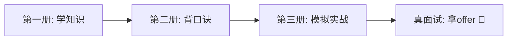
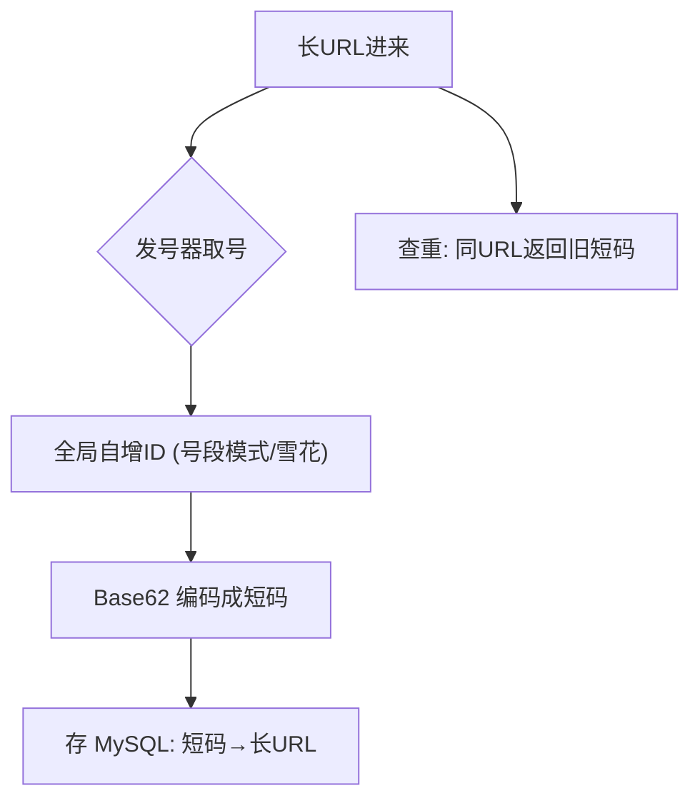
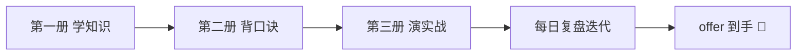

# 🎬 2026 Java 后端面试通关手册 · 第三期（全真模拟实战版）

> 🎀 前两册练好了内功，这一册上擂台！
> **完整还原一面 → 二面 → 三面 → HR 面的真实对话**，每段回答后配【讲师点评】
> 看的时候把自己代入 🙋，面试前照着念 3 遍，上场就是肌肉记忆！💪

***

## 📖 三册体系（怎么配合用）

| 册数        | 定位      | 一句话           |
| --------- | ------- | ------------- |
| 第一期       | 学习版     | 懂原理（知识全图）     |
| 第二期       | 记忆版     | 背口诀（开口能说）     |
| **第三期 ⭐** | **实战版** | **会表演（临场不慌）** |



***

# 🎒 第 0 部分：开演前的装备

## 0.1 自我介绍黄金 90 秒公式 ⭐⭐⭐

- 🎵 **公式**：**「我是谁 → 做过啥（数字）→ 凭啥行（技术匹配）→ 为啥来」**

**模板（1-3 年经验版）**：

> 🙋 面试官您好，我叫 XXX，X 年 Java 后端开发经验。上一家公司在电商业务线，主要负责订单和库存模块——把下单接口的 P99 从 800ms 优化到 150ms，还主导过一次 RabbitMQ 到 RocketMQ 的迁移，解决了消息堆积问题。技术栈方面，我熟悉 SpringBoot + MyBatisPlus + MySQL + Redis + RocketMQ 这套组合，最近一年也在用 SpringAI 做大模型应用落地。看到咱们公司在做高并发电商 + AI 方向，和我的技术路线非常契合，所以很想加入。

**模板（应届/实习版）**：

> 🙋 面试官您好，我是 XX 大学 XX 专业应届生。校招准备期间我系统学习了 Java 后端技术栈，自己做过一个 xx 项目——比如一个电商系统，用到了 Redis 分布式锁防超卖、RocketMQ 异步下单，QPS 压到 xx。另外我对 AI 应用开发很感兴趣，用 LangChain4j 做过一个知识库问答的 demo。我的特点是基础扎实、动手能力强，希望能快速为团队产出。

【讲师点评】

- ✅ 好的自我介绍 = **简历精华 30 秒 + 亮点数字 30 秒 + 匹配岗位 30 秒**
- ❌ 千万别背简历流水账，也别超 2 分钟——面试官会走神
- 🎯 「数字」是灵魂：800ms→150ms 比「性能优化」有说服力一万倍

## 0.2 项目介绍 STAR 法 ⭐⭐⭐

- 🎵 **口诀**：**「情境 Situation → 任务 Task → 行动 Action → 结果 Result」**

**示例（订单超卖问题）**：

| 要素   | 怎么说                                           |
| ---- | --------------------------------------------- |
| S 情境 | 大促期间订单服务出现超卖，客诉激增                             |
| T 任务 | 我负责彻底解决超卖并防止复发                                |
| A 行动 | Redis Lua 脚本原子预扣库存 + DB 层乐观锁兜底 + 下单链路走 MQ 异步化 |
| R 结果 | 超卖归零，下单峰值扛住 5000 QPS，获季度绩效 A                  |

【讲师点评】结果一定要有**数字**！没有数字的 STAR 等于白讲。

## 0.3 简历防坑 7 条（投递前最后检查）

1. ❌ 「精通」→ ✅ 写「熟悉/掌握」（写了精通=邀请面试官往死里问）
2. ❌ 技术名词堆砌 → ✅ 每个技术都能讲出「用它解决了什么问题」
3. ❌ 项目描述全是业务 → ✅ 加技术亮点（难点+方案+数字）
4. ✅ 每份简历按 JD 定制关键词（很多公司机器先筛一遍）
5. ✅ AI 项目放显眼位置（2026 年这是流量密码）
6. ❌ 虚构没碰过的技术 → 面试 3 个追问就现形
7. ✅ PDF 格式 + 命名「姓名-岗位-X年.pdf」

***

# 🎤 第 1 部分：一面实录（技术基础面）

> 场景设定：某电商公司 Java 后端一面，视频面试 45 分钟。
> 👨‍💼 = 面试官，🙋 = 你，💡 = 讲师点评

## 1.1 开场

👨‍💼 「先做个自我介绍吧。」

🙋 （用 0.1 的模板，90 秒，带数字）

💡 一面前 5 分钟定基调——自我介绍里埋的「钩子」（比如提到 Redis 分布式锁），大概率就是接下来提问的主线。**你想被问什么，就主动提什么！**

## 1.2 Java 基础追问链

👨‍💼 「你提到 String，为什么 String 设计成不可变的？」

🙋 「主要有三个原因，口诀是『安全、缓存、常量池』——首先是安全，字符串大量用于路径、URL、类名，不可变防止被恶意篡改；其次它不可变所以 hashCode 可以缓存，作为 HashMap 的 key 特别高效；最后字符串常量池依赖不可变性，相同字符串可以共享一份对象，节省内存。」

👨‍💼 「那 `String s = "a" + "b"` 和 `new StringBuilder().append("a").append("b")` 有区别吗？」

🙋 「有的。如果是常量拼接如 `"a" + "b"`，编译期就被优化成 `"ab"` 放进常量池；如果是变量拼接，编译后会自动变成 StringBuilder 的 append。另外在循环里拼接字符串要特别注意——每次循环都会 new 一个 StringBuilder，产生大量临时对象，应该把 StringBuilder 提到循环外面。」

👨‍💼 「String、StringBuilder、StringBuffer 怎么选？」

🙋 「口诀『不可变选 String，单线程拼接选拼 Builder，多线程拼接才 Buffer』。实际开发里 StringBuffer 几乎绝迹，因为字符串接基本在方法内部（局部变量），没有共享，StringBuilder 就够了。」

💡 **亮点分析**：三个问题层层递进，答的时候始终「先给结论 → 再说原因 → 顺带扩展边界情况」。提到循环拼接陷阱 = 证明你写过真实代码，不是背书。

## 1.3 集合追问链

👨‍💼 「HashMap 的 put 流程说说？」

🙋 「一句话：数组加链表加红黑树的组合。put 时先对 key 的 hash 做扰动——高 16 位异或低 16 位，再和数组长度减一做与运算定位到桶。桶空直接放；桶不空看 key 是否相同，相同就覆盖；不同就挂到链表尾部。链表长度到 8 并且数组长度到 64 就转红黑树，查询从 O(n) 变 O(logn)。元素超过阈值就扩容，容量翻倍。口诀『八转树、六退化、六四才树化、二倍来扩容』。」

👨‍💼 「为什么要做 hash 扰动？」

🙋 「因为定位桶只用低位 hash（数组长度小的时候），不扰动的话高位信息全浪费了，冲突会变多。异或 16 位相当于把高位也掺进来，让散列更均匀。」

👨‍💼 「HashMap 线程不安全体现在哪？」

🙋 「1.7 是扩容头插法可能形成环形链表导致死循环；1.8 改尾插解决了成环，但仍然会有数据覆盖丢失——两个线程同时 put 到同一个空桶，后写的覆盖先写的。要并发就用 ConcurrentHashMap。」

👨‍💼 「ConcurrentHashMap 1.8 怎么保证线程安全的？」

🙋 「口诀『空桶 CAS，有桶锁头』——桶为空时用 CAS 无锁插入；桶已经有元素，就用 synchronized 锁住桶头节点，只锁这一个桶，锁粒度非常细。另外 size 统计用的是 baseCount 加 CounterCell 分片累加，类似 LongAdder 的思路，减少竞争。」

💡 **亮点分析**：注意最后主动补了 size 的 CounterCell——**答出边界外的细节，就是「用过」和「背过」的分水岭**。

## 1.4 并发追问链

👨‍💼 「线程池参数讲一下，你项目里怎么配的？」

🙋 「七个参数，口诀『核心、最大、存活、单位、队列、工厂、拒绝』。执行流程是核心忙→进队列→队满开临时工→到顶就拒绝。我项目里订单接口是 IO 密集型，按 2N 到 4N 配的（8 核机器核心 16、最大 32），队列用有界 LinkedBlockingQueue 防 OOM，拒绝策略用 CallerRuns——让提交任务的线程自己跑，起到天然反压作用，上下游自动减速。」

👨‍💼 「为什么不用 Executors 创建？」

🙋 「阿里规约禁用。FixedThreadPool 和 SingleThreadExecutor 的队列是无界的，任务堆积会 OOM；CachedThreadPool 最大线程数是 Integer.MAX\_VALUE，可能创建海量线程。手动 new ThreadPoolExecutor 所有参数可控。」

👨‍💼 「volatile 干嘛的？i++ 加 volatile 行不行？」

🙋 「volatile 保证可见性和有序性，不保证原子性——口诀『可见、有序、不原子』。i++ 是读、加、写三步，不是原子的，volatile 救不了，要用 AtomicInteger，底层是 CAS 自旋。CAS 有 ABA 问题，可以用 AtomicStampedReference 加版本号解决。」

💡 **亮点分析**：「CallerRuns 起反压作用」这种**工程视角**的回答，比背参数高级一个段位——面试官心里已经在给你画 ✅ 了。

## 1.5 MySQL 追问链

👨‍💼 「为什么用 B+ 树不用 B 树？」

🙋 「三点：第一，B+ 树非叶子节点只存键不存数据，同样一页能放更多键，树更矮胖，磁盘 IO 更少；第二，叶子节点用双向链表串起来，范围查询和排序顺着链表扫就行；第三，所有查询都要走到叶子节点，查询时间稳定。口诀『矮胖少 IO，叶子成链好范围』。」

👨‍💼 「一条 SQL 很慢，你怎么排查？」

🙋 「我的排查套路是『一开二看三分析，四改五测』——先开慢查询日志定位到 SQL；然后 EXPLAIN 看执行计划，重点看 type 是不是 ALL 全表扫、key 有没有命中索引、rows 扫描行数、Extra 有没有 Using filesort；再分析原因，通常是索引缺失或失效——比如最左前缀没满足、索引列上用了函数、隐式类型转换、左模糊匹配；对应优化就是建联合索引、改写 SQL；如果是深分页，用延迟关联或者游标翻页。上线前还要回归压测，并观察慢查询监控防止劣化。」

👨‍💼 「讲讲可重复读和 MVCC。」

🙋 「RR 是 MySQL 默认隔离级别。MVCC 靠两样东西：undo log 版本链和 ReadView。每行数据有隐藏的事务 id 和回滚指针，修改会留旧版本在 undo log 里形成链；ReadView 记录生成时刻的活跃事务列表，判断版本对当前事务是否可见。RC 和 RR 的区别就在 ReadView 的生成时机——RC 每次查询生成新的，所以能看到别人新提交的；RR 只在第一次查询生成，之后一直复用，所以能重复读。幻读则主要靠间隙锁加 MVCC 配合解决。」

💡 **亮点分析**：三连问全部「结构化输出」（先总后分、有口诀、有细节）。面试官一面打分表通常就五项：基础、深度、表达、工程感、潜力——这套答法四项全占。

## 1.6 手撕环节

👨‍💼 「写一下反转链表。」

🙋 （一边写一边讲，不要闷头写！）

> 「我用迭代三指针：prev 初始化 null，cur 指向头。每轮先存下 cur 的后继，然后把 cur 的 next 掉头指向 prev，再让 prev 和 cur 双双前进。口诀『存后继、掉头、双双前进』。时间 O(n) 空间 O(1)。」

```java
public ListNode reverse(ListNode head) {
    ListNode prev = null, cur = head;
    while (cur != null) {
        ListNode next = cur.next;  // 存后继
        cur.next = prev;           // 掉头
        prev = cur;                // prev 前进
        cur = next;                // cur 前进
    }
    return prev;
}
```

👨‍💼 「能用递归写吗？」

> 「可以：`reverse(head.next)` 先反转后面的，然后把下一个节点指回自己，自己指向 null。不过递归栈深是 O(n)，链表太长会栈溢出，生产上还是迭代稳妥。」

💡 **亮点分析**：手撕环节的大忌是**沉默地写**。边写边说思路 = 展示沟通协作能力（以后结对编程就靠这个）。写完主动说复杂度，主动比较递归缺点——把追问的活儿自己干了！

## 1.7 反问环节

👨‍💼 「你有什么想问的？」

🙋 「想请教两个问题：一是团队目前的主力技术栈和接下来的架构演进方向是什么？二是这个岗位入职后前三个月，团队期望我优先产出的是什么？」

💡 一面反问别问薪资福利（HR 面再问）、别问「我表现怎么样」（给面试官出难题）。问技术栈=关心团队，问期望=展示产出意识。

***

# 🔍 第 2 部分：二面实录（项目深挖 + 场景题）

> 二面面试官通常是未来的直接 Leader，他考察的不是知识点，是\*\*「你会不会干活」\*\*。

## 2.1 项目深挖连环炮 ⭐⭐⭐

👨‍💼 「挑一个你最有挑战的项目讲讲。」

🙋 （STAR 法展开，90 秒，见 0.2 示例，结尾留钩子：「这里面消息一致性和库存热点是两个最难的点」）

👨‍💼 「你说用了 RocketMQ，为什么不用 Kafka？」

🙋 「选型时主要看场景。我们是电商交易链路，需要事务消息保证『本地订单创建成功和消息发送』的原子性，还需要延迟消息做超时关单，这两个 Kafka 原生都不支持，RocketMQ 开箱即用。吞吐上 Kafka 确实更强，但交易消息量级每天千万条，RocketMQ 完全够用，而且它自带控制台和消息轨迹，排查问题方便。」

👨‍💼 「消息会不会丢？怎么保证的？」

🙋 「三段防护，口诀『生产要确认，Broker 要持久，消费要手动 ACK』——生产端用同步发送加重试，确认 Broker 收到；存储端配同步刷盘加主从同步复制；消费端关掉自动提交，业务处理成功后再手动 ACK，失败就重试。极端情况仍然可能丢，所以还有对账补偿任务每小时跑一次，兜底最终一致。」

👨‍💼 「重复消费怎么办？」

🙋 「重试机制必然带来重复，MQ 只保证至少一次，所以业务必须幂等。我们用『订单号+状态机』方案——消费前先查订单状态，只有『待支付』才能流转到『已支付』，配合数据库乐观锁版本号，重复消息来了更新不生效，天然幂等。」

👨‍💼 「如果消息堆积了几百万条，怎么办？」

🙋 「口诀『先扩容，再转储，后补偿』——先看是不是消费者挂了或者有慢消费（比如里面有个同步 RPC 超时），修复根因；紧急情况下水平扩容消费者实例（注意队列数要多于消费者数才有意义）；如果队列数不够就临时上转储程序把消息搬到新 topic 多队列分片；最后对堆积期间可能失败的业务跑补偿任务。」

👨‍💼 「流量翻 10 倍，这个系统要怎么改造？」

🙋 「分四层说——入口层加网关限流和 CDN 静态化，削掉无效流量；应用层无状态化后横向扩容，重点排查代码里的单点比如本地缓存不一致、synchronized 全局锁；数据层先读写分离，再按用户 id 分库分表，热点商品数据走 Redis 多级缓存；异步化能异步的都异步（下单、通知、积分）。另外容量规划上用全链路压测摸天花板，别等大促当天才发现问题。」

💡 **亮点分析**：注意这套连环炮的答法精髓——**每个答案都以「方案+为什么+兜底」收尾**。二面 Leader 招的是「出了事能兜住的人」，你展示的就是兜底思维。

## 2.2 场景题：线上接口突然变慢 🚨

👨‍💼 「周一早上，订单接口 P99 从 50ms 涨到 2s，你怎么排查？」

🙋 「我按『先看面、再看点、后看变』三步走：

第一步**看面**——先确认影响范围：监控看是单个接口还是整个应用？整个应用的话看 CPU、内存、GC、网络，大概率是资源或依赖问题；单接口的话继续往下。

第二步**看 点**——链路追踪（SkyWalking）拉出慢请求，看耗时分布在哪一段：是 DB 慢查询？Redis 超时？下游 RPC 慢？还是自己应用里锁竞争？DB 慢的话 EXPLAIN 看执行计划是不是走了全表扫描。

第三步**看变**——最重要的灵魂问题：『周日晚上到周一早上，改了什么？』查发布记录、配置变更、数据量变化（比如活动导致订单表暴涨）、定时任务挤占资源。经验上 **80% 的线上事故和最近的变更有关**。

定位后应急处置：先止血再根因——该回滚回滚、该扩容扩容、该降级降级，别在线上边猜边试。」

💡 **亮点分析**：这道题考的是**排查方法论**而不是知识背诵。「看变」和「先止血再根因」两句是多年运维经验的结晶，说出来面试官会心一笑。

## 2.3 场景题：Redis 和 DB 不一致导致超卖

👨‍💼 「缓存里的库存和数据库不一致了，导致少卖了很多，怎么救？怎么根治？」

🙋 「先救火再根治。

救火：立刻对账——以 DB 为准扫描 Redis 库存，重算修正；少卖的库存可以回补一轮二次售卖。

根治分两层。一致性方案上，用 Cache Aside：写操作先更新 DB 再删除缓存，读操作 miss 后回填，关键的读写交叉场景加延迟双删；再配合 binlog 订阅（Canal）异步删缓存，保证最终一致。

架构上，库存扣减不依赖『读缓存-判断-再写』这种多步操作，改成 **Lua 脚本原子扣减**，判断和扣减一步完成，不一致和超卖从根上就少了。」

***

# 🏗️ 第 3 部分：三面实录（系统设计 + 软素质）

## 3.1 系统设计：设计一个短链系统 ⭐⭐⭐

👨‍💼 「设计一个短链服务，输入长 URL 返回短链，日均 1 亿访问量。」

🙋 「我按五步走：**澄清需求 → 估算规模 → 定 API 和存储 → 核心设计 → 容量兜底**。

**① 澄清需求**：短链永不过期吗？需要自定义后缀吗？要统计点击量吗？（先问再设计，别上来就画图！）

**② 估算**：1 亿访问/日 ≈ 峰值 QPS 约 1 万量级；写入（生成短链）约是访问的 1%，读写比 100:1——典型读多写少，**缓存友好型**。

**③ API 与存储**：两个接口——`POST /shorten` 生成、`GET /{code}` 302 跳转。存储用 MySQL：短码做主键/唯一索引，长 URL 建索引查重。

**④ 核心设计——短码怎么生成**：



> 我不用 MD5 哈希截断——会冲突还得处理碰撞；用**发号器+Base62**：全局递增 ID 转 62 进制（a-z A-Z 0-9），6 位就能表达 568 亿个短码，天然不冲突还短。302 跳转比 301 好——301 浏览器永久缓存，后续点击不经过服务，没法统计。

**⑤ 读性能兜底**：QPS 1 万，MySQL 扛不住——加 Redis 缓存短码映射（读多写少天然适合），命中率 99% 后 DB 压力忽略不计；再往前可以加本地 Caffeine 做二级缓存防热点 key。

**⑥ 容灾**：Redis 挂了降级直接查 DB（限流保护）；发号器是单点就用号段模式——一次取一千个号在内存里发，DB 挂了还能撑一阵。」

💡 **亮点分析**：系统设计题的评分点不是「方案多高级」，而是：**先澄清（需求意识）→ 有估算（容量意识）→ 讲 trade-off（为什么 302 不 301、为什么发号器不哈希——决策意识）→ 有兜底（容灾意识）**。四个意识齐了，就是高级工程师思维。

## 3.2 软素质三连

👨‍💼 「你的技术规划是什么？」

🙋 「短期一年内深耕业务域的高并发和稳定性，把负责模块做到可观测、可降级、可扩容；中期两三年往架构方向发展，提升系统设计和跨团队协作能力；另外我会持续跟进 AI 工程化方向——这不是追热点，我判断它是后端的新基础设施，我的 SpringAI 实践已经开始了。」

👨‍💼 「和同事方案有分歧怎么办？」

🙋 「先对齐目标再争方案——很多分歧其实是目标不一致。然后拿数据说话：压测结果、线上指标、业界案例，谁证据硬听谁的；实在定不了就小流量灰度验证。对事不对人，会上充分争论，会后坚决执行。」

💡 **亮点分析**：软素质题的核心是「展示你是个**好协作的成年人**」。所有答案围绕：目标导向、数据驱动、尊重流程、情绪稳定。

***

# 💰 第 4 部分：HR 面实录 + 薪资谈判

## 4.1 高频问题实战对话

👨‍💼 「为什么从上家离职？」

🙋 「主要求发展——上家业务线比较稳定，技术上增量空间有限，我希望去业务体量更大、技术挑战更多的平台。我在职期间也一直在为这次跳槽做技术储备，比如系统学了 AI 应用开发。」

💡 口诀「求发展不吐槽」：**永远不说前公司坏话**（HR 会想：他将来也会这么说我们）。

👨‍💼 「期望薪资多少？」

🙋 「我目前薪资是 X，年包 X。结合我的技术匹配度和这几轮面试表现，期望涨幅在 20%-30%，具体也看重整体 package——期权、调薪机制、成长空间我也一并考虑，相信公司有成熟的定薪体系，只要在合理区间都好谈。」

💡 三要点：**报现薪+给区间+留口子**。给区间不给死数；把「涨幅百分比」而不是「绝对数」挂嘴边；表达灵活性但不卑微。

👨‍💼 「手里有其他 offer 吗？」

🙋 「有在看几个机会，也有进入终面流程的。但选公司我不是价高者得，团队技术和业务前景对我更重要——贵司这两点我都很认可，如果双方匹配，我优先考虑。」

💡 「有但不拿捏」：证明自己有市场，同时给足对方面子。

## 4.2 谈薪加分细节

- 🕐 **时机**：HR 明确表达录用意向后再谈细节，别一面就问钱
- 📊 **情报**：先查目标公司薪资范围（脉脉/OfferShow），报价贴着上限区间的下沿往上谈
- 🤝 **僵局话术**：「如果现金部分确实有限制，能否在签字费/期权/试用期长度上找补一些平衡？」
- ✍️ **口头 offer 不是 offer**：拿到书面 offer 再提离职！

***

# 🚑 第 5 部分：突发状况急救包

## 5.1 被问到不会的怎么办？（三步急救法）⭐⭐⭐

🙋 话术模板：

> 「这块我实际用得不多，我说下我的理解（**诚实**）——我猜测应该和 XX 机制有关，类似我在 YY 场景遇到过的（**迁移已知知识**）。不知道我的理解对不对，也想请教下您这块的实践是怎样的？（**转为请教**）」

💡 **三步口诀「诚实+迁移+请教」**。大忌：不懂装懂瞎编（面试官一眼看穿，诚信直接扣光分）。会示弱+会请教 = 反而加分，团队要的不是全知的人，是靠谱的人。

## 5.2 压力面应对

识别：面试官连续打断、否定你的答案、追问到底、表情冷漠。
真相：**可能是压力测试，不是你答得烂！**

应对口诀「**稳住、认可、补充**」：

> 🙋 「您说的这个角度确实是我刚才没考虑到的（认可），我补充一下另一面……（补充）」

情绪稳定本身就是这道题的答案。题可以答错，人不能慌。

## 5.3 说错话自救

- 说错技术细节：「稍等，我刚才那句话说反了，纠正一下——正确的应该是 XX」（主动纠错反而是加分项！）
- 吐槽了前公司：「不好意思刚才表达欠妥，我的本意是……」（及时拉回，别恋战）

## 5.4 线上面试检查清单 ✅

| 检查项 | 标准                   |
| --- | -------------------- |
| 网络  | 有线 > WiFi，手机热点做备用    |
| 环境  | 安静、逆光别开窗、背景整洁        |
| 设备  | 提前 10 分钟进会议测试摄像头麦克风  |
| 界面  | 关通知！微信弹窗弹出八卦就社死了     |
| 材料  | 简历、笔记开好放在旁边（偷偷看没人知道） |
| 着装  | 上半身体面即可（别穿睡裤站起来拿东西！） |

***

# 📝 第 6 部分：面试复盘模板

## 6.1 每场面试后 30 分钟复盘表

| 复盘项      | 记录                       |
| -------- | ------------------------ |
| 被问到没答好的题 | 原题 + 标准答案 + 下次话术         |
| 答得特别顺的题  | 记住节奏，固化成模板               |
| 面试官风格    | 压力型/温和型/抠细节型 → 下次同类怎么调   |
| 自己的时间分配  | 自我介绍/项目/八股/手撕各占几分钟       |
| 信号解读     | 反问环节的态度、面试时长（<30min 要警惕） |

## 6.2 「我挂了吗」信号自查

- 🟢 好信号：面试超时、主动介绍团队、聊薪资细节、加了联系方式
- 🟡 中性：准点结束、说「后续 HR 联系你」
- 🔴 危险：20 分钟匆匆结束、二面跳过直接 HR、反问环节敷衍

> 💡 无论感觉多差，**面试后 24 小时内把不会的题弄懂**——面经是最贵的复习资料，这场挂在哪，下场就从哪爬起来！

***

# 🏁 结语：三册合一，出征！



| 最后叮嘱 | 一句话                  |
| ---- | -------------------- |
| 心态   | 面试是双向选择，你也在挑公司       |
| 节奏   | 语速放慢 20%，思考 3 秒再答不丢人 |
| 秘籍   | 每场面试前把第二册口诀总表刷一遍     |
| 底线   | 不会就「诚实+迁移+请教」，别编     |

> 🎀 讲师的悄悄话：
> 三册手册写完了，但你和讲师的故事还没完——
> 拿到 offer 那天记得回来报喜哦！
> **愿你的每一次自我介绍，都以「入职通知」结束。** 💪🎉✨

