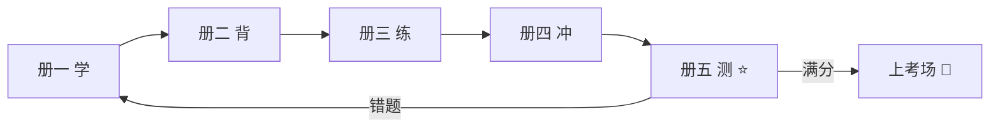
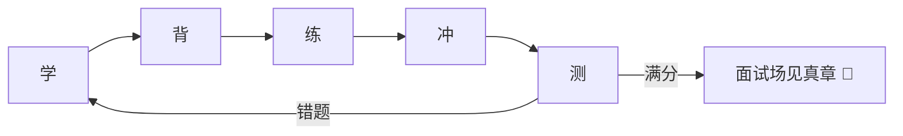

# 📝 2026 Java 后端面试通关手册 · 第五期（全真自测题库 · 盲测版）

> 🎀 前四册是「输入」，第五册是「**输出检验**」！
> 5 套模拟卷 + 终极快问快答卷，选择/判断/填空/简答/手撕五种题型
> **遮住答案做 → 对答案打分 → 错题记错题本 → 回翻对应册复习**
> 学没学会，考完见真章！💪

---

## 📖 五册体系（完整闭环）



## 🎯 使用说明（三遍法）

| 遍数 | 做法 | 目标 |
|------|------|------|
| 第一遍 | **遮住答案盲测**，限时 40 分钟/卷 | 暴露真实水平 |
| 第二遍 | 只重做错题 + 蒙对的题 | 堵漏洞 |
| 第三遍 | 考前只刷错题本 | 巩固薄弱点 |

**计分规则（每卷满分 100）**：选择 8×3 + 判断 6×2 + 填空 6×3 + 简答 6×5 + 编程 16

| 得分 | 定级 | 行动 |
|------|------|------|
| 90+ | 🏆 大厂冲刺级 | 保持手感，重点练项目表达 |
| 75-89 | ✅ 中厂稳过级 | 错题专项补强 |
| 60-74 | ⚠️ 危险边缘 | 错题对应模块回炉重学 |
| <60 | 🔄 回炉重造 | 别急着面试，先刷册一册二 |

---

# 📄 卷一：Java 基础 + 集合

## 一、选择题（8×3=24 分）

**1.** 关于 String，下列说法正确的是：
A. String 可以被继承  B. String 是可变类  C. String 是 final 类  D. substring 修改原字符串

**2.** 下列代码输出：
```java
Integer a = 127, b = 127;
Integer c = 128, d = 128;
System.out.print((a == b) + " " + (c == d));
```
A. true true  B. true false  C. false true  D. false false

**3.** HashMap 的默认初始容量和负载因子是：
A. 10 / 0.75  B. 16 / 0.75  C. 16 / 0.8  D. 32 / 0.75

**4.** HashMap 链表转红黑树的条件是：
A. 链表长度 ≥ 8  B. 数组长度 ≥ 64  C. 链表 ≥ 8 且数组 ≥ 64  D. 元素总数超过阈值

**5.** ArrayList 默认容量和扩容倍数是：
A. 10 / 2 倍  B. 16 / 2 倍  C. 10 / 1.5 倍  D. 16 / 1.5 倍

**6.** 下列哪个类是线程安全的：
A. HashMap  B. ArrayList  C. LinkedList  D. ConcurrentHashMap

**7.** 迭代 ArrayList 时并发修改，会抛出：
A. NullPointerException  B. ConcurrentModificationException  C. ArrayIndexOutOfBoundsException  D. IllegalStateException

**8.** 重写了 equals 但没重写 hashCode，放入 HashMap 可能出现：
A. 编译错误  B. 相等的对象被存两份  C. 自动调用 toString  D. 永远取不出值

## 二、判断题（6×2=12 分）

1. volatile 能保证 i++ 的原子性（ ）
2. StringBuffer 是线程安全的（ ）
3. HashMap 1.8 使用头插法插入链表节点（ ）
4. 接口中可以定义构造方法（ ）
5. 仅返回值类型不同，也能构成方法重载（ ）
6. 有 GC 存在，Java 程序不可能内存泄漏（ ）

## 三、填空题（6×3=18 分）

1. equals 相等的两个对象，hashCode 必须______。
2. 红黑树节点数小于等于______时退化为链表。
3. ConcurrentHashMap 1.8 中，空桶用______插入，非空桶用 synchronized 锁住______。
4. String 不可变的三大原因：______、______、常量池。
5. 深拷贝与浅拷贝的区别在于是否递归复制______。
6. Error 与 Exception 的区别：Error 是程序______的，不应该捕获。

## 四、简答题（6×5=30 分）

1. String / StringBuilder / StringBuffer 怎么选？
2. HashMap 的 put 流程（说全树化条件加分）
3. ArrayList 和 LinkedList 的选型依据？
4. == 和 equals 的区别？为什么重写 equals 必须重写 hashCode？
5. 讲讲 Java 异常体系（Error / 编译异常 / 运行时异常）
6. JDK21 虚拟线程了解吗？和平台线程的区别、适用场景？

## 五、编程题（16 分）

**手写 LRU 缓存**：要求 get/put 均 O(1)，容量超限淘汰最久未使用的数据。（LinkedHashMap 三行版 + 说出手写双向链表思路）

---

## 📝 卷一答案速查

| 题号 | 答案 | 错了翻哪 |
|------|------|---------|
| 选1 | C（final 不可继承不可变） | 册二 1.2 |
| 选2 | B（-128~127 缓存池） | 册四 A1.7 |
| 选3 | B（16 / 0.75） | 册二 2.1 |
| 选4 | C | 册二 2.1 |
| 选5 | C（10 / 1.5 倍） | 册四 A1 补充 |
| 选6 | D | 册二 2.2 |
| 选7 | B（fail-fast） | 册二 2.5 |
| 选8 | B（相等对象存两份） | 册二 1.1 |
| 判1 | ×（不原子，用 AtomicInteger） | 册二 3.3 |
| 判2 | √ | 册四 A1.1 |
| 判3 | ×（1.8 尾插，1.7 才头插） | 册二 2.1 追问2 |
| 判4 | ×（接口没有构造方法） | 册二 1.4 |
| 判5 | ×（重载看参数列表，返回值不参与） | 册四 A1.3 |
| 判6 | ×（无用引用、ThreadLocal 泄漏都会 OOM） | 册四 A1.6 |
| 填1 | 相等 | 册二 1.1 |
| 填2 | 6 | 册二 2.1 |
| 填3 | CAS；桶头节点 | 册二 2.3 |
| 填4 | 安全；缓存（hash 缓存） | 册二 1.2 |
| 填5 | 引用类型字段（整个对象图） | 册四 A1.5 |
| 填6 | 无法处理/不可恢复 | 册二 1.5 |
| 简1 | 不可变选 String，单线程拼接 Builder，多线程 Buffer（几乎绝迹） | 册四 A1.1 |
| 简2 | 数组+链表+红黑树；hash 扰动定位桶→空放/同覆盖/挂尾→8&64 树化→超阈值 2 倍扩容 | 册二 2.1 |
| 简3 | 随机访问多 ArrayList，头尾增删多/当队列 LinkedList；实战默认 ArrayList | 册二 2.4 |
| 简4 | == 地址 equals 内容；HashMap 先 hashCode 定桶再 equals 定节点，不重写会「相等对象存两份」 | 册二 1.1 |
| 简5 | Throwable → Error（绝症）/ Exception → 受检（编译查）/运行时（空指针越界） | 册二 1.5 |
| 简6 | JVM 调度、KB 级栈、阻塞自动让出载体线程；IO 密集用虚拟、CPU 密集用平台 | 册四 B1.1 |
| 编程 | 见册二 13.1（removeEldestEntry 三行版；手写版=双向链表+HashMap，访问挪头部，淘汰尾部） | 册二 13.1 |

---

# 📄 卷二：并发 + JVM

## 一、选择题（8×3=24 分）

**1.** 下列关于 sleep 和 wait 说法正确的是：
A. sleep 释放锁  B. wait 属于 Thread 类  C. wait 释放锁，sleep 不释放  D. 都必须在 synchronized 内调用

**2.** 线程池提交任务时，正确的处理顺序是：
A. 核心线程 → 最大线程 → 队列  B. 核心线程 → 队列 → 最大线程 → 拒绝  C. 队列 → 核心线程 → 拒绝  D. 核心线程 → 拒绝 → 队列

**3.** ThreadLocalMap 的 key 是：
A. 强引用  B. 弱引用  C. 软引用  D. 虚引用

**4.** CAS 无法解决的问题是：
A. 原子性  B. ABA 问题  C. 可见性  D. 自旋开销

**5.** synchronized 锁升级的正确顺序：
A. 无锁→重量级→轻量级→偏向  B. 无锁→偏向→轻量级→重量级  C. 偏向→无锁→重量级  D. 无序

**6.** 下列哪个**不是** GC Roots：
A. 虚拟机栈中的局部变量  B. 静态变量  C. 常量引用  D. 堆中对象的自引用

**7.** 停顿时间可预测、按 Region 回收的收集器是：
A. CMS  B. G1  C. ParNew  D. Serial

**8.** 双亲委派模型中，收到类加载请求首先：
A. 自己尝试加载  B. 委派给父加载器  C. 交给线程上下文加载器  D. 抛出异常

## 二、判断题（6×2=12 分）

1. 核心线程满了之后，会立即创建非核心线程（ ）
2. volatile 保证可见性和有序性，但不保证原子性（ ）
3. G1 收集器已经完全不分代了（ ）
4. 元空间使用的是 JVM 堆内存（ ）
5. 线程池中的线程使用 ThreadLocal，用完必须 remove（ ）
6. ZGC 的停顿时间随堆增大线性增长（ ）

## 三、填空题（6×3=18 分）

1. 线程池七大参数：corePoolSize、maximumPoolSize、______、unit、______、threadFactory、handler。
2. IO 密集型任务核心线程数经验值约为 CPU 核数的______倍。
3. AQS 的核心 = 一个______状态位 + 一条______队列。
4. JVM 线程私有的三个内存区：程序计数器、______、______。
5. 类加载五步：加载、______、______、解析、初始化。
6. 线上 CPU 飙高：top 找进程 → ______ 找线程 → printf 转______进制 → jstack 定位。

## 四、简答题（6×5=30 分）

1. 线程池的执行流程？拒绝策略有哪几种？
2. ThreadLocal 为什么会内存泄漏？怎么避免？
3. 讲讲 volatile 的作用和原理（内存屏障）。
4. 分代垃圾收集：新生代为什么用复制算法？老年代用什么？
5. 什么是双亲委派？怎么打破？为什么要打破（举例 SPI）？
6. 线上服务 CPU 100%，完整排查步骤？

## 五、编程题（16 分）

**手写双重检锁单例（DCL）**：并回答——为什么要两次判空？为什么必须 volatile？

---

## 📝 卷二答案速查

| 题号 | 答案 | 错了翻哪 |
|------|------|---------|
| 选1 | C | 册四 A2.1 |
| 选2 | B（核满→入队→队满→临时工→拒绝） | 册二 3.6 |
| 选3 | B（Entry 弱引用，value 强引用残留） | 册二 3.7 |
| 选4 | B（版本号解决） | 册二 3.4 |
| 选5 | B（无偏轻重量） | 册二 3.2 |
| 选6 | D（GC Roots：栈静常JNI） | 册二 4.2 |
| 选7 | B | 册二 4.4 |
| 选8 | B（向上委托，向下加载） | 册二 4.5 |
| 判1 | ×（先入队！队满才开临时工） | 册二 3.6 |
| 判2 | √ | 册二 3.3 |
| 判3 | ×（逻辑分代仍在，物理上按 Region） | 册二 4.4 |
| 判4 | ×（本地内存，替代永久代） | 册二 4.1 |
| 判5 | √（线程复用不死，value 残留） | 册二 3.7 |
| 判6 | ×（亚毫秒级，且基本与堆大小无关） | 册二 4.4 |
| 填1 | keepAliveTime；workQueue | 册二 3.6 |
| 填2 | 2（2N~4N 区间都对） | 册二 3.6 追问2 |
| 填3 | volatile 的 state；CLH 双向等待 | 册二 3.5 |
| 填4 | 虚拟机栈；本地方法栈 | 册二 4.1 |
| 填5 | 验证；准备 | 册二 4.5 |
| 填6 | top -Hp pid；十六 | 册二 4.6 |
| 简1 | 核忙→入队→队满开非核心→到顶拒绝；四种：Abort 抛异常/CallerRuns 调用者执行/Discard 丢弃/DiscardOldest 丢最老 | 册二 3.6 |
| 简2 | 线程池线程不死 + key 弱引用被回收 + value 访问不到→堆积；finally 中 remove() | 册二 3.7 |
| 简3 | 可见（写立即刷主存+读失效）+ 有序（禁重排，内存屏障）；不原子 | 册二 3.3 |
| 简4 | 新生代对象朝生夕死、存活少，复制只需搬少量活对象；老年代标记-整理/标记-清除 | 册二 4.3 |
| 简5 | 先问爹再自己来（防篡改+防重复）；重写 loadClass/线程上下文加载器（JDBC SPI）/OSGi；SPI 接口在启动类加载器、实现类在 jar 里，得「逆向」委托 | 册二 4.5 |
| 简6 | top→top -Hp→转16进制→jstack（或 Arthas thread -n 3）；先定位再快照后分析 | 册二 4.6 |
| 编程 | 见册二 13.2；外层判空省性能、内层判空保安全；new 三步（分配/初始化/赋值）可能重排，防拿到半成品 | 册二 13.2 |

---

# 📄 卷三：Spring + MySQL

## 一、选择题（8×3=24 分）

**1.** 下列哪种情况 Spring 事务**不会**失效：
A. 方法是 private  B. 方法是 public 且被代理对象调用  C. 同类中 this 调用  D. 异常被 catch 吞掉

**2.** AOP 代理对象在 Bean 生命周期的哪个阶段创建：
A. 实例化时  B. 属性填充时  C. 初始化后（BeanPostProcessor）  D. 销毁前

**3.** 三级缓存主要解决：
A. Bean 排序  B. 循环依赖  C. 事务传播  D. 作用域隔离

**4.** @Autowired 的注入策略是：
A. 先 byType，多个再 byName  B. 先 byName  C. 只 byName  D. 随机

**5.** B+ 树叶子节点的组织方式：
A. 各自独立  B. 双向链表串联  C. 单向链表  D. 数组

**6.** MySQL 默认事务隔离级别是：
A. 读未提交  B. 读已提交  C. 可重复读  D. 串行化

**7.** MVCC 的两大核心组件：
A. redo log + binlog  B. undo log 版本链 + ReadView  C. 间隙锁 + 临键锁  D. 表锁 + 行锁

**8.** 联合索引 (a, b, c)，下列哪条**能**完整用到索引：
A. WHERE b=1 AND c=2  B. WHERE a=1 AND b=2 AND c=3  C. WHERE a>1 AND b=2  D. WHERE c=3

## 二、判断题（6×2=12 分）

1. SpringBoot 默认使用 JDK 动态代理（ ）
2. @Transactional 加在 private 方法上有效（ ）
3. RR 隔离级别下幻读被 100% 根治（ ）
4. 一张表可以有多个唯一索引（ ）
5. 覆盖索引可以避免回表（ ）
6. binlog 是 InnoDB 引擎层特有的日志（ ）

## 三、填空题（6×3=18 分）

1. Spring 三级缓存：singletonObjects、______、______。
2. @Transactional 的默认传播级别是______；默认只回滚______异常。
3. B+ 树相比 B 树：非叶子节点只存______，叶子节点用______串联。
4. 新生代 Eden : S0 : S1 = ______ : ______ : ______。
5. 二级索引叶子节点存的是______值，用它查整行需要______。
6. MySQL 两阶段提交：redo log ______ → 写 binlog → redo log ______。

## 四、简答题（6×5=30 分）

1. SpringBoot 自动装配原理（外卖版）
2. 三级缓存怎么解决循环依赖？为什么需要第三级？
3. 列举至少 5 种事务失效场景
4. 索引为什么选 B+ 树而不是 Hash/B 树/跳表？
5. 一条 SQL 慢，完整排查步骤？
6. RC 和 RR 下 MVCC 的 ReadView 区别？

## 五、设计题（16 分）

订单表 `orders(id, user_id, status, created_at)`，高频查询：
```sql
SELECT * FROM orders WHERE user_id = ? AND status = ? ORDER BY created_at DESC LIMIT 10;
```
**该建什么索引？为什么？**（说出列顺序的理由 + 能否覆盖索引）

---

## 📝 卷三答案速查

| 题号 | 答案 | 错了翻哪 |
|------|------|---------|
| 选1 | B | 册二 5.2 |
| 选2 | C | 册二 5.3 |
| 选3 | B | 册二 5.4 |
| 选4 | A | 册四 A3.3 |
| 选5 | B | 册二 6.1 |
| 选6 | C | 册二 6.6 |
| 选7 | B | 册二 6.7 |
| 选8 | B（最左前缀连续使用；C 中 a 范围后 b 失效） | 册二 6.3 |
| 判1 | ×（Boot 2+ 默认 CGLIB，proxy-target-class=true） | 册四 A3.1 |
| 判2 | ×（private 不被代理拦截） | 册二 5.2 |
| 判3 | ×（快照读靠 MVCC、当前读靠间隙锁，基本避免；极端交叉场景仍可能出现） | 册二 6.6 |
| 判4 | √ | 册四 A4.6 |
| 判5 | √（Extra=Using index） | 册二 6.2 |
| 判6 | ×（binlog 是 Server 层，所有引擎都有；redo/undo 才是 InnoDB） | 册四 A4.1 |
| 填1 | earlySingletonObjects；singletonFactories | 册二 5.4 |
| 填2 | REQUIRED；运行时（RuntimeException/Error，受检需 rollbackFor） | 册二 5.2 |
| 填3 | 键（不存数据）；双向链表 | 册二 6.1 |
| 填4 | 8:1:1 | 册二 4.3 |
| 填5 | 主键；回表 | 册二 6.2 |
| 填6 | prepare；commit | 册四 B2.3 |
| 简1 | 启动读清单文件（imports）→加载候选配置类→条件注解筛选生效；商家菜单固定位置，厨房营业才下单 | 册一 5.5 |
| 简2 | A 实例化后先把工厂放三级→B 注入时经工厂提前拿到 A（或其代理）→A 完成后共用同一代理；第三级=延迟决定是否提前生成 AOP 代理 | 册二 5.4 |
| 简3 | private/静态/final、自调用、异常被吞、受检异常没 rollbackFor、多线程、MyISAM、没被 Spring 管理 | 册二 5.2 |
| 简4 | 矮胖少 IO；叶子成链范围查询爽；查询稳定；Hash 不能范围；跳表适合内存（Redis） | 册二 6.1 |
| 简5 | 慢日志定位→EXPLAIN（type/key/rows/Extra）→分析失效原因→建索引/改写/深分页优化→压测回归 | 册二 6.9 |
| 简6 | RC 每次查询新建 ReadView（能读到新提交）；RR 首查生成后复用（可重复读） | 册二 6.7 |
| 设计 | 建 (user_id, status, created_at)：等值列在前（user_id、status），范围/排序列在后（created_at）；若 SELECT 的列能收进索引则可覆盖免回表 | 册二 6.3+6.2 |

---

# 📄 卷四：Redis + MQ + 微服务分布式

## 一、选择题（8×3=24 分）

**1.** 查询**不存在**的数据、缓存永不命中，这是：
A. 击穿  B. 穿透  C. 雪崩  D. 大 key

**2.** Redis 加锁的正确原子命令是：
A. SETNX 后再 EXPIRE  B. SET key value NX EX 10  C. INCR  D. GETSET

**3.** Redisson 看门狗的作用是：
A. 删除死 key  B. 业务未执行完自动续期锁  C. 监控哨兵  D. 持久化触发

**4.** 保证消息不丢，消费端应该：
A. 自动提交 offset  B. 手动 ACK，处理完再确认  C. 关闭持久化  D. 提高并发

**5.** CAP 中注册中心 Nacos 默认保证：
A. CP  B. AP（可切 CP）  C. CA  D. 三者都要

**6.** Seata AT 模式的核心是：
A. 两阶段阻塞提交  B. undo log 自动反向补偿  C. 业务写 Try/Confirm/Cancel  D. 消息最终一致

**7.** 雪花算法 ID 的组成不含：
A. 时间戳  B. 机器 ID  C. 序列号  D. 用户 ID

**8.** Sentinel 熔断器处于「半开」状态时：
A. 直接放行所有请求  B. 放一个试探请求，成功则恢复  C. 永久拒绝  D. 只放 GET

## 二、判断题（6×2=12 分）

1. Redis 6.0 之后命令执行也是多线程了（ ）
2. 推荐的缓存更新策略是「先更新缓存再更新数据库」（ ）
3. Redis 的锁过期但业务没跑完，Redisson 会自动续期（ ）
4. Kafka 和 RocketMQ 一样原生支持事务消息和延迟消息（ ）
5. Nacos 只能工作在 AP 模式（ ）
6. RocketMQ 可以用延迟消息实现订单超时关闭（ ）

## 三、填空题（6×3=18 分）

1. 缓存穿透两大方案：缓存______、______过滤器。
2. 缓存击穿两大方案：______锁重建、______过期。
3. 缓存雪崩方案：TTL 加______值、集群高可用、多级缓存。
4. 双写一致性主流方案：写库后______缓存（Cache Aside），可疑场景加______双删。
5. Redis Cluster 把键空间分成______个哈希槽。
6. 幂等四方案：唯一 ID+去重表、Redis______、______、乐观锁。

## 四、简答题（6×5=30 分）

1. 缓存穿透/击穿/雪崩分别是什么 + 解决方案？
2. Redis 分布式锁的完整演进（setnx 的问题 → Redisson）？
3. 消息丢失的三段防护？
4. 怎么保证消息顺序？
5. 服务雪崩防护「五字诀」展开讲讲？
6. 雪花算法结构？时钟回拨怎么办？

## 五、场景题（16 分）

**秒杀场景**：库存 100 件，预计 10 万人抢购。设计防超卖方案，要求：
① Redis 预扣怎么做才是原子的？② DB 层怎么兜底？③ 写出 DB 兜底 SQL 的核心条件。

---

## 📝 卷四答案速查

| 题号 | 答案 | 错了翻哪 |
|------|------|---------|
| 选1 | B | 册二 7.3 |
| 选2 | B | 册二 7.5 |
| 选3 | B | 册二 7.5 |
| 选4 | B | 册二 8.2 |
| 选5 | B | 册四 A6.3 |
| 选6 | B | 册四 A6.2 |
| 选7 | D（雪花=符号位+时间戳+机器ID+序列号） | 册二 9.5 |
| 选8 | B | 册二 9.3 |
| 判1 | ×（只有网络 IO 多线程，命令仍单线程） | 册四 A5.4 |
| 判2 | ×（先更新库再删缓存；先更缓存宕机数据永久不一致） | 册二 7.4 |
| 判3 | √ | 册二 7.5 |
| 判4 | ×（Kafka 事务是流处理语义，不是 RocketMQ 那种事务消息；延迟消息 Kafka 无原生） | 册四 A6.1 |
| 判5 | ×（AP/CP 可按实例切换） | 册四 A6.3 |
| 判6 | √ | 册二 8.6/册三 2.1 |
| 填1 | 空值；布隆 | 册二 7.3 |
| 填2 | 互斥；逻辑 | 册二 7.3 |
| 填3 | 随机 | 册二 7.3 |
| 填4 | 删除；延迟 | 册二 7.4 |
| 填5 | 16384 | 册二 7.8 |
| 填6 | setnx；状态机 | 册二 8.3 |
| 简1 | 穿透=查无数据（空值+布隆）；击穿=热点 key 过期（互斥锁/逻辑过期）；雪崩=大面积同过期或宕机（随机 TTL+集群+多级缓存） | 册二 7.3 |
| 简2 | setnx+expire 非原子（宕机死锁）→Lua→误删他人锁（值校验）→过期业务没完（看门狗续期）→可重入（hash 计数）→主从切换锁丢（RedLock 争议，业务幂等兜底） | 册二 7.5 |
| 简3 | 生产同步发送+确认重试；Broker 同步刷盘+主从同步复制；消费手动 ACK+失败重试；极端对账补偿兜底 | 册二 8.2 |
| 简4 | 同一业务 key 路由到同一队列（局部有序）+消费端单线程/队列维度串行 | 册二 8.4 |
| 简5 | 限（令牌桶/滑动窗口）隔（线程池/信号量舱壁）熔（错误率跳闸+半开试探）降（兜底数据）超（超时+幂等重试） | 册四 B2.5 |
| 简6 | 1+41+10+1... 即符号+时间戳+机器ID+序列号；回拨：等待追平/备用机器ID/抛异常拒绝发号 | 册二 9.5 |
| 场景 | ①Lua 脚本「GET 判断+DECR」一步原子；②DB 扣减带条件更新兜底；③`UPDATE stock SET num=num-1 WHERE id=? AND num>0`，affected=0 即售罄回滚 | 册二 11.1 |

---

# 📄 卷五：网络 + 场景设计 + AI

## 一、选择题（8×3=24 分）

**1.** TCP 三次握手不能改成两次的原因：
A. 浪费资源  B. 服务端无法确认客户端能收到自己的包，且旧请求会建立脏连接  C. 速度太慢  D. 协议规定

**2.** TIME_WAIT 状态出现在哪一方、等待多久：
A. 被动关闭方 / 1MSL  B. 主动关闭方 / 2MSL  C. 双方 / 3MSL  D. 服务端 / 0.5MSL

**3.** HTTPS 的加密策略是：
A. 全程非对称  B. 非对称交换密钥，对称加密通信  C. 全程对称  D. 不加密只签名

**4.** HTTP/3 的传输层协议是：
A. TCP  B. UDP 上的 QUIC  C. SCTP  D. HTTP/2

**5.** 四次挥手中服务端的 ACK 和 FIN 通常分开发，因为：
A. 协议要求  B. 可能还有数据没发完  C. 防止丢包  D. 减少流量

**6.** RAG 的正确流程顺序是：
A. 向量化→生成→检索  B. 切片→向量化→检索→重排→拼接生成  C. 检索→切片→生成  D. 生成→检索→向量化

**7.** MCP 协议最贴切的类比是：
A. 数据库连接池  B. AI 的 USB 接口（统一外设标准）  C. 消息队列  D. 负载均衡器

**8.** 下列哪个**不是**死锁的必要条件：
A. 互斥  B. 不可剥夺  C. 循环等待  D. 优先级抢占

## 二、判断题（6×2=12 分）

1. HTTPS 通信全程使用非对称加密（ ）
2. 布隆过滤器说「不存在」时可能有误判（ ）
3. Token(JWT) 比 Session 更容易实现「立即注销」（ ）
4. UDP 完全不可靠所以没有实际用途（ ）
5. Function Calling 由大模型直接执行工具并返回结果（ ）
6. 从输入 URL 到页面展示包含：DNS→TCP→TLS→HTTP→渲染（ ）

## 三、填空题（6×3=18 分）

1. TCP 保证可靠的三板斧：校验、______、______。
2. HTTPS 握手的核心产物：安全交换出一把______密钥。
3. 零拷贝技术：数据不进______态，内核缓冲区直达______。
4. RAG 口诀：切片嵌入______，______再生成。
5. Agent 四件套：大脑(LLM)、______、______、规划(Planning)。
6. 短链系统短码生成主流方案：______+______编码。

## 四、简答题（6×5=30 分）

1. 从输入 URL 到页面展示，完整流程（30 秒版）
2. HTTPS 握手过程？证书防的是谁？
3. 秒杀系统设计（限流→库存→下单全链路）
4. 10 亿数字找最大的 100 个，怎么做？
5. 线上接口 P99 突然从 50ms 涨到 2s，排查思路？
6. RAG 效果差，你的优化思路（四层排查）？

## 五、编程题（16 分）

**手写反转链表**（迭代三指针），并口述每一步在干什么。

---

## 📝 卷五答案速查

| 题号 | 答案 | 错了翻哪 |
|------|------|---------|
| 选1 | B | 册二 10.1 追问1 |
| 选2 | B（等 2MSL：确保 ACK 对方收到+旧包消亡） | 册二 10.2 |
| 选3 | B | 册二 10.4 |
| 选4 | B | 册四 B1.2 |
| 选5 | B | 册二 10.2 |
| 选6 | B | 册二 12.1 |
| 选7 | B | 册二 12.2 |
| 选8 | D（四条件：互斥/持有并等待/不可剥夺/循环等待） | 册二 10.7 |
| 判1 | ×（握手非对称、通信对称） | 册二 10.4 |
| 判2 | ×（说「不存在」是真不存在；误判发生在说「存在」时） | 册二 11.3 |
| 判3 | ×（JWT 签发后到期前难作废，要黑名单；Session 服务端删了即注销） | 册四 A7.2 |
| 判4 | ×（DNS/直播/游戏/QUIC 都是 UDP） | 册二 10.3 |
| 判5 | ×（模型只选工具+给参数，程序执行后把结果回填） | 册二 12.3 |
| 判6 | √ | 册二 10.5 |
| 填1 | 序号（去重排序）；确认应答+超时重传（答 ARQ/重传机制均可） | 册二 10.3 |
| 填2 | 对称 | 册二 10.4 |
| 填3 | 用户；网卡 | 册二 10.8 |
| 填4 | 向量库；召回重排 | 册二 12.1 |
| 填5 | 工具(Tool)；记忆(Memory) | 册二 12.4 |
| 填6 | 发号器（全局自增 ID）；Base62 | 册三 3.1 |
| 简1 | DNS 解析→TCP 三握手→TLS 握手→发 HTTP 请求→服务端处理→响应→浏览器解析渲染 | 册二 10.5 |
| 简2 | 客户端要证书→验证证书（CA 链）→生成随机对称密钥用公钥加密发回→双方对称通信；证书防中间人冒充服务器 | 册二 10.4 |
| 简3 | 网关令牌桶限流→Redis Lua 预扣（≤0 快速返回已抢完）→MQ 异步下单→DB 条件更新兜底→轮询查结果；热点库存分桶 | 册二 11.1 |
| 简4 | 小顶堆 O(n log k)：维持 100 大小的小顶堆，新数大于堆顶则替换；别全排序！ | 册二 11.2 |
| 简5 | 看面（范围：单接口还是全应用）→看点（SkyWalking 定位慢在哪段）→看变（最近改了什么，80% 事故源于变更）；先止血再根因 | 册三 2.2 |
| 简6 | 切块（固定→语义）→检索（向量→混合 BM25+向量）→重排（加 Rerank）→生成（引用溯源+降温）；建评估集量化 | 册四 B1.6 |
| 编程 | prev=null, cur=head；存后继→掉头→双双前进；O(n)/O(1) | 册二 13.4 |

---

# ⚡ 终极卷：快问快答 20 连（限时 5 分钟，每题 15 秒内开口）

> 🎮 规则：找个人（或对着手机录音）念题，15 秒内说出答案要点。卡壳超过 3 秒 = 不过关！

1. HashMap 树化两个条件？
2. volatile 三特性口诀？
3. 线程池执行流程口诀？
4. ThreadLocal 用完干什么？
5. GC Roots 四个来源口诀？
6. AOP 代理在生命周期哪一步诞生？
7. 事务失效口诀（至少 3 个）？
8. 最左前缀口诀？
9. RC 和 RR 的 ReadView 区别一句话？
10. 缓存三兄弟口诀？
11. 分布式锁三件套（加锁/解锁/续期）？
12. 消息不丢三段口诀？
13. CAP 怎么选？
14. 雪崩防护五字诀？
15. HTTPS 加密策略口诀？
16. 死锁四条件？
17. 秒杀总口诀？
18. 布隆过滤器口诀？
19. RAG 口诀？
20. Agent 四件套？

**⚡ 速查答案**：8且64｜可见有序不原子｜核心忙进队列队满临时工到顶拒绝｜remove｜栈静常JNI｜初始化后｜私有静态final自调用+异常被吞｜带头大哥不能死中间兄弟不能断范围之后全失效｜RC次次新RR只第一次｜穿透查无击穿热点雪崩齐塌｜NX EX/Lua/看门狗｜生产确认Broker持久消费手动ACK｜P必选CA二选一（Nacos默认AP）｜限隔熔降超｜非对称换钥匙对称锁传数据｜互斥持有并等待不可剥夺循环等待｜一限二削三库存异步下单防超卖｜说没有真没有说有可能是冤枉的｜切片嵌入向量库召回重排再生成｜大脑工具记忆规划

> 20/20 → 🏆 战神；16+ → ✅ 可以上场；<16 → 把卡壳题抄进错题本，明天再战！

---

# 📒 错题本模板（自复制使用）

```markdown
## 错题本 · YYYY-MM-DD
| 题号 | 卷 | 考点 | 错因分类 | 回翻 | 重做日期 |
|------|----|------|---------|------|---------|
| 选3 | 卷二 | G1 分代 | 概念混淆 | 册二4.4 | 10-08 |
| 简5 | 卷三 | 慢SQL步骤 | 背不全 | 册二6.9 | 10-08 |

错因分类：🅰 概念混淆 / 🅱 记忆缺失 / 🅲 理解不深 / 🅳 表达卡壳（懂但说不出→重点练册三）
```

> 💡 错因 🅳 最危险也最好治——**懂但说不出**说明只完成了输入，去册三把对应对话大声念 3 遍！

---

# 🗺️ 五册总复习地图（哪弱补哪）

| 症状 | 病根 | 药方 |
|------|------|------|
| 选择判断错一片 | 概念混淆 | 册四 Part A 易混表 |
| 填空答不出 | 记忆缺失 | 册二口诀总表 |
| 简答说不全 | 知识不熟 | 册一对应模块精读 |
| 编程题写不出 | 手感生疏 | 册二 13 章每天默写 1 题 |
| 懂但表达卡壳 | 缺乏演练 | 册三对话大声念 |
| 场景题没思路 | 缺方法论 | 册三 2.2/3.1 + 册四 B2 |

---

# 🏁 五册终章



> 🎀 讲师的最后叮嘱：
> 五册到齐，你的知识闭环正式完工——
> **会学、会背、会演、会冲、还会自我检测**，这已经不是面试准备了，这是工程师的自我修养。
> 卷子做完 90 分以上的话……
> **就去把 offer 拿回来给讲师看呀！** 💪🎊✨
