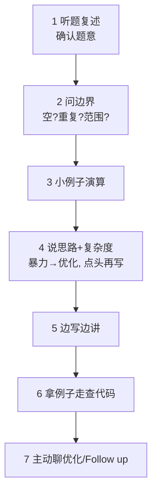
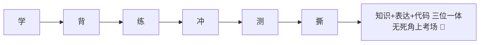

# 💻 2026 Java 后端面试通关手册 · 第六期（手撕算法专项 · 代码不慌版）

> 🎀 八股五册已通关，还差最后一块拼图——**手撕代码**！
> 12 大套路模板 + 30 道高频题全代码 + 并发手撕专场 + 21 天刷题计划
> 口诀记套路，模板背熟练，**现场不慌就是赢**！💪

---

## 📖 六册体系（终极大图）

| 册 | 定位 | 一句话 |
|----|------|--------|
| 一 | 学 | 懂原理 |
| 二 | 背 | 记口诀 |
| 三 | 练 | 会表达 |
| 四 | 冲 | 分得清 |
| 五 | 测 | 考得出 |
| **六 ⭐** | **撕** | **代码写得对** |

---

# 🎬 Part A：手撕现场 SOP（比算法本身更重要！）

## A1 七步标准动作 ⭐⭐⭐



- 🎵 **口诀「复述、问界、举例、说思路、边写边讲、走查、聊优化」**

## A2 致命伤 vs 加分项

| ❌ 致命伤 | ✅ 加分项 |
|---------|---------|
| 一声不吭闷头写 10 分钟 | 全程碎碎念讲解思路 |
| 不问边界直接开写 | 「输入可能为空吗？有重复吗？」 |
| 只想最优解，想不出就卡死 | **先暴力再优化**，展示思考路径 |
| 写完就说「好了」 | 自己拿 2-3 个 case 走查（含边界！） |
| 变量名 a/b/tmp 一把梭 | 命名达意：slow/fast/prev/cur |

## A3 现场救急三板斧
1. **没思路** →「我先说个暴力解法……再看看能不能优化」（暴力分也是分！）
2. **复杂度不达标** →「先保证正确，我再优化到 O(n log n)」
3. **忘 API** →「这个 API 我手写一下/先假设它存在」

---

# 📏 Part B：复杂度速查（30 秒估算该用什么算法）

| 数据规模 n | 可接受复杂度 | 暗示算法 |
|-----------|-------------|---------|
| ≤ 20 | O(2ⁿ) | 回溯 / DFS 全排列 |
| ≤ 500 | O(n³) | 区间 DP |
| ≤ 5000 | O(n²) | 普通 DP / 双重循环 |
| ≤ 10⁵~10⁶ | O(n log n) | 排序 / 二分 / 堆 |
| ≤ 10⁸ | O(n) | 双指针 / 滑窗 / 哈希 |
| 更大 | O(log n) / O(√n) | 二分 / 数学 |

- 🎵 **口诀「看范围猜算法：小了暴力搜，大了哈希二分逃」**

---

# 🧩 Part C：十二大套路（口诀 + 模板 + 高频题）

## C1 双指针
🎵 **口诀「有序想双针：对撞找目标，快慢找中点」**

**三数之和（高频）**
```java
public List<List<Integer>> threeSum(int[] nums) {
    Arrays.sort(nums);                          // 前提：先排序！
    List<List<Integer>> res = new ArrayList<>();
    for (int i = 0; i < nums.length - 2; i++) {
        if (i > 0 && nums[i] == nums[i - 1]) continue;   // i 去重
        int l = i + 1, r = nums.length - 1;
        while (l < r) {
            int sum = nums[i] + nums[l] + nums[r];
            if (sum < 0) l++;
            else if (sum > 0) r--;
            else {
                res.add(Arrays.asList(nums[i], nums[l], nums[r]));
                while (l < r && nums[l] == nums[l + 1]) l++;  // 去重
                while (l < r && nums[r] == nums[r - 1]) r--;  // 去重
                l++; r--;
            }
        }
    }
    return res;
}
```
🔥 追问：为什么排序后能去重？→ 相同元素跳过只算一次；时间 O(n²)。

## C2 滑动窗口
🎵 **口诀「右进左缩：不满足右扩，满足了左收」**

**无重复字符的最长子串（高频）**
```java
public int lengthOfLongestSubstring(String s) {
    Map<Character, Integer> win = new HashMap<>();  // 字符 → 最后出现下标
    int left = 0, max = 0;
    for (int right = 0; right < s.length(); right++) {
        char c = s.charAt(right);
        if (win.containsKey(c)) {
            left = Math.max(left, win.get(c) + 1);  // ★只进不退，防左指针回跳
        }
        win.put(c, right);
        max = Math.max(max, right - left + 1);
    }
    return max;
}
```
🔥 追问：为什么用 max？→ "abba" 场景左指针不能被旧下标拉回去。

## C3 哈希计数
🎵 **口诀「找配对、数次数，先想 HashMap」**

**两数之和**
```java
public int[] twoSum(int[] nums, int target) {
    Map<Integer, Integer> seen = new HashMap<>();   // 值 → 下标
    for (int i = 0; i < nums.length; i++) {
        if (seen.containsKey(target - nums[i])) {
            return new int[]{seen.get(target - nums[i]), i};
        }
        seen.put(nums[i], i);   // 先查后存，防自己配自己
    }
    return new int[0];
}
```

## C4 链表专项（Java 后端最爱考！）
🎵 **口诀「链表三件套：dummy 哨兵、快慢双针、画图再动手」**

**反转链表（迭代版，册二 13.4 的复习）**
```java
public ListNode reverse(ListNode head) {          // 迭代版
    ListNode prev = null, cur = head;
    while (cur != null) {
        ListNode next = cur.next;  // 1 存后继
        cur.next = prev;           // 2 掉头
        prev = cur; cur = next;    // 3 双双前进
    }
    return prev;
}
```

**合并两个有序链表**
```java
public ListNode mergeTwoLists(ListNode a, ListNode b) {
    ListNode dummy = new ListNode(0), cur = dummy;
    while (a != null && b != null) {
        if (a.val <= b.val) { cur.next = a; a = a.next; }
        else                { cur.next = b; b = b.next; }
        cur = cur.next;
    }
    cur.next = (a != null) ? a : b;    // 剩下的直接挂上
    return dummy.next;
}
```

**环形链表 I：判环（快慢指针）**
```java
public boolean hasCycle(ListNode head) {
    ListNode slow = head, fast = head;
    while (fast != null && fast.next != null) {   // ★两个判断防 NPE
        slow = slow.next;
        fast = fast.next.next;
        if (slow == fast) return true;            // 相遇必有环
    }
    return false;
}
```
🔥 追问：找环入口？→ 相遇后一个指针回 head，两指针**同速**前进，再次相遇点即入口。

**删除链表倒数第 N 个节点**
```java
public ListNode removeNthFromEnd(ListNode head, int n) {
    ListNode dummy = new ListNode(0, head);
    ListNode fast = dummy, slow = dummy;
    for (int i = 0; i <= n; i++) fast = fast.next;   // 快针先走 n+1 步
    while (fast != null) { fast = fast.next; slow = slow.next; }
    slow.next = slow.next.next;      // slow 恰好停在被删节点前一个
    return dummy.next;
}
```

**相交链表**
```java
public ListNode getIntersection(ListNode a, ListNode b) {
    ListNode p1 = a, p2 = b;
    while (p1 != p2) {              // 走完自己走对方的路，必在交点(或null)会合
        p1 = (p1 == null) ? b : p1.next;
        p2 = (p2 == null) ? a : p2.next;
    }
    return p1;
}
```
🎵 口诀「**你走我的路，我走你的路，走过一样长，必然同归宿**」

## C5 栈与队列
🎵 **口诀「匹配、撤销、最近关系 → 栈；先进先出排队 → 队列」**

**有效括号**
```java
public boolean isValid(String s) {
    Deque<Character> stack = new ArrayDeque<>();
    for (char c : s.toCharArray()) {
        if (c == '(') stack.push(')');
        else if (c == '[') stack.push(']');
        else if (c == '{') stack.push('}');
        else if (stack.isEmpty() || stack.pop() != c) return false;
    }
    return stack.isEmpty();   // ★别忘空栈判断
}
```

**最小栈（辅助栈同步存最小值）**
```java
class MinStack {
    private Deque<Integer> stack = new ArrayDeque<>();
    private Deque<Integer> minSt = new ArrayDeque<>();
    public void push(int x) {
        stack.push(x);
        minSt.push(minSt.isEmpty() || x <= minSt.peek() ? x : minSt.peek());
    }
    public void pop() { stack.pop(); minSt.pop(); }
    public int top()    { return stack.peek(); }
    public int getMin() { return minSt.peek(); }
}
```

## C6 二叉树（递归三步曲）
🎵 **口诀「树题先问三件事：根干嘛？左子树要啥？右子树要啥？」**

**遍历三件套**
```java
// 递归版（前序，中/后序换位置）
void preOrder(TreeNode root, List<Integer> res) {
    if (root == null) return;
    res.add(root.val);
    preOrder(root.left, res);
    preOrder(root.right, res);
}

// 迭代前序（栈，先右后左）
void preOrderIter(TreeNode root, List<Integer> res) {
    Deque<TreeNode> stack = new ArrayDeque<>();
    if (root != null) stack.push(root);
    while (!stack.isEmpty()) {
        TreeNode node = stack.pop();
        res.add(node.val);
        if (node.right != null) stack.push(node.right);
        if (node.left  != null) stack.push(node.left);
    }
}

// 层序（队列 + size 记录当前层）
List<List<Integer>> levelOrder(TreeNode root) {
    List<List<Integer>> res = new ArrayList<>();
    if (root == null) return res;
    Queue<TreeNode> queue = new LinkedList<>();
    queue.offer(root);
    while (!queue.isEmpty()) {
        int size = queue.size();              // ★先取出本层数量
        List<Integer> level = new ArrayList<>();
        for (int i = 0; i < size; i++) {
            TreeNode node = queue.poll();
            level.add(node.val);
            if (node.left  != null) queue.offer(node.left);
            if (node.right != null) queue.offer(node.right);
        }
        res.add(level);
    }
    return res;
}
```
🔥 追问：Z 字形层序？→ 偶数层 `Collections.reverse(level)` 或双端队列 addFirst。

**最大深度（一句话递归）**
```java
public int maxDepth(TreeNode root) {
    if (root == null) return 0;
    return 1 + Math.max(maxDepth(root.left), maxDepth(root.right));
}
```

**最近公共祖先 LCA**
```java
public TreeNode lowestCommonAncestor(TreeNode root, TreeNode p, TreeNode q) {
    if (root == null || root == p || root == q) return root;  // 碰到 p/q 就上报
    TreeNode left  = lowestCommonAncestor(root.left, p, q);
    TreeNode right = lowestCommonAncestor(root.right, p, q);
    if (left != null && right != null) return root;  // 一边一个 → 根是交点
    return left != null ? left : right;              // 谁非空交谁
}
```

**验证二叉搜索树**
```java
public boolean isValidBST(TreeNode root) {
    return check(root, Long.MIN_VALUE, Long.MAX_VALUE);
}
private boolean check(TreeNode node, long min, long max) {
    if (node == null) return true;
    if (node.val <= min || node.val >= max) return false;   // 严格界内
    return check(node.left, min, node.val) && check(node.right, node.val, max);
}
```
🔥 追问：为什么不能只比较节点和左右孩子？→ 要和**整个祖先链**比，用上下界传递。

## C7 二分查找
🎵 **口诀「mid 防溢出写法 l+(r-l)/2；一半有序判哪边」**

**标准模板 + 旋转数组搜索（高频）**
```java
public int search(int[] nums, int target) {
    int l = 0, r = nums.length - 1;
    while (l <= r) {
        int mid = l + (r - l) / 2;          // ★防 int 溢出
        if (nums[mid] == target) return mid;
        if (nums[l] <= nums[mid]) {         // 左半段有序
            if (nums[l] <= target && target < nums[mid]) r = mid - 1;
            else l = mid + 1;
        } else {                            // 右半段有序
            if (nums[mid] < target && target <= nums[r]) l = mid + 1;
            else r = mid - 1;
        }
    }
    return -1;
}
```
🔥 追问：x 的平方根？→ 二分 0~x，`mid` 用 long 比较，返回 r。

## C8 回溯（万能模板背熟）
🎵 **口诀「做选择 → 递归 → 撤销选择」**

**全排列**
```java
public List<List<Integer>> permute(int[] nums) {
    List<List<Integer>> res = new ArrayList<>();
    backtrack(nums, new ArrayList<>(), new boolean[nums.length], res);
    return res;
}
private void backtrack(int[] nums, List<Integer> path,
                       boolean[] used, List<List<Integer>> res) {
    if (path.size() == nums.length) {       // 终止：凑齐了
        res.add(new ArrayList<>(path));     // ★必须拷贝！
        return;
    }
    for (int i = 0; i < nums.length; i++) {
        if (used[i]) continue;
        used[i] = true; path.add(nums[i]);      // 做选择
        backtrack(nums, path, used, res);       // 递归
        path.remove(path.size() - 1); used[i] = false;  // 撤销选择
    }
}
```
🔥 追问：子集/组合怎么办？→ 用 `start` 索引代替 used 防重复取；含重复元素先排序 + 同层去重。

## C9 动态规划（五步入门法）
🎵 **定义状态 → 转移方程 → 初始化 → 遍历顺序 → 举例子验证**

| 经典题 | 状态定义 | 转移方程 |
|--------|---------|---------|
| 爬楼梯 | dp = 到第 i 阶的方法数 | `dp[i] = dp[i-1] + dp[i-2]` |
| 打家劫舍 | dp = 前 i 家最大金额 | `dp[i] = max(dp[i-1], dp[i-2]+nums[i])` |
| 最长递增子序列 | dp = 以 i 结尾的 LIS 长 | `dp[i] = max(dp[j]+1)`, nums[j]<nums[i] |
| 最长公共子序列 | dp[i][j] = a 前 i 和 b 前 j 的 LCS | 相等取左上+1，否则取上/左最大 |
| 编辑距离 | dp[i][j] = a 前 i 变 b 前 j 的最少操作 | `min(左+1, 上+1, 左上+代价)` |
| 0-1 背包 | dp[j] = 容量 j 的最大价值 | `dp[j] = max(dp[j], dp[j-w]+v)` **倒序！** |

**打家劫舍（滚动变量版）**
```java
public int rob(int[] nums) {
    int prev = 0, cur = 0;
    for (int x : nums) {
        int next = Math.max(cur, prev + x);  // 不偷cur / 偷cur
        prev = cur; cur = next;
    }
    return cur;
}
```

**0-1 背包（一维倒序）**
```java
for (int i = 0; i < n; i++)
    for (int j = cap; j >= weight[i]; j--)     // ★倒序：防止物品重复选
        dp[j] = Math.max(dp[j], dp[j - weight[i]] + value[i]);
```
🔥 追问：为什么倒序？→ 正序会把同一件物品装两次（变成完全背包）。

## C10 堆与 TopK
🎵 **口诀「第 K 大用小顶堆（堆里留 K 个），第 K 小用大顶堆」**

**数组第 K 大元素**
```java
public int findKthLargest(int[] nums, int k) {
    PriorityQueue<Integer> heap = new PriorityQueue<>();   // 默认小顶堆
    for (int num : nums) {
        heap.offer(num);
        if (heap.size() > k) heap.poll();   // 维持堆大小 = k
    }
    return heap.peek();    // 堆顶就是第 K 大
}
```
🔥 追问：更快？→ 快速选择 partition，平均 O(n)；10 亿数据 top100 → 分治小顶堆（册二 11.2）。

**前 K 个高频元素**
```java
public int[] topKFrequent(int[] nums, int k) {
    Map<Integer, Integer> cnt = new HashMap<>();
    for (int x : nums) cnt.merge(x, 1, Integer::sum);
    PriorityQueue<int[]> heap =                        // [元素, 次数] 小顶堆
        new PriorityQueue<>((a, b) -> a[1] - b[1]);
    for (Map.Entry<Integer, Integer> e : cnt.entrySet()) {
        heap.offer(new int[]{e.getKey(), e.getValue()});
        if (heap.size() > k) heap.poll();
    }
    int[] res = new int[k];
    for (int i = k - 1; i >= 0; i--) res[i] = heap.poll()[0];
    return res;
}
```

## C11 图论基础（会两题就够）
🎵 **口诀「依赖关系 → 拓扑排序（入度+队列）；连成片 → DFS 灌水」**

**课程表（拓扑排序判环）**
```java
public boolean canFinish(int numCourses, int[][] prerequisites) {
    List<List<Integer>> graph = new ArrayList<>();
    int[] inDegree = new int[numCourses];
    for (int i = 0; i < numCourses; i++) graph.add(new ArrayList<>());
    for (int[] p : prerequisites) {
        graph.get(p[1]).add(p[0]);      // 先修 → 后修
        inDegree[p[0]]++;               // 后修课入度+1
    }
    Queue<Integer> queue = new LinkedList<>();
    for (int i = 0; i < numCourses; i++)
        if (inDegree[i] == 0) queue.offer(i);   // 入度0的先上
    int taken = 0;
    while (!queue.isEmpty()) {
        int course = queue.poll(); taken++;
        for (int next : graph.get(course))
            if (--inDegree[next] == 0) queue.offer(next);  // 解锁后修课
    }
    return taken == numCourses;   // 全修完 = 无环
}
```

**岛屿数量（DFS 灌水）**
```java
public int numIslands(char[][] grid) {
    int count = 0;
    for (int i = 0; i < grid.length; i++)
        for (int j = 0; j < grid[0].length; j++)
            if (grid[i][j] == '1') { count++; sink(grid, i, j); }
    return count;
}
private void sink(char[][] grid, int i, int j) {   // 走过就灌水
    if (i < 0 || i >= grid.length || j < 0 || j >= grid[0].length
        || grid[i][j] != '1') return;
    grid[i][j] = '0';
    sink(grid, i + 1, j); sink(grid, i - 1, j);
    sink(grid, i, j + 1); sink(grid, i, j - 1);
}
```

## C12 位运算彩蛋
🎵 **口诀「异或三性质：自异或归零、零异或保身、交换律」**

**只出现一次的数字（其余都出现两次）**
```java
public int singleNumber(int[] nums) {
    int x = 0;
    for (int num : nums) x ^= num;   // 成对抵消，剩单只
    return x;
}
```
🔥 追问：判断 2 的幂？→ `n > 0 && (n & (n - 1)) == 0`（只有一个 1）。

---

# ⚙️ Part D：并发手撕专场（Java 后端独有加试题）

## D1 三线程交替打印 ABC（经典中的经典！）
```java
class PrintABC {
    private int state = 0;                        // 0→A 1→B 2→C
    private final Object lock = new Object();

    public void print(String name, int target, int times) {
        for (int i = 0; i < times; i++) {
            synchronized (lock) {
                while (state % 3 != target) {     // ★while 防虚假唤醒
                    try { lock.wait(); } catch (InterruptedException e) { }
                }
                System.out.print(name);
                state++;
                lock.notifyAll();                 // 叫醒所有人重新竞争
            }
        }
    }
}
// main: new Thread(() -> p.print("A", 0, 10)).start(); × 3
```
🎵 口诀「**状态位 + while 等 + notifyAll 全叫醒**」
🔥 追问：为什么 notifyAll 不 notify？→ notify 随机叫一个，可能叫错人导致死等。

## D2 生产者消费者（原生 wait/notify 版，册二 BlockingQueue 版的兄弟）
```java
class Buffer {
    private final Queue<Integer> queue = new LinkedList<>();
    private final int cap = 10;

    public synchronized void put(int v) throws InterruptedException {
        while (queue.size() == cap) wait();      // ★while 而不是 if！
        queue.offer(v);
        notifyAll();                             // 可能唤醒消费者
    }

    public synchronized int take() throws InterruptedException {
        while (queue.isEmpty()) wait();
        int v = queue.poll();
        notifyAll();                             // 可能唤醒生产者
    }
}
```
🔥 追问：为什么 while 不能换 if？→ `wait()` 被唤醒后条件**可能又被别人改掉**（虚假唤醒），必须重查条件。

## D3 手写一个死锁（并说怎么定位）
```java
Object a = new Object(), b = new Object();
new Thread(() -> { synchronized (a) { sleep(100);
    synchronized (b) {} } }).start();            // 线程1: 先a后b
new Thread(() -> { synchronized (b) { sleep(100);
    synchronized (a) {} } }).start();            // 线程2: 先b后a
```
🗣️ 定位：`jstack <pid>` 看 "Found one Java-level deadlock"；预防：**固定加锁顺序** / tryLock 超时。

---

# 📅 Part E：21 天刷题冲刺计划（每日 3 题）

| 周次 | 套路 | 每日 3 题安排 |
|------|------|--------------|
| 第 1 周 | 链表 + 栈队列 + 哈希 + 双指针 | C4 五题 → C5 两题 → C1/C3 各一 |
| 第 2 周 | 二叉树 + 二分 + 滑窗 | C6 六题 → C7 二题 → C2 一题 |
| 第 3 周 | 回溯 + DP + TopK + 图 + 并发 | C8~C12 每类轮换 + D1/D2 必默写 |

**每日流程**：白纸手写 3 题（模拟无 IDE）→ 对答案订正 → 卡壳题标记次日重做。

### 高频 21 题必刷清单（核心中的核心）
- [ ] 1 反转链表（迭代+递归）
- [ ] 2 合并两个有序链表
- [ ] 3 环形链表判环 + 入口
- [ ] 4 删除倒数第 N 个节点
- [ ] 5 相交链表
- [ ] 6 LRU 缓存（册二 13.1）
- [ ] 7 两数之和
- [ ] 8 三数之和
- [ ] 9 无重复最长子串
- [ ] 10 有效括号
- [ ] 11 最小栈
- [ ] 12 层序遍历 + Z 字
- [ ] 13 最大深度 / 翻转二叉树
- [ ] 14 最近公共祖先
- [ ] 15 验证 BST
- [ ] 16 二分：旋转数组
- [ ] 17 全排列
- [ ] 18 爬楼梯 / 打家劫舍
- [ ] 19 LIS / LCS / 编辑距离
- [ ] 20 第 K 大 / 前 K 高频
- [ ] 21 交替打印 ABC + 生产者消费者（并发）

---

# 🆘 Part F：风格速配表（坊间普遍印象，仅供备考参考）

| 面试类型 | 风格侧重 | 备考主力册 |
|---------|---------|-----------|
| 大厂（算法严） | 白板两道算法起步，讲思路+复杂度 | **册六** + 册二13章 |
| 大厂（原理深） | 八股连环追问到源码/设计取舍 | 册一 + 册四 B |
| 中厂/独角兽 | 八股全面 + 项目场景题 | 册二 + 册三 |
| 电商/业务厂 | 场景设计 + MQ/Redis 深挖 | 册二 7-9 章 + 册三 2.1 |
| 外包/传统企业 | 框架 CRUD + SQL 手写 | 项目表达 + 索引题 |

> 💡 通用规律：**越是算法强的厂，册六权重越高；越是业务重的厂，册二册三权重越高。**

---

# 🏁 六册终章



> 🎀 讲师收官寄语：
> 到这里，六册把「**原理、记忆、表达、辨析、自测、手撕**」全部补齐。
> 算法没有捷径，但有套路——**套路熟了，新题也只是旧题换了件衣服**。
> 每天三题，21 天后，白纸上的代码会替你说话。
> **去刷题吧，然后把 offer 拍在讲师面前！** 💪🎊✨
